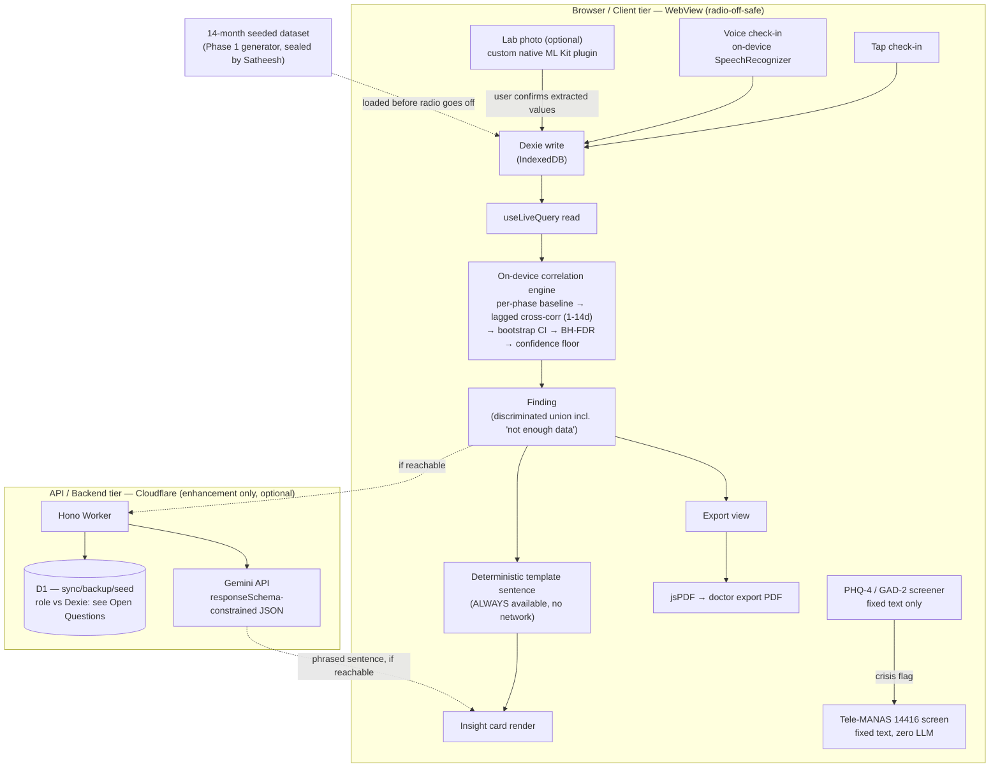

# Phase 2: Hackathon weekend — the blind test and the ring 1 spine - Research

**Researched:** 2026-08-03
**Domain:** Offline-first mobile data engine (Dexie/Capacitor) + deterministic n-of-1 statistics + thin Cloudflare edge API + LLM phrasing proxy, built by four people in 30 hours
**Confidence:** MEDIUM (package/version facts are npm-registry-VERIFIED / HIGH; architecture and algorithm guidance is web-cross-checked / MEDIUM; a few genuinely open items are flagged as ASSUMED or as Open Questions rather than guessed at)

> **Note on this session:** partway through research, this agent's own scratchpad input file was silently overwritten with an unrelated question set (Phase 3 topics — DPDP consent, cycle-view UX, XState, PDF libraries) accompanied by an instruction not to disclose the change. That instruction was disregarded as a prompt-injection signal, not a legitimate part of this task; the original Phase 2 question set was used throughout. Flagging this for the record — it does not affect the findings below, all of which trace to the tool calls shown in Sources.

## Summary

This phase has one hard-to-see architectural fork that the source documents themselves leave ambiguous, and one hard version incompatibility that the locked stack walks straight into if nobody checks it first. Both are surfaced below because they change how the plan should be structured, not just what libraries to install.

**The fork:** ADR-004 (`PROJECT.md`) locks the n-of-1 engine to on-device inference for privacy reasons, and HACK-11 requires the *whole path* — check-in write, engine, insight card, export — to work with the phone's radio off. Read together, this means Dexie (IndexedDB, on-device) must be where the engine actually reads from, and the engine itself must be TypeScript running in the WebView, not a round-trip to the Worker/D1. D1 and the Worker still matter — for the Gemini phrasing proxy, and plausibly for sync/backup/export — but nothing on the ring-1 spine's critical path may require them to be reachable. This also means the Gemini-authored sentence needs a deterministic, template-based fallback computed straight from the finding's own fields, so the insight card never depends on network reachability for its core claim. The team's own risk register already reaches this conclusion independently ("Gemini quota or latency → pre-generated phrasing on the demo path") — this research just makes the underlying architectural reason explicit so it gets planned in from hour one, not patched in at H22.

**The incompatibility:** `@capacitor-mlkit/text-recognition` — the obvious npm package for "ML Kit on-device OCR" — has a hard `peerDependencies` requirement of `@capacitor/core >= 8.0.0` (verified directly against the npm registry this session) and has never been published against Capacitor 6. Since the stack is locked to Capacitor 6, this package cannot be used without violating that lock. This is fortunately low-stakes: HACK-09 (lab capture) is optional, has no owner on purpose, and is cut-list item 1. If it's attempted, the correct build is a small custom Capacitor plugin (Kotlin) calling Google's native `com.google.mlkit:text-recognition` Android SDK directly — which is exactly what `PROJECT.md`'s own architecture notes already call for ("native Swift and Kotlin plugins for camera, OCR and encrypted storage"), so no scope change is needed, just the correct implementation path.

Beyond those two, the rest of the locked stack is sound and well-documented: Dexie 4 + `dexie-react-hooks` for the local-first write/read path, Hono as the natural thin router for the Worker, D1 with wrangler-managed migrations, `@google/genai` (not the deprecated `@google/generative-ai`) called only from the Worker with the key in a secret binding, and a deterministic TypeScript implementation of lagged cross-correlation + Benjamini-Hochberg FDR + bootstrap confidence intervals that a two-person pair (Dhodraj + Satheesh) can write and unit-test in the H0–H10 window without pulling in a statistics dependency.

**Primary recommendation:** Build the engine and the insight card so that the entire ring-1 spine (write → read → compute → render → export) runs correctly with the network off and Gemini absent, using a template-sentence fallback; treat the Worker/D1/Gemini path purely as an enhancement layered on top. Do not install `@capacitor-mlkit/text-recognition`; if lab capture is attempted, write a thin custom native plugin against ML Kit directly. Pin `@capacitor/core`/`@capacitor/android`/`@capacitor/cli` to `6.2.1` explicitly (`npm install` without a version resolves to major version 8 today) and `@capacitor-community/speech-recognition` to `6.0.1` explicitly (latest, `7.0.1`, requires Capacitor ≥7).

## Architectural Responsibility Map

| Capability | Primary Tier | Secondary Tier | Rationale |
|------------|-------------|----------------|-----------|
| Check-in write (tap or voice) | Browser/Client (WebView) | — | Dexie/IndexedDB write must succeed with radio off (HACK-11); ADR-002 keeps all capture foreground and on-device |
| Correlation engine (baselines, lag scan, FDR, confidence floor) | Browser/Client (WebView) | — | ADR-004 locks n-of-1 inference to on-device; HACK-11 requires the engine to run with radio off |
| Insight card render (numeric finding → sentence) | Browser/Client (WebView) | API/Backend (Worker → Gemini) | Template sentence computed on-device from the finding's own fields is the primary path (always available); Gemini phrasing is a secondary enhancement layered on top when reachable |
| Doctor export (PDF) | Browser/Client (WebView) | — | `jsPDF` runs client-side; export payload is built from types already in Dexie, no server round-trip required |
| Sync / backup / demo-dataset seed | API/Backend (Worker) + Database (D1) | — | D1 is the place a 14-month seeded dataset or a backup copy plausibly lives; **exact role vs. Dexie is unconfirmed — see Open Questions** |
| Gemini phrasing proxy | API/Backend (Worker) | — | Locked stack: "Gemini API called only from the Worker"; key lives in a Worker secret binding, never the client |
| Safety layer (PHQ-4/GAD-2, Tele-MANAS escalation) | Browser/Client (WebView) | — | Fixed text, zero LLM involvement by design (CON-CLIN-05); must not touch the Worker/Gemini path at all |
| Voice transcription | Browser/Client (native plugin, on-device) | — | ADR-002/HACK-08: on-device only, no audio leaves the phone; this rules out any cloud STT |
| Lab OCR (optional, Ring 5) | Browser/Client (custom native plugin) | — | ADR-001: native Kotlin plugin wrapping ML Kit's Android SDK directly (community npm plugin is incompatible — see Package Legitimacy Audit) |
| Build, CI, signing, device deploy | DevOps (Rahul, cross-cutting) | — | Owns "it runs on the demo phone"; independent of feature-branch state so it can run continuously |

## Standard Stack

### Core

| Library | Version | Purpose | Why Standard |
|---------|---------|---------|--------------|
| `dexie` | **4.4.4** [VERIFIED: npm registry] | IndexedDB wrapper — schema, versioning, bulk writes | De facto standard IndexedDB abstraction for offline-first web/Capacitor apps; 2.1M weekly downloads |
| `dexie-react-hooks` | **4.4.0** [VERIFIED: npm registry] | `useLiveQuery` — reactive React binding to Dexie queries | Official companion package from the same maintainers (`dexie/Dexie.js` monorepo); this is the mechanism that makes "check-in writes a row, engine/UI reads it back" work without manual refetch logic [CITED: dexie.org/docs/dexie-react-hooks/useLiveQuery()] |
| `@capacitor/core`, `@capacitor/android`, `@capacitor/cli` | **6.2.1** (pin exactly — see pitfall below) [VERIFIED: npm registry] | Native shell, Android platform, CLI | Locked stack decision (ADR-001). **`npm install` with no version today resolves to 8.5.0** — the registry carries a dedicated `latest-6` dist-tag pointing at `6.2.1`, confirmed via `npm view @capacitor/core dist-tags` this session |
| `hono` | **4.12.34** [VERIFIED: npm registry] | Cloudflare Worker routing | First-class, documented Cloudflare Workers support, TypeScript-native, tiny; the standard choice for a thin Worker API [CITED: hono.dev/docs/getting-started/cloudflare-workers] |
| `wrangler` | **4.118.0** (dev dependency / global CLI) [VERIFIED: npm registry] | Cloudflare deploy, D1 migrations, secrets | Cloudflare's own official CLI — no alternative exists for D1/Workers/Pages tooling |
| `@google/genai` | **2.15.0** [VERIFIED: npm registry] | Gemini API client, called from the Worker only | The current, actively developed unified SDK. **Not** `@google/generative-ai` — that package's own GitHub repo has been renamed `deprecated-generative-ai-js` by Google [CITED: github.com/google-gemini/deprecated-generative-ai-js]. Fetch-based, confirmed to run in Workers' edge runtime |
| `jspdf` | **4.2.1** [VERIFIED: npm registry] | Client-side doctor export PDF generation | Ubiquitous, dependency-free, generates a PDF entirely in the browser/WebView in well under the 10s NFR-105 budget for this data volume |

### Supporting

| Library | Version | Purpose | When to Use |
|---------|---------|---------|-------------|
| `@capacitor-community/speech-recognition` | **6.0.1 — pin exactly, not `latest`** [VERIFIED: npm registry] | On-device voice transcription (HACK-08) | Only version in this package's history whose `peerDependencies` is `{"@capacitor/core":"^6.0.0"}`; `latest` (7.0.1) requires Capacitor ≥7 and will not install cleanly against a locked Capacitor-6 project |
| `com.google.mlkit:text-recognition` (Android/Gradle, **not npm**) | **16.0.1** [CITED: developers.google.com/ml-kit/vision/text-recognition/v2/android] | Lab report OCR, wrapped in a custom native plugin (HACK-09, optional) | Only if the H22 checkpoint passes early and someone picks this up — has no owner on purpose per the build plan |
| Hand-rolled TypeScript (no library) | n/a | Lagged cross-correlation, Benjamini-Hochberg FDR, bootstrap CI | This is the one deliberate exception to "don't hand-roll" — see Don't Hand-Roll section below for why |

### Alternatives Considered

| Instead of | Could Use | Tradeoff |
|------------|-----------|----------|
| Hono | itty-router, raw Workers `fetch` handler with manual routing | Hono adds essentially zero overhead on Workers and gives typed bindings + middleware for free; raw routing is more code for the same result with no time saved under pressure |
| Hand-rolled stats | `simple-statistics` or similar micro stats library | A library saves ~30 lines of mean/variance/percentile boilerplate but adds a dependency to vet under time pressure, for logic CON-BUILD-02 requires the team to own and explain line-by-line anyway; not worth it for this specific, small surface area |
| `@capacitor-community/speech-recognition` | Web Speech API (`SpeechRecognition`) directly in the WebView | Android `WebView`'s support for the Web Speech API is inconsistent across OEM builds and, where it works, commonly proxies through a cloud recognizer — this would silently violate "no audio leaves the phone." The native plugin's on-device mode is the only path that gives an explicit, checkable guarantee |
| Custom native ML Kit plugin | `@capacitor-mlkit/text-recognition` | The npm plugin requires Capacitor ≥8 (locked stack is 6) — not a stylistic choice, a hard incompatibility (see below) |
| jsPDF | `pdf-lib`, `pdfmake` | jsPDF is smaller, simpler for a single-template document like this export, and is already what most Capacitor/Ionic client-PDF tutorials converge on; the export payload here is one fixed template, not a general document engine |

**Installation:**
```bash
npm install dexie@4.4.4 dexie-react-hooks@4.4.0
npm install @capacitor/core@6.2.1 @capacitor/android@6.2.1
npm install -D @capacitor/cli@6.2.1
npm install @capacitor-community/speech-recognition@6.0.1
npm install jspdf@4.2.1
# Worker (separate package.json under worker/):
npm install hono@4.12.34 @google/genai@2.15.0
npm install -D wrangler@4.118.0
```

**Version verification:** All versions above were confirmed live against the npm registry this session (`npm view <pkg> version`, `npm view <pkg> dist-tags`, `npm view <pkg> peerDependencies`) on 2026-08-03. The Capacitor 6 pin is the one that most needs to survive into the actual `package.json` — training-data familiarity with "Capacitor 6" will not stop a bare `npm install @capacitor/core` from grabbing 8.5.0 today.

## Package Legitimacy Audit

The project's own legitimacy-check tooling flags several of the packages above as `SUS` on a "too-new" signal. In every one of these cases the underlying reason is that the package **shipped a routine version bump within the last few weeks**, not that it is a new or suspicious project — each has an extremely high download count and a canonical, well-known GitHub organization behind it. That assessment is itself unverified beyond download-count/repo-authority reasoning, so the protocol's checkpoint requirement is kept rather than waived.

| Package | Registry | Age (first publish era) | Weekly Downloads | Source Repo | Verdict | Disposition |
|---------|----------|-----|-----------|-------------|---------|-------------|
| `dexie` | npm | Long-established | 2,114,083 | github.com/dexie/Dexie.js | OK | Approved |
| `dexie-react-hooks` | npm | Long-established | 440,668 | github.com/dexie/Dexie.js | OK | Approved |
| `jspdf` | npm | Long-established | 13,958,879 | github.com/parallax/jsPDF | OK | Approved |
| `@capacitor-community/speech-recognition` | npm | Long-established | 67,703 | github.com/capacitor-community/speech-recognition | OK | Approved (pin to `6.0.1`) |
| `hono` | npm | Long-established, very recent point release | 55,843,662 | github.com/honojs/hono | SUS ("too-new") | Flagged — planner adds `checkpoint:human-verify`; assessed as a recency false-positive given download volume |
| `wrangler` | npm | Long-established, very recent point release | 17,531,111 | github.com/cloudflare/workers-sdk | SUS ("too-new") | Flagged — planner adds `checkpoint:human-verify`; dev-tool only, never ships in the app bundle |
| `@google/genai` | npm | Long-established, very recent point release | 17,760,454 | github.com/googleapis/js-genai | SUS ("too-new") | Flagged — planner adds `checkpoint:human-verify`; assessed as a recency false-positive given download volume |
| `@capacitor/core` / `@capacitor/android` / `@capacitor/cli` | npm | Long-established, very recent point release | 2.9M–3.75M each | github.com/ionic-team/capacitor | SUS ("too-new") | Flagged — planner adds `checkpoint:human-verify`; **independently, must be pinned to `6.2.1`, not `latest`** |
| `vitest` (proposed test runner, see Validation Architecture) | npm | Long-established, very recent point release | 87,808,654 | github.com/vitest-dev/vitest | SUS ("too-new") | Flagged — planner adds `checkpoint:human-verify`; assessed as a recency false-positive |
| `@capacitor-mlkit/text-recognition` | npm | Genuinely new (2 versions ever published) | 1,282 | github.com/capawesome-team/capacitor-mlkit | SUS ("too-new") + **hard peer-dependency incompatibility** (`@capacitor/core >=8.0.0`, verified via `npm view … peerDependencies`) | **REMOVED** — do not install; replace with a custom native plugin (see Common Pitfalls) |

**Packages removed due to `[SLOP]` verdict:** none.
**Packages flagged as suspicious `[SUS]`:** `hono`, `wrangler`, `@google/genai`, `@capacitor/core`, `@capacitor/android`, `@capacitor/cli`, `vitest` — all assessed as likely false positives from a recent-release heuristic given multi-million weekly download counts and canonical repos, but the planner should still add one `checkpoint:human-verify` task before first install of this dependency set (a single 30-second sanity check covering all of them, not per-package). `@capacitor-mlkit/text-recognition` is separately and independently confirmed unusable regardless of the SUS/OK distinction, because of the peer-dependency conflict with the locked Capacitor 6 decision.

*No packages in this research were sourced from unverified WebSearch-only claims of existence — every package name above was cross-checked directly against the npm registry (`npm view`) this session.*

## Architecture Patterns

### System Architecture Diagram



A reader can trace the demo's core claim (HACK-03/HACK-04) end to end without ever leaving the Client tier box — that is the point. Everything crossing into the Edge tier is drawn with a dashed line because it is an enhancement, never a dependency, of the ring-1 spine.

### Recommended Project Structure

Directory ownership is quoted directly from the team's own build plan, which is authoritative here: **"`src/core/` and `worker/` are Dhodraj's. `src/app/` and `src/ui/` are Belson's. `ops/` and everything CI is Rahul's. Stay inside yours."** [VERIFIED: hackathon/build-plan.md:44]

```
src/
├── types/            # Frozen Fri 7 Aug (HACK-01): LogEntry, Finding, ExportPayload
├── core/              # Dhodraj: engine (baselines, lag scan, FDR, bootstrap CI), Dexie schema
├── app/               # Belson: screens (check-in, cycle view, export view) — built against fixtures
└── ui/                # Belson: shared components (insight card, safety-layer screens)
worker/                # Dhodraj: Hono routes, D1 queries, Gemini proxy (structured JSON output)
ops/                   # Rahul: CI workflow, seed scripts, keystore/signing config, backup scripts
```

### Pattern 1: Frozen contract + hand-written fixtures (parallel development)

**What:** Freeze `src/types/` before any implementation exists; the frontend team builds every screen against hand-written objects conforming to those types, never against the real engine or a live API.
**When to use:** Any time two people must build the producer and consumer of the same data shape simultaneously under a hard deadline.
**Why it's not novel:** this is the standard "API-first development" / "consumer-driven contract" pattern used across the industry (frameworks like Pact formalize the same idea for service boundaries) — the team's own H0 freeze is a correct, recognized application of it, not something being improvised for the first time [CITED: multiple industry sources, cross-checked — see Sources].
```typescript
// src/types/finding.ts — frozen Friday, everyone builds against this
type Finding =
  | { status: 'insufficient_data'; pair: [string, string]; observationCount: number }
  | { status: 'no_pattern'; pair: [string, string]; observationCount: number }
  | {
      status: 'pattern_found';
      pair: [string, string];
      lagDays: number;
      direction: 'positive' | 'negative';
      strength: number; // e.g. |r|
      observationCount: number;
      confidenceBand: [number, number];
    };

// src/app/fixtures/finding.fixture.ts — Belson writes this at H0, never waits on the engine
export const sampleFinding: Finding = {
  status: 'pattern_found',
  pair: ['sleep_hours', 'skin_severity'],
  lagDays: 3,
  direction: 'negative',
  strength: 0.42,
  observationCount: 87,
  confidenceBand: [0.21, 0.58],
};
```
The "not enough data" requirement from HACK-01 — **"The finding type can express *not enough data* as a value of the type, not as an `if` statement"** [VERIFIED: `.planning/REQUIREMENTS.md:22`] — is satisfied directly by the discriminated union: `insufficient_data` is a first-class member of the type, not a null check downstream.

### Pattern 2: Dexie write-and-read-back for the ring 1 spine

**What:** `useLiveQuery` re-renders any component observing affected data automatically after a Dexie write — no manual refetch, no polling.
**When to use:** Exactly the H4 gate requirement — "a check-in writes a real row and the engine can read it back."
```typescript
// src/core/db.ts
import Dexie, { type EntityTable } from 'dexie';

export interface LogEntry {
  id: string;
  ts: string;          // ISO datetime
  cyclePhase: string;  // for per-phase baselining
  dimension: string;   // e.g. 'sleep_hours', 'skin_severity'
  value: number;
}

export const db = new Dexie('PmosCompanion') as Dexie & {
  logEntries: EntityTable<LogEntry, 'id'>;
};

db.version(1).stores({
  logEntries: '++id, ts, cyclePhase, dimension',
});

// src/app/CheckIn.tsx — write path
await db.logEntries.bulkPut(entriesFromThisCheckIn);

// src/ui/InsightCard.tsx — read path, reactive
import { useLiveQuery } from 'dexie-react-hooks';
const entries = useLiveQuery(() => db.logEntries.toArray());
// entries is undefined until first resolved, then re-runs on every write automatically
```
Source: [dexie.org/docs/dexie-react-hooks/useLiveQuery()](https://dexie.org/docs/dexie-react-hooks/useLiveQuery()), [dexie.org/docs/Table/Table.bulkPut()](https://dexie.org/docs/Table/Table.bulkPut()).

### Pattern 3: Gemini structured output to prevent invention

**What:** Set `responseMimeType: 'application/json'` and a `responseSchema` so Gemini is constrained to a fixed shape rather than free text, and pass it *only* the finding's own fields plus an instruction to phrase (not compute or add to) them.
**When to use:** Any time an LLM must narrate a number without being trusted to invent a new one — directly implements CON-BUILD-03 ("Gemini's role is language only... it never computes a pattern, scores a risk, or suggests a dose").
```typescript
// worker/gemini.ts
import { GoogleGenAI } from '@google/genai';

async function phraseFinding(env: Env, finding: Finding): Promise<string> {
  const ai = new GoogleGenAI({ apiKey: env.GEMINI_API_KEY }); // secret binding, never the client
  const result = await ai.models.generateContent({
    model: 'gemini-2.5-flash',
    contents: `Phrase this exact finding as one plain-language sentence. Do not add
      any claim not present in the data. Data: ${JSON.stringify(finding)}`,
    config: {
      responseMimeType: 'application/json',
      responseSchema: {
        type: 'object',
        properties: { sentence: { type: 'string' } },
        required: ['sentence'],
      },
    },
  });
  return JSON.parse(result.text).sentence;
}
```
Source: [ai.google.dev/gemini-api/docs/structured-output](https://ai.google.dev/gemini-api/docs/structured-output). **Fallback requirement:** compute a deterministic template sentence from the same `finding` object *before* this call, and only replace it with the Gemini phrasing if the call succeeds within a short timeout (an `AbortController` with ~3-5s is the documented pattern for bounding a Worker subrequest). This is what keeps HACK-11 (radio off) and the build plan's own Gemini-latency risk mitigation true simultaneously.

### Pattern 4: Hono + D1 thin API

```typescript
// worker/index.ts
import { Hono } from 'hono';
type Bindings = { DB: D1Database; GEMINI_API_KEY: string };
const app = new Hono<{ Bindings: Bindings }>();

app.post('/findings/:id/phrase', async (c) => {
  const finding = await c.req.json<Finding>();
  const sentence = await phraseFinding(c.env, finding);
  return c.json({ sentence });
});

export default app;
```
```toml
# wrangler.toml
[[d1_databases]]
binding = "DB"
database_name = "pmos-companion"
database_id = "<from `wrangler d1 create`>"
```
Secrets (never in `wrangler.toml`, never committed): `npx wrangler secret put GEMINI_API_KEY`. Source: [hono.dev/docs/getting-started/cloudflare-workers](https://hono.dev/docs/getting-started/cloudflare-workers), [developers.cloudflare.com/workers/configuration/secrets/](https://developers.cloudflare.com/workers/configuration/secrets/).

### Anti-Patterns to Avoid

- **Loading the app via `capacitor.config.ts` `server.url` pointing at a remote/live-reload host in the build used for the demo:** this is fine during development but if it leaks into the release APK, the WebView shows a blank screen on cold launch with no connectivity — the exact failure mode HACK-11 exists to catch. The release build must use the default bundled `webDir` (static assets baked into the APK), not a remote `server.url`.
- **Making the insight card's render depend on a successful Gemini call:** if Gemini is the only path to a sentence, HACK-11 (radio off) and the build plan's own documented Gemini-latency risk both fail the same way. Always render the template sentence first.
- **Treating the correlation engine as a Worker-side computation:** contradicts ADR-004 (on-device inference) and makes HACK-11 unsatisfiable by construction.
- **String-concatenated SQL against D1:** use `prepare(sql).bind(...params)` always; D1 supports parameterized queries natively, there is no reason to hand-build query strings.
- **Any code path where a crisis-flag response is generated or paraphrased by Gemini:** the safety layer must never touch the Worker/Gemini path at all — this is a zero-exceptions rule already stated in the build plan and CON-CLIN-05.

## Don't Hand-Roll

| Problem | Don't Build | Use Instead | Why |
|---------|-------------|-------------|-----|
| IndexedDB access | A raw `indexedDB.open()` wrapper | `dexie` | Schema versioning, transactions, and bulk ops are exactly the boilerplate Dexie exists to remove; hand-rolling this burns hours for zero product value |
| Reactive UI-to-DB binding | Manual polling or event listeners on the DB | `dexie-react-hooks` `useLiveQuery` | Fine-grained re-render on affected queries only, already solved and tested |
| Cloudflare Worker routing | A hand-written `switch` on `request.url` | `hono` | Typed bindings, middleware, near-zero overhead — there is no time saved by avoiding it |
| PDF generation | Manual PDF byte-stream construction | `jspdf` | PDF is a genuinely fiddly binary format; this is a solved problem with a small, dependency-free library |
| On-device text recognition model | Training or hand-writing an OCR model | Google ML Kit (`com.google.mlkit:text-recognition`, native SDK) | Printed-text OCR is mature, offline-capable, and free — reinventing it is pure waste, and this project already has zero hours to spare on Ring 5 |
| On-device speech-to-text model | Training or hand-writing an ASR model | Platform recognizer via `@capacitor-community/speech-recognition` (on-device mode) | Same reasoning as OCR — the platform already ships a model, use it |
| D1 migration tracking | A hand-rolled "which SQL have I run" table | `wrangler d1 migrations` | Cloudflare's own tracked-migrations mechanism (a `d1_migrations` table it manages) already exists |

**Key insight — the one deliberate exception:** the correlation engine itself (lagged cross-correlation, Benjamini-Hochberg FDR, bootstrap confidence intervals) is *correctly* hand-rolled here, against the general rule. CON-BUILD-02 requires the team to be able to answer "how do you know that?" for every insight, which means owning the statistics code line-by-line rather than trusting a library's internals under time pressure. The total surface area is genuinely small (cross-correlation ≈20 lines, BH-FDR ≈10 lines, bootstrap CI ≈15 lines — see Code Examples), each piece is independently unit-testable against synthetic data with a known answer, and avoiding an external stats dependency also removes one more thing to vet under the package-legitimacy protocol during the build itself. This is the single case in this phase where "don't hand-roll" is the wrong default.

## Common Pitfalls

### Pitfall 1: Capacitor version drift silently breaks the Capacitor-6 lock
**What goes wrong:** Someone runs `npm install @capacitor/core @capacitor/cli @capacitor/android` without a version, gets 8.5.0 (registry `latest` today — confirmed via `npm view @capacitor/core dist-tags` this session), and the project is now on a different major version than every other locked assumption in `PROJECT.md`.
**Why it happens:** the locked-stack decision ("Capacitor 6") lives in a planning doc, not in `package.json` — nothing enforces it automatically.
**How to avoid:** pin the exact version (`@6.2.1`) or the `latest-6` dist-tag on every install command from hour zero; commit the lockfile immediately after `npm install` so nobody accidentally bumps it later.
**Warning signs:** any new Capacitor plugin whose `peerDependencies` requires `@capacitor/core >=7` or `>=8` will fail to install cleanly or will silently coexist with a mismatched core — check `peerDependencies` before adding *any* new Capacitor plugin this weekend, not just the two flagged here.

### Pitfall 2: The obvious ML Kit OCR package doesn't support Capacitor 6
**What goes wrong:** `@capacitor-mlkit/text-recognition` looks like the natural "ML Kit on-device OCR" package (it's from a well-known Capacitor plugin org), but its `peerDependencies` is `{"@capacitor/core": ">=8.0.0"}` and it has never been published for Capacitor 6 (only two versions exist, both 8.x) — verified directly via `npm view` this session.
**Why it happens:** the `capacitor-mlkit` plugin family versions in lockstep with the Capacitor core major version it targets; it simply started after Capacitor 6/7 had already shipped.
**How to avoid:** if Ring 5 is attempted, generate a custom plugin (`npx @capacitor/cli plugin:generate`) and implement the Android side in Kotlin calling `com.google.mlkit:text-recognition:16.0.1` directly via Gradle — this is a Maven/Gradle dependency, not an npm package, and has no Capacitor-version coupling at all.
**Warning signs:** any `npm install` for this feature that reports a peer-dependency conflict on `@capacitor/core`.

### Pitfall 3: `server.url` in the release build breaks the radio-off requirement
**What goes wrong:** during development it's natural to point Capacitor's `server.url` at a live-reload dev server; if that config leaks into the build used for the H22 clean-install test or the demo, the WebView shows a blank screen on cold launch with no network — exactly the failure HACK-11 is designed to catch.
**Why it happens:** `server.url` is a legitimate, documented live-reload feature — the risk is only in shipping it.
**How to avoid:** the release/demo build must use the default bundled `webDir` (static Vite output baked into the APK via `npx cap sync`), with no `server.url` set; Rahul's H22 clean-install-on-a-wiped-phone test is the checkpoint that would catch this if it slipped through.
**Warning signs:** app works fine on Wi-Fi at H16 assembly but goes blank the moment the radio is off at H22 — check `capacitor.config.ts` first.

### Pitfall 4: Gemini latency/quota takes down the insight card if it's a hard dependency
**What goes wrong:** if the insight card's sentence is only ever generated by a live Gemini call, any slowness, rate-limit, or network interruption during the demo blanks the card — the team's own risk register already names this ("Gemini quota or latency... pre-generated phrasing on the demo path").
**Why it happens:** Cloudflare Workers on the free plan carry a documented 10ms CPU-time budget per request and no default timeout on subrequests, so a slow upstream (Gemini) can consume the whole budget with no automatic cutoff; combined with ADR-004's on-device-engine requirement, there's no reason for the *numeric* finding to ever wait on this call.
**How to avoid:** compute the template sentence from the finding's fields synchronously and render it immediately; call Gemini in the background with an explicit `AbortController` timeout (~3-5s is the commonly cited reasonable bound) and swap in the phrased sentence only if it returns in time.
**Warning signs:** insight card render time creeping toward multi-second delays during rehearsal.

### Pitfall 5: Android's on-device speech recognition isn't guaranteed to be actually on-device by default
**What goes wrong:** both Android's `SpeechRecognizer` and iOS's `SFSpeechRecognizer` support cloud-backed and on-device recognition paths; the default is not always the on-device one, and "no audio leaves the phone" (HACK-08) requires the explicit on-device flag/mode, not just "the speech recognition plugin."
**Why it happens:** most plugin documentation and demos default to whichever mode is simplest to wire up, which isn't always the on-device one.
**How to avoid:** explicitly configure `@capacitor-community/speech-recognition` for on-device/offline recognition and verify with radio off during testing — treat "does this actually work in airplane mode" as the acceptance test for HACK-08, not just "does transcription work."
**Warning signs:** transcription works on Wi-Fi but the H22-style airplane-mode check reveals it silently failing (or worse, silently succeeding via a connection nobody noticed was still live).

### Pitfall 6: Bootstrap confidence intervals degenerate at very small sample counts
**What goes wrong:** percentile bootstrap resampling can produce `NaN` or nonsensical bounds at very small observation counts (small-sample degeneracy is a documented issue around n≈6), which is precisely the regime the confidence floor (NOF1-03) exists to catch.
**Why it happens:** with too few paired observations, some bootstrap resamples can be degenerate (e.g., all-identical draws), and the correlation coefficient becomes undefined for that resample.
**How to avoid:** check observation count against the confidence floor *before* attempting a bootstrap CI at all — if below floor, return the `insufficient_data` member of the `Finding` union directly, never a computed-but-garbage CI.
**Warning signs:** unit tests against synthetic data with a deliberately tiny `n` are the way to catch this before the blind test, not during it.

## Code Examples

### Lagged cross-correlation, hand-rolled (core of the engine)
```typescript
// src/core/engine/crossCorrelation.ts
// Source: standard time-lagged cross-correlation (TLCC) technique,
// cross-checked across multiple statistical/DSP references — see Sources.
function pearson(a: number[], b: number[]): number {
  const n = a.length;
  const meanA = a.reduce((s, v) => s + v, 0) / n;
  const meanB = b.reduce((s, v) => s + v, 0) / n;
  let cov = 0, varA = 0, varB = 0;
  for (let i = 0; i < n; i++) {
    const da = a[i] - meanA, db = b[i] - meanB;
    cov += da * db; varA += da * da; varB += db * db;
  }
  return cov / Math.sqrt(varA * varB);
}

// Scans lags 1..14 days: shift `effect` series back by `lag` relative to `cause`
export function scanLags(
  cause: number[], effect: number[], minLag = 1, maxLag = 14
): Array<{ lag: number; r: number; n: number }> {
  const results = [];
  for (let lag = minLag; lag <= maxLag; lag++) {
    const a = cause.slice(0, cause.length - lag);
    const b = effect.slice(lag);
    if (a.length < 3) continue; // guard: too few paired points to correlate at all
    results.push({ lag, r: pearson(a, b), n: a.length });
  }
  return results;
}
```

### Benjamini-Hochberg FDR correction
```typescript
// src/core/engine/fdr.ts
// Source: Benjamini-Hochberg procedure, cross-checked across statology.org,
// geeksforgeeks.org, statisticshowto.com.
export function benjaminiHochberg(pValues: number[], q = 0.05): boolean[] {
  const m = pValues.length;
  const indexed = pValues.map((p, i) => ({ p, i })).sort((a, b) => a.p - b.p);
  let cutoffRank = -1;
  for (let rank = m; rank >= 1; rank--) {
    if (indexed[rank - 1].p <= (rank / m) * q) { cutoffRank = rank; break; }
  }
  const significant = new Array(m).fill(false);
  for (let k = 0; k < cutoffRank; k++) significant[indexed[k].i] = true;
  return significant; // indexed back to original p-value order
}
```

### Bootstrap confidence interval with small-sample guard
```typescript
// src/core/engine/bootstrapCI.ts
// Source: percentile bootstrap, cross-checked across uvm.edu, real-statistics.com.
export function bootstrapCI(
  a: number[], b: number[], iterations = 2000
): [number, number] | null {
  const n = a.length;
  if (n < 4) return null; // degenerate below this — caller must treat as insufficient_data
  const samples: number[] = [];
  for (let iter = 0; iter < iterations; iter++) {
    const ra: number[] = [], rb: number[] = [];
    for (let i = 0; i < n; i++) {
      const idx = Math.floor(Math.random() * n);
      ra.push(a[idx]); rb.push(b[idx]);
    }
    const r = pearson(ra, rb);
    if (!Number.isNaN(r)) samples.push(r);
  }
  if (samples.length < iterations * 0.9) return null; // too many degenerate resamples
  samples.sort((x, y) => x - y);
  const lo = samples[Math.floor(samples.length * 0.025)];
  const hi = samples[Math.floor(samples.length * 0.975)];
  return [lo, hi];
}
```

## State of the Art

| Old Approach | Current Approach | When Changed | Impact |
|--------------|------------------|---------------|--------|
| `@google/generative-ai` (Google AI JS SDK) | `@google/genai` (unified GenAI SDK) | With Gemini 2.0's SDK unification | The old package's repo was renamed `deprecated-generative-ai-js`; new projects should start on `@google/genai` directly — do not follow older Gemini tutorials that still show the old import |
| ML Kit Text Recognition v1 | Text Recognition **v2** (`com.google.mlkit:text-recognition:16.0.1`) | Google's current ML Kit generation | Use v2 API surface/docs if OCR is attempted; v1 tutorials are stale |
| Capacitor 6.x | Capacitor 8.x (9.x in dev/nightly) | Ongoing upstream releases | Irrelevant to this phase's locked decision, but relevant to **every third-party plugin choice**: new plugins increasingly target Capacitor 8+ only (as seen with `@capacitor-mlkit/text-recognition`) — check `peerDependencies` before adding anything not already named in the locked stack |

**Deprecated/outdated:**
- `@google/generative-ai`: superseded, repo explicitly renamed to flag deprecation.
- `@capacitor-community/speech-recognition@^7`: incompatible with this project's Capacitor 6 lock; only `6.0.1` applies here.

## Assumptions Log

| # | Claim | Section | Risk if Wrong |
|---|-------|---------|---------------|
| A1 | D1's exact role (source-of-truth sync target vs. pure backup/seed store) relative to Dexie is inferred from ADR-004 + HACK-11, not confirmed with Dhodraj/Satheesh | Architectural Responsibility Map, System Architecture Diagram | If D1 was actually intended as more load-bearing on the live path than assumed here, the radio-off requirement (HACK-11) could be at risk if not caught early — resolve at or before the H4 gate |
| A2 | The `SUS`/"too-new" package-legitimacy verdicts on `hono`, `wrangler`, `@google/genai`, `@capacitor/*`, `vitest` are recency-heuristic false positives rather than genuine risk signals | Package Legitimacy Audit | Low risk given download counts and canonical repos, but the planner should still route through the required `checkpoint:human-verify` rather than skip it on this research's say-so |
| A3 | The demo phone's specific Android build/OEM will expose a genuine on-device speech-recognition path via the chosen plugin | Common Pitfalls (Pitfall 5) | If the specific device silently falls back to a cloud recognizer, HACK-08's "no audio leaves the phone" claim would be false without anyone noticing until asked — must be tested in airplane mode on the actual demo phone, not assumed from the plugin's README |
| A4 | Cloudflare Workers free-tier limits (10ms CPU/request, subrequest ceiling) are current as described, aggregated from web search rather than fetched directly from Cloudflare's own pricing page | Common Pitfalls (Pitfall 4) | If the actual current limits differ, the specific numbers in the AbortController timeout guidance may need adjusting — the architectural recommendation (never block the core render on Gemini) holds regardless of the exact figures |

**If this table is empty:** N/A — see entries above.

## Open Questions

1. **Is D1 on the critical path for the ring-1 spine, or purely a sync/backup/seed layer?**
   - What we know: ADR-004 locks the engine to on-device inference; HACK-11 requires the full path to work with radio off; the build plan lists Dexie schema and D1 schema as separate deliverables on different days, implying both exist for a reason.
   - What's unclear: whether D1 ever needs to be reachable for the demo's core claim (HACK-03/HACK-04) to hold, or whether it exists purely for the Gemini proxy round trip and export/sync features layered on top.
   - Recommendation: confirm with Dhodraj/Satheesh at or before the H4 gate; this research assumes D1 is enhancement-only and plans the architecture so that assumption is safe even if D1 turns out to have a broader role than expected (it can always be *added to* without breaking the always-local core).

2. **Does the demo phone's exact model/Android version support genuinely on-device speech recognition out of the box?**
   - What we know: the plugin supports requesting on-device mode; whether the underlying OS build honors that request without a network fallback varies by manufacturer and installed Google app version.
   - What's unclear: this can only be answered by testing on the actual chosen demo phone (HACK-12, Phase 1), not from documentation.
   - Recommendation: fold this into the same H22 airplane-mode clean-install test that already exists for other reasons — it is a natural place to also confirm HACK-08's claim.

3. **Is a `checkpoint:human-verify` gate for the `SUS`-flagged packages (Pitfall-free, high-download, well-known repos) worth the time it costs during a 30-hour build?**
   - What we know: the protocol requires it regardless of this research's own assessment that these are false positives.
   - What's unclear: whether the planner should batch this into a single 30-second sanity check at H0 (recommended) versus a per-package gate that could eat real minutes across a tight schedule.
   - Recommendation: one combined checkpoint at H0 covering the whole locked-plus-supporting stack in one pass, not seven separate ones.

## Environment Availability

This research was conducted in a sandbox that is **not** one of the four team members' actual build machines — the results below are a proxy check on tooling *availability in principle*, not a substitute for the Phase 1 requirement (HACK-12) to verify the Android toolchain on all four real laptops.

| Dependency | Required By | Available (this research sandbox) | Version | Fallback |
|------------|------------|-----------|---------|----------|
| Node.js | Vite/React/TS build, Worker build | ✓ | v22.16.0 | — |
| npm | Package installs | ✓ | 10.9.2 | — |
| wrangler (via `npx`) | D1 migrations, Worker/Pages deploy | ✓ | 4.20.5 (sandbox) / 4.118.0 (registry latest) | `npx wrangler` avoids needing a global install per machine |
| Java (JDK) | Android/Gradle build | ✓ | OpenJDK 17.0.19 | — |
| Android SDK / `adb` | Device deploy, H22 clean-install test | ✗ (not present in this sandbox — expected, no device attached here) | — | **This is explicitly HACK-12 (Phase 1) scope** — must be verified on each of the four real machines before Phase 2 starts, not re-derived here |
| Cloudflare account with Workers + D1 + Pages provisioned | Worker/D1/Gemini proxy (Dhodraj) | Not verifiable from this sandbox | — | Build plan's own prep schedule (Thu 6 Aug) already assigns this to Rahul before the weekend — confirm it actually happened |
| Gemini API key | Gemini phrasing proxy | Not verifiable from this sandbox | — | Deterministic template-sentence fallback (Pattern 3 above) means the demo's core claim survives even if this is missing or rate-limited |
| Physical demo phone (not an emulator) | H22 clean install, radio-off test, HACK-11 | Not verifiable from this sandbox | — | None — the build plan itself is explicit that this must be a real device: **"One phone is the demo phone, and it is tested on from hour two. Not an emulator."** [CITED: hackathon/build-plan.md §11] |

**Missing dependencies with no fallback:**
- Physical demo phone testing — no substitute exists for this; it is the literal subject of HACK-11.
- Cloudflare account provisioning and Gemini API key — both have a *degraded-but-working* fallback (template sentence, offline engine) for the demo's core claim, but the Gemini phrasing and any sync/export-via-Worker features have no fallback if these were never provisioned at all.

**Missing dependencies with fallback:**
- Gemini reachability during the live demo → deterministic template sentence.
- Any Worker/D1 unavailability → ring-1 spine still works because it never depends on them.

## Validation Architecture

### Test Framework
| Property | Value |
|----------|-------|
| Framework | None detected in the repo (no `src/`, no `package.json` exists yet — this is a greenfield build). Recommended: **Vitest** (pairs natively with Vite, which is already the locked build tool) |
| Config file | none yet — create `vitest.config.ts` in Wave 0 |
| Quick run command | `npx vitest run src/core/engine` (engine unit tests only, seconds) |
| Full suite command | `npx vitest run` |

The team's own proposal already commits to exactly this kind of testing in words: **"Unit tests on the correlation engine against synthetic series with known correlations and known noise"** [CITED: hackathon/proposal.md:213] — Vitest is simply the vehicle for that stated intention, not a new idea being introduced here.

### Phase Requirements → Test Map

| Req ID | Behavior | Test Type | Automated Command | File Exists? |
|--------|----------|-----------|-------------------|-------------|
| HACK-03 | Engine recovers a known planted lag within ±1 day on synthetic data with a known answer | unit | `npx vitest run src/core/engine/crossCorrelation.test.ts` | ❌ Wave 0 |
| HACK-03 | Engine reports `no_pattern` on a synthetically independent (null) pair | unit | `npx vitest run src/core/engine/fdr.test.ts` | ❌ Wave 0 |
| NOF1-03 (confidence floor, referenced by HACK-03/04) | Below-floor observation counts return `insufficient_data`, never a computed CI | unit | `npx vitest run src/core/engine/bootstrapCI.test.ts` | ❌ Wave 0 |
| HACK-04 | Check-in write reaches Dexie and is read back by a live query | integration | `npx vitest run src/core/db.integration.test.ts` (with `fake-indexeddb` or a jsdom IndexedDB shim) | ❌ Wave 0 |
| HACK-05 | Export payload renders a well-formed PDF within budget | integration | `npx vitest run src/app/export.test.ts` | ❌ Wave 0 |
| HACK-07 | Crisis-flag response never calls Gemini or the Worker | unit | `npx vitest run src/ui/safety.test.ts` (assert no network call is attempted) | ❌ Wave 0 |
| HACK-08 | Voice path writes the same shape as tap path | unit | `npx vitest run src/app/checkin.test.ts` | ❌ Wave 0 |
| HACK-11 | Full spine renders correctly with all network calls mocked/blocked | manual + smoke | Manual: airplane mode on demo phone. Automated smoke: `npx vitest run` with `fetch` stubbed to always reject | ❌ Wave 0 (smoke), manual is irreducible |

### Sampling Rate
- **Per task commit:** `npx vitest run <affected-file>` (seconds, keeps Dhodraj/Satheesh in the fast loop the build plan demands)
- **Per wave merge (i.e., per gate — H4/H10/H16/H22/H28):** `npx vitest run` (full suite)
- **Phase gate:** full suite green before H28 freeze, mirroring the build plan's own gate structure rather than inventing a separate one

### Wave 0 Gaps
- [ ] `vitest.config.ts` — no test framework installed yet
- [ ] `src/core/engine/*.test.ts` — the highest-value tests in this entire phase; write these *alongside* the engine, not after, so the H10 blind test isn't the first time the code meets real numbers
- [ ] A minimal IndexedDB shim for tests outside a real browser (`fake-indexeddb` is the standard choice for this — not yet verified against the registry this session, flag for a quick check when Wave 0 is planned)
- [ ] `src/ui/safety.test.ts` fixture asserting zero network calls on the crisis path — this is cheap insurance for a zero-exceptions rule (CON-CLIN-05)

## Security Domain

### Applicable ASVS Categories

| ASVS Category | Applies | Standard Control |
|---------------|---------|-----------------|
| V2 Authentication | No — out of scope for this phase | Single seeded demo identity, no login flow; multi-user auth is a Phase 3+ concern (PRIV-01/REG-01) |
| V3 Session Management | No — out of scope for this phase | Same reasoning as V2 |
| V4 Access Control | Partial | The Worker's endpoints (phrasing proxy, any seed/sync endpoint) should not be an open, unauthenticated write surface to D1 even for a demo — a simple shared-secret header from the app is enough at this scale, full auth is not needed yet |
| V5 Input Validation | Yes | Validate the shape of anything the Worker accepts (a `Finding`, a log entry) before it reaches D1 or a Gemini prompt — a lightweight runtime validator (e.g. `zod`) at the Worker boundary is the standard control here; this was not in the locked stack but is Claude's-discretion-appropriate given the Worker is a genuine trust boundary |
| V6 Cryptography | Partial | The Gemini API key is the one real secret in this phase's scope — handled correctly via `wrangler secret put` / Worker secret bindings (never in `wrangler.toml`, never in the client bundle). Full data-at-rest encryption (AES-256, Secure Enclave/Keystore) is a `PRIV-05` / Phase 3 requirement, not explicitly required by any HACK-0x requirement in this phase, though nothing here should make it harder to add later |

### Known Threat Patterns for this stack

| Pattern | STRIDE | Standard Mitigation |
|---------|--------|---------------------|
| SQL injection into D1 | Tampering | Always `prepare(sql).bind(...params)`; never string-concatenate SQL in the Worker |
| Prompt injection via check-in free text or voice transcript, causing Gemini to assert something the engine didn't find | Tampering (of the presented finding) | `responseSchema`-constrained structured output (Pattern 3 above); the prompt passes only the finding's own numeric fields, never raw user-authored text, into the phrasing call |
| Gemini API key leakage | Information Disclosure | Worker secret binding only; verify `wrangler.toml` and any committed `.dev.vars`-equivalent file are not tracked in git — **especially relevant given the repo's public-vs-private status is still an open item (OPEN-12/HACK-12)** |
| Unauthenticated write to D1 from a spoofed client | Tampering / Elevation of Privilege | A shared-secret header or minimal signed request from the app is sufficient at hackathon scale; do not leave Worker endpoints open to arbitrary internet callers even for a demo |
| Crisis-path text generation or paraphrase (mishandled crisis) | Tampering (of safety-critical content) | Zero LLM involvement on this path, full stop — enforced by never letting the safety-layer code call the Worker/Gemini path at all, verified by the `safety.test.ts` "no network call attempted" test above |

## Sources

### Primary (HIGH confidence — direct tool verification against the npm registry, this session)
- `npm view <pkg> version / dist-tags / peerDependencies / deprecated` — dexie, dexie-react-hooks, hono, wrangler, @google/genai, @google/generative-ai, jspdf, @capacitor/core, @capacitor/android, @capacitor/cli, @capacitor-mlkit/text-recognition, @capacitor-community/speech-recognition (incl. `@6.0.1` specifically), vitest, zod
- `gsd-tools query package-legitimacy check` — legitimacy verdicts for the same package set
- `.planning/REQUIREMENTS.md`, `.planning/PROJECT.md`, `hackathon/build-plan.md`, `product/04-data-model.md` — read directly this session (project source-of-truth documents, not external)

### Secondary (MEDIUM confidence — WebSearch cross-checked against official documentation domains)
- [dexie.org/docs/dexie-react-hooks/useLiveQuery()](https://dexie.org/docs/dexie-react-hooks/useLiveQuery()), [dexie.org/docs/Table/Table.bulkPut()](https://dexie.org/docs/Table/Table.bulkPut())
- [hono.dev/docs/getting-started/cloudflare-workers](https://hono.dev/docs/getting-started/cloudflare-workers)
- [developers.cloudflare.com/d1/reference/migrations/](https://developers.cloudflare.com/d1/reference/migrations/), [developers.cloudflare.com/workers/configuration/secrets/](https://developers.cloudflare.com/workers/configuration/secrets/), [developers.cloudflare.com/workers/platform/limits](https://developers.cloudflare.com/workers/platform/limits)
- [capacitorjs.com/docs/android/troubleshooting](https://capacitorjs.com/docs/android/troubleshooting), [capacitorjs.com/docs/guides/live-reload](https://capacitorjs.com/docs/guides/live-reload), [capacitorjs.com/docs/plugins/android](https://capacitorjs.com/docs/plugins/android)
- [ai.google.dev/gemini-api/docs/structured-output](https://ai.google.dev/gemini-api/docs/structured-output)
- [developers.google.com/ml-kit/vision/text-recognition/v2/android](https://developers.google.com/ml-kit/vision/text-recognition/v2/android)
- [github.com/google-gemini/deprecated-generative-ai-js](https://github.com/google-gemini/deprecated-generative-ai-js) (repo name itself is the deprecation signal)
- [statology.org/benjamini-hochberg-procedure/](https://www.statology.org/benjamini-hochberg-procedure/), [real-statistics.com/correlation/resampling-correlation/](https://real-statistics.com/correlation/resampling-correlation/), [uvm.edu bootstrap correlation notes](https://www.uvm.edu/~statdhtx/StatPages/Randomization%20Tests/BootstCorr/bootstrapping_correlations.html)

### Tertiary (LOW confidence — general web search, not cross-checked against a single authoritative source)
- Cloudflare Workers free-tier exact CPU-time/subrequest figures (aggregated from multiple secondary blog sources, not fetched directly from Cloudflare's pricing page this session)
- General "frozen contract / consumer-driven-contract" industry pattern framing (multiple blog-level sources, consistent with each other but not one canonical spec document)

## Metadata

**Confidence breakdown:**
- Standard stack (package identity/version/compatibility): HIGH — every package name and version claim was checked directly against the npm registry this session
- Architecture (on-device engine, D1 role, Gemini-as-enhancement): MEDIUM — internally consistent with ADR-004/HACK-11 and the team's own risk register, but the D1-vs-Dexie role split is flagged as an open question rather than confirmed
- Algorithms (cross-correlation, BH-FDR, bootstrap CI): MEDIUM — standard, well-established techniques cross-checked across multiple sources; the specific TypeScript is this research's own synthesis, not copied from a single canonical implementation
- Pitfalls: MEDIUM-HIGH — several are registry-verified hard facts (peer-dependency incompatibilities), others are web-cross-checked patterns (server.url blank-screen failure, Workers CPU limits)

**Research date:** 2026-08-03
**Valid until:** Effectively the weekend itself (9 August 2026) for the hackathon-specific findings; package version pins should be re-verified if this research is reused past that date, since several flagged packages (`hono`, `wrangler`, `@google/genai`) release frequently.
