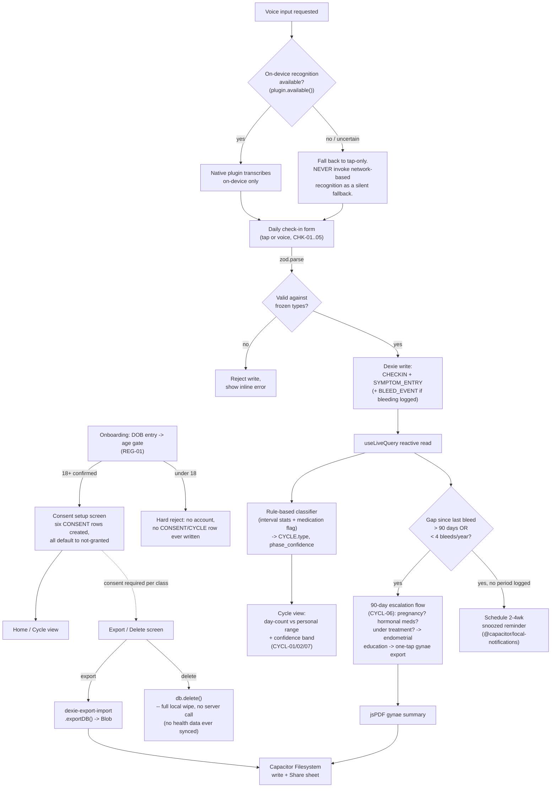

# Phase 3: Irregular-native foundation - Research

**Researched:** 2026-08-03
**Domain:** Local-first health data modeling (Dexie/IndexedDB), on-device voice transcription in a Capacitor shell, DPDP-compliant consent architecture, menstrual-cycle classification logic
**Confidence:** MEDIUM-HIGH (stack/library mechanics are HIGH; the on-device-voice compliance question and the DPDP age-gate question are genuinely unsettled and are flagged LOW/MEDIUM throughout)

No `CONTEXT.md` exists yet for this phase, so there is no `<user_constraints>` section to reproduce — this research is unconstrained by prior `/gsd:discuss-phase` decisions beyond what is already locked in `PROJECT.md` and `REQUIREMENTS.md`.

<phase_requirements>
## Phase Requirements

| ID | Description | Research Support |
|----|-------------|------------------|
| CYCL-01 | Probabilistic cycle windows with confidence bands, never a single due-date | Calendar-based phase-estimation methods; `CYCLE.phase_confidence` field already in data model |
| CYCL-02 | Day-count vs. personal historical range, zero "late/overdue/missed/pregnancy" copy | Cross-referenced against DOCFIX-03 (Phase 1) — the literal "Day 47" pattern is being renamed out of the docs; Phase 3's copy must not reintroduce it |
| CYCL-03 | Six named cycle states, each valid, never an error | Clinical threshold research (oligomenorrhea >35d, amenorrhea >90d/3mo) mapped to `CYCLE.type`; flags a modeling gap (see Common Pitfalls #7) |
| CYCL-04 | Bleed taxonomy: period/spotting/withdrawal/breakthrough, flow, clots, pain | Dexie schema design for `BLEED_EVENT`; zod validation pattern |
| CYCL-05 | Rolling interval distribution + bleeds/year | Pure-function statistics over Dexie-queried `CYCLE` records; `useLiveQuery` aggregation pattern |
| CYCL-06 | 90-day sentinel: pregnancy/medication/treatment questions, endometrial education, one-tap gynae export, 2-4wk snoozed reminder | Local Notifications scheduling API (verified); jsPDF for the export; 90-day threshold clinically cross-checked against the amenorrhea definition |
| CYCL-07 | Probabilistic phase estimation, no hard ovulation prediction | Calendar-based / personal-luteal-length method (PMC-sourced) |
| CHK-01 | 30-second median check-in across 9 dimensions | Dexie write-path performance; "same as yesterday" pre-fill query pattern |
| CHK-02 | ~15 symptom dimensions, hard cap at 20 | Schema-level constant + test pattern |
| CHK-03 | One-tap severity + "same as yesterday" | `useLiveQuery` + prior-record lookup |
| CHK-04 | Pause mode, no guilt copy/streaks/backfill on return | State-modeling research (reducer vs. XState verdict) |
| CHK-05 | Voice-note check-in, on-device transcription, English MVP, audio never leaves phone | **Primary research finding of this phase** — Web Speech API is non-functional inside Capacitor's WebView; Capacitor-6-compatible native plugins do not expose an on-device-forcing flag either. See Common Pitfalls #1-#2. |
| PRIV-01 | Purpose-bound consent per data class (6 classes), never inherited from mycyclesafe | `CONSENT` entity design; DPDP Rules 2025 purpose-limitation requirements; forward-compatible 6-class modeling (2 classes unused until later phases) |
| PRIV-02 | One-tap full export + full deletion, 72hr | `dexie-export-import` (schema-introspecting, avoids hand-maintained table lists) + Capacitor Filesystem/Share |
| PRIV-03 | No ad-tech SDK/analytics on health events, no data sale | Architectural note — no third-party SDK integration this phase |
| PRIV-04 | Consented mycyclesafe import, re-collects consent | `CONSENT` class #5 modeling; cold-start-removal outcome explicitly unverified per `INFO-01` |
| PRIV-05 | Raw media never uploaded; on-device processing; AES-256 at rest, keys in Secure Enclave/Keystore | Encryption-at-rest research — `dexie-encrypted` has **no** hardware-keystore integration; needs pairing with a native secure-storage plugin. Raw-media clause is largely N/A this phase (no camera/mic capture of raw media until Phase 6; voice is transcribed, not stored as audio) |
| REG-01 | 18+ age gate, no under-18 data processed | DPDP age-gate legal-sufficiency research — self-declaration is contested; recommend hard-block + zero retention |
| REG-02 | "Not a medical device" disclaimer + clinician-consult reminder, no BP/SpO2/glucose/temp | Low technical research need — a copy/UI requirement; confirmed no device-sensor APIs are touched this phase |
| NOTF-01 | Every notification carries insight or due action | Notification-content-gating design tied to the escalation/reminder flows |
| NOTF-02 | Max 1-2/day, user-controlled quiet hours | `@capacitor/local-notifications` scheduling API (verified via official docs) |
| NOTF-03 | No guilt streaks/punitive gamification | Schema-level design note — no streak-counter field |
</phase_requirements>

## Summary

This phase has one finding that should reorder how the team plans it: **the Web Speech API does not function inside a Capacitor app's embedded WebView on either platform**, and of the Capacitor-native speech-recognition plugins that exist on the public npm registry, only one supports the team's locked Capacitor 6 core — and that one exposes no way to force on-device-only recognition. This is not a theoretical risk; it directly threatens a requirement stated as non-negotiable in three places (`CHK-05`, `HACK-08`, `PRIV-05`: "audio never leaves the phone... under any configuration"). The rest of this document is organized so that finding gets the attention it needs, but the phase has real, if lower-stakes, research depth elsewhere too: a genuine tension between the locked "IndexedDB via Dexie" data plane and the locked "AES-256, keys in Secure Enclave or Android Keystore" encryption requirement (Dexie/IndexedDB has no such thing built in); a DPDP consent model that has to be six classes wide from day one even though only two of those classes are used before Phase 6; and clinically-grounded numeric thresholds (35 days, 90 days) that turn "named cycle states" from a vague UX idea into a testable classifier.

**Primary recommendation:** Build the six-class `CONSENT` ledger and the typed Dexie schema first — every other Phase 3 feature (check-in, cycle view, export, escalation) reads or writes through it. Treat on-device voice as a native-plugin engineering problem, not a library-install problem: gate the feature behind an explicit on-device-availability check that fails closed to tap-only (never falls back to network recognition), and verify compliance empirically with the device radio off, reusing the same protocol the team already committed to for the Phase 2 demo (`HACK-11`). Keep Phase 3's cycle-state and phase-estimation logic to simple, clinically-thresholded rules — the statistical n-of-1 engine (lagged correlation, bootstrap CI, FDR correction) is explicitly Phase 4 scope (`NOF1-*`) and must not be pulled forward.

## Architectural Responsibility Map

Phase 3 is, by design, a fully local-first phase — `PROJECT.md`'s privacy constraint states plainly: "Health records never leave the device. Only accounts and anonymised metrics cross the network" — so there is no API/Backend tier and no CDN/Static tier doing meaningful work here. Everything lives in the Browser/Client tier (the React UI and native-plugin bridges) and the Database/Storage tier (Dexie/IndexedDB).

| Capability | Primary Tier | Secondary Tier | Rationale |
|------------|-------------|----------------|-----------|
| Cycle day-count + confidence-band display | Browser/Client | Database/Storage | Rendered in React, reactive read from Dexie via `useLiveQuery` |
| Check-in form (30s, 9 dimensions) | Browser/Client | Database/Storage | Pure client UI; validated write to Dexie |
| Cycle-state / phase classification | Browser/Client | Database/Storage | Rule-based calculation over Dexie query results, in-memory, no round-trip |
| Consent per data class | Database/Storage | Browser/Client | `CONSENT` table is the source of truth; UI is a thin toggle layer over it |
| Voice check-in transcription | Browser/Client (native bridge) | — | A native Capacitor plugin (Kotlin/Swift) — a sensing capability under ADR-001, never server-side |
| 90-day-gap escalation | Browser/Client | Database/Storage | Local gap computation + local notification trigger; no backend |
| One-tap export | Browser/Client | Database/Storage | `dexie-export-import` serializes IndexedDB to a Blob; Capacitor Filesystem/Share persists or shares it |
| One-tap delete | Database/Storage | Browser/Client | Direct `db.delete()`; UI is a confirmation dialog |
| 18+ age gate | Browser/Client | Database/Storage | Onboarding-time gate; `USER.age_verified` persisted locally, never synced |
| Notifications (cadence, quiet hours) | Browser/Client (native bridge) | — | `@capacitor/local-notifications`; purely on-device scheduling |
| API/Backend | — (not applicable) | — | Out of scope this phase — Worker/D1 sync never touches health records per the locked privacy constraint |
| CDN/Static | — (not applicable) | — | Capacitor bundles assets into the app package; no web deployment target for this phase's content |

## Standard Stack

### Core

| Library | Version | Purpose | Why Standard |
|---------|---------|---------|--------------|
| react / react-dom | 18.3.1 `[VERIFIED: npm registry — npm view, this session]` | UI layer | Locked by `PROJECT.md` constraints ("React 18 + TypeScript + Vite + Tailwind"); 18.3.1 is the latest 18.x patch — do **not** jump to the 19.x line the registry now shows as absolute-latest, that would break the locked decision |
| typescript | 5.9.3, **not 7.x** `[VERIFIED: npm registry version; CITED: visualstudiomagazine.com / typescriptpro.com for the 7.0 API gap]` | Types | See Common Pitfall #5 — TypeScript 7.0 (native Go compiler, GA 2026-07-08) ships **without a public compiler API** until 7.1, which risks breaking `typescript-eslint` and similar tooling. Stay on the 5.x line for this phase. |
| vite | Inherit whatever Phase 1/2 already scaffolded `[ASSUMED — no code exists in the repo yet as of this research]` | Build tool | Phase 3 depends on Phase 2's output; this research cannot see an actual `package.json` yet. If genuinely unpinned when Phase 3 starts, 5.x is the safer choice for Capacitor-ecosystem plugin maturity as of this research date |
| @capacitor/core, @capacitor/cli, @capacitor/android | 6.2.1 `[VERIFIED: npm registry, this session]` | Native shell | Locked stack ("Capacitor 6"); this is the latest 6.x line — do not float to 7/8, every native plugin choice below is pinned to major-version-6 compatibility for exactly this reason |
| dexie | 4.4.4 `[VERIFIED: dexie.org — WebFetched this session — + package-legitimacy OK]` | IndexedDB wrapper | Locked stack ("IndexedDB via Dexie"); 2.1M weekly downloads, actively maintained by its original author |
| dexie-react-hooks | 4.4.0 `[CITED: dexie.org/docs/dexie-react-hooks — WebSearch-indexed official page; VERIFIED via legitimacy check]` | Reactive React↔Dexie binding | `useLiveQuery` — see Don't Hand-Roll |
| tailwindcss | 4.3.3 on registry `[ASSUMED — not independently WebFetched]` | Styling | Locked stack. **Flag:** Tailwind v4 changed its configuration paradigm (CSS-first `@theme`, no default `tailwind.config.js`) — if Phase 1/2 scaffolded on v3, do not blind-upgrade mid-project; confirm which major Phase 1/2 actually used before adding Tailwind-dependent UI in Phase 3 |

### Supporting

| Library | Version | Purpose | When to Use |
|---------|---------|---------|-------------|
| dexie-export-import | 4.4.0 `[CITED: dexie.org/docs/ExportImport/dexie-export-import + github.com/dexie/Dexie.js; VERIFIED legitimacy OK]` | Full-database export/import | `PRIV-02` one-tap export. Introspects the **entire** schema automatically — see Don't Hand-Roll |
| zod | 4.4.3 `[ASSUMED — package identity from training/registry, not independently doc-fetched this session; legitimacy OK]` | Runtime schema validation | Validate every check-in/consent record against the frozen `src/types/` shapes before a Dexie write |
| jspdf | 4.2.1 `[ASSUMED — identity from training/WebSearch, not doc-fetched; legitimacy OK, 14M weekly downloads]` | Client-side PDF generation | The 90-day-gap flow's one-tap gynaecology export (`CYCL-06`) — generates a document from scratch, which is jsPDF's strength (see Alternatives table re: pdf-lib) |
| @capacitor/local-notifications | 6.1.3 `[VERIFIED: capacitorjs.com/docs/apis/local-notifications — WebFetched this session]` | Local notification scheduling | `NOTF-01/02` cadence + quiet hours; `CYCL-06`'s 2-4 week snoozed reminder |
| @capacitor/preferences | 6.0.4 `[ASSUMED — not independently doc-fetched, same first-party org as verified sibling packages]` | Small key-value settings (quiet-hours window, snooze state) | Lightweight settings that don't belong in the relational Dexie schema |
| @capacitor/filesystem | 6.0.4 `[ASSUMED — not independently doc-fetched]` | Writing the exported Blob/PDF to device storage | `PRIV-02` export, `CYCL-06` gynae export |
| @capacitor/share | 6.0.4 `[ASSUMED — not independently doc-fetched]` | Native share sheet for the exported file | Same as above — one-tap export needs a destination, not just a Blob in memory |
| @capacitor-community/speech-recognition | **6.0.1**, not the registry's latest 7.0.1 `[VERIFIED: github.com/capacitor-community/speech-recognition README at the v6.0.1 tag, fetched via \`gh api\` this session]` | Voice check-in bridge | See Common Pitfalls #1-#2 — this is the *only* speech-recognition plugin found that is peer-compatible with Capacitor core 6, and its v6.0.1 API has **no** on-device-forcing option. Read the pitfall before treating this as a drop-in solution |
| fake-indexeddb (dev) | 6.2.5 `[ASSUMED, legitimacy OK]` | Test Dexie code without a real browser | Vitest unit/integration tests over Dexie schema and query logic |
| vitest (dev) | 4.x `[ASSUMED, legitimacy "SUS: too-new" — see audit note]` | Test runner | Vite-native, zero extra config; see Validation Architecture |

### Alternatives Considered

| Instead of | Could Use | Tradeoff |
|------------|-----------|----------|
| Dexie's built-in `useLiveQuery` reactivity | Redux/Zustand + manual subscriptions | Adds a state-management dependency and boilerplate for something Dexie already does; not worth it at this data scale |
| jsPDF for the gynae export | pdf-lib | pdf-lib is stronger for **editing/filling an existing PDF template**; the export is generated from scratch each time, which is jsPDF's actual strength. Revisit if the team later wants a fixed hospital-referral template to fill rather than a generated document |
| A native speech-recognition plugin | The Web Speech API directly (`window.SpeechRecognition`) | Confirmed non-functional inside Capacitor's embedded WebView on both platforms (see Pitfall #1) — do not use, regardless of how convenient the JS-only API looks |
| A rule-based cycle-state classifier this phase | A statistical/ML classifier | That is Phase 4's `NOF1-*` engine scope (lagged cross-correlation, bootstrap CI, FDR correction). Building it early is scope creep this phase should resist |
| A plain `useReducer`/discriminated-union state model | XState | XState is ~16.7kB min+gzip and, per current guidance, "overkill for simple UI state" — the state counts involved here (pause/active/escalation-pending, a handful of check-in steps) don't justify it. Revisit only if a future phase (e.g., Experiment Mode in v1) introduces a genuinely complex multi-step wizard |
| `dexie-encrypted` alone for at-rest encryption | Pairing `dexie-encrypted` with a native Keystore/Keychain-backed key (e.g., `@aparajita/capacitor-secure-storage`) | `dexie-encrypted` alone manages keys in JS-reachable memory/config — it has **no** documented hardware-keystore integration (verified via its own official docs page). See Pitfall #4 |

**Installation (illustrative — verify against whatever Phase 1/2 already committed to `package.json` before running):**
```bash
npm install dexie dexie-react-hooks dexie-export-import zod jspdf
npm install @capacitor/local-notifications@6 @capacitor/preferences@6 @capacitor/filesystem@6 @capacitor/share@6
npm install @capacitor-community/speech-recognition@6.0.1
npm install -D vitest fake-indexeddb @testing-library/react @testing-library/jest-dom jsdom
npx cap sync
```

**Version verification performed this session:** every version above was checked with `npm view <pkg> version` against the live npm registry (2026-08-03). Package **identity** (is this the right library, not a slopsquat) was independently confirmed via official documentation for `dexie`, `dexie-encrypted`, `@capacitor/local-notifications`, and `@capacitor-community/speech-recognition` (fetched directly this session); the remaining packages are ecosystem-standard, registry-existence-confirmed, but tagged `[ASSUMED]` per the strict package-provenance rule since their official docs were not independently fetched this session.

## Package Legitimacy Audit

| Package | Registry | Latest version published | Weekly downloads | Source Repo | Verdict | Disposition |
|---------|----------|---------------------------|-------------------|--------------|---------|-------------|
| dexie | npm | 2026-06-16 | 2,114,083 | github.com/dexie/Dexie.js | OK | Approved |
| dexie-react-hooks | npm | 2026-03-18 | 440,668 | github.com/dexie/Dexie.js | OK | Approved |
| dexie-export-import | npm | 2026-03-18 | 41,392 | github.com/dexie/Dexie.js | OK | Approved |
| dexie-encrypted | npm | 2020-11-16 (legacy 2.0.0 line; a 4.2.0-beta line also exists per dexie.org) | 10,495 | github.com/mark43/dexie-encrypted | OK | Approved, conditionally — see Pitfall #4 before using |
| zod | npm | 2026-05-04 | 251,112,541 | github.com/colinhacks/zod | OK | Approved |
| jspdf | npm | 2026-03-17 | 13,958,879 | github.com/parallax/jsPDF | OK | Approved |
| @capacitor/core | npm | 2026-07-31 | 3,725,023 | github.com/ionic-team/capacitor | SUS ("too-new") | Approved — see note below |
| @capacitor/local-notifications | npm | 2026-07-15 | 446,433 | github.com/ionic-team/capacitor-plugins | SUS ("too-new") | Approved — see note below |
| @capacitor/preferences | npm | 2026-02-12 | 954,351 | github.com/ionic-team/capacitor-plugins | OK | Approved |
| @capacitor/filesystem | npm | 2026-02-13 | 935,418 | github.com/ionic-team/capacitor-filesystem | OK | Approved |
| @capacitor/share | npm | 2026-02-12 | 829,477 | github.com/ionic-team/capacitor-plugins | OK | Approved |
| @capacitor-community/speech-recognition | npm | 2025-06-09 (v7.0.1; the recommended v6.0.1 is older) | 67,703 | github.com/capacitor-community/speech-recognition | OK | Approved — install pinned to `6.0.1`, not latest |
| vitest (dev) | npm | 2026-07-06 | 87,808,654 | github.com/vitest-dev/vitest | SUS ("too-new") | Approved — see note below |
| jsdom (dev) | npm | 2026-07-29 | 90,611,622 | github.com/jsdom/jsdom | SUS ("too-new") | Approved — see note below |
| @testing-library/jest-dom (dev) | npm | 2026-07-20 | 58,288,867 | github.com/testing-library/jest-dom | SUS ("too-new") | Approved — see note below |
| @testing-library/react (dev) | npm | 2026-01-19 | 51,586,049 | github.com/testing-library/react-testing-library | OK | Approved |
| fake-indexeddb (dev) | npm | 2025-11-07 | 5,154,993 | github.com/dumbmatter/fakeIndexedDB | OK | Approved |

**Packages removed due to `[SLOP]` verdict:** none.

**Packages flagged as suspicious `[SUS]`:** `@capacitor/core`, `@capacitor/local-notifications`, `vitest`, `jsdom`, `@testing-library/jest-dom`. **Important note on these five:** the legitimacy checker's "too-new" signal is measuring the publish date of the **latest version**, not the package's overall age or trustworthiness — every one of these five has multi-million-weekly-download counts and an official, well-known source repo (`ionic-team`, `vitest-dev`, `jsdom`, `testing-library`), i.e. they are actively-maintained, ecosystem-standard packages that happen to have shipped a routine version bump recently. This is very likely a heuristic false positive, not a real slopsquatting risk. Per protocol these are kept and the planner should still add a lightweight `checkpoint:human-verify` before install, but the verification should take seconds (confirm the org name matches), not a deep audit.

*One package discovered via WebSearch/training data and not independently doc-verified against an authoritative source this session — everything in the "ASSUMED" tier above (`zod`, `jspdf`, `@capacitor/preferences`, `@capacitor/filesystem`, `@capacitor/share`) — should still get a `checkpoint:human-verify` before install per the package-name-provenance rule, even though their legitimacy verdicts are clean `OK`.*

## Architecture Patterns

### System Architecture Diagram



The diagram deliberately shows **no server/API box** — Phase 3 has none. Every arrow terminates either in the Dexie store or a native Capacitor plugin bridge.

### Recommended Project Structure
```
src/
├── types/                # HACK-01 frozen types (LogEntry, Finding, ExportPayload) — inherited from Phase 1/2, do not redefine
├── db/
│   ├── schema.ts          # Dexie class, db.version().stores() with typed EntityTable fields
│   ├── consent.ts         # CONSENT table helpers — one row per class, never a global flag
│   └── export.ts          # dexie-export-import wrapper + Capacitor Filesystem/Share glue
├── features/
│   ├── checkin/            # 30s check-in form, "same as yesterday" pre-fill
│   ├── cycle/               # cycle view, day-count+range+confidence display, rule-based classifier
│   ├── consent/             # per-class consent toggles, export/delete UI
│   ├── escalation/          # 90-day-gap flow screens + copy
│   └── voice/                # native speech-recognition wrapper + availability-gated fallback
├── native/                    # thin typed wrappers around each Capacitor plugin used
├── state/                     # small reducers/discriminated unions for pause mode, escalation, check-in steps
└── components/                 # shared UI
```

### Pattern 1: Typed Dexie schema with versioned migrations
**What:** Declare the database as a class extending `Dexie`, with typed `EntityTable` fields and an explicit `version(N).stores()` chain; every schema change is a new version, with an `.upgrade()` transform when data needs reshaping.
**When to use:** From the first commit — retrofitting this pattern after ad-hoc Dexie calls exist is far more painful than starting with it.
**Example:**
```typescript
// Source: dexie.org/docs/Typescript (fetched this session) + dexie.org/docs/Tutorial/Understanding-the-basics
import { Dexie, type EntityTable } from "dexie";

interface ConsentRow {
  id: string;
  dataClass:
    | "cycle_symptom"
    | "camera_sensing"
    | "skin_images"
    | "mental_health"
    | "mycyclesafe_import"
    | "microphone";
  granted: boolean;
  ts: string;
  purpose: string;
}

class AppDB extends Dexie {
  consent!: EntityTable<ConsentRow, "id">;
  // cycle!: EntityTable<CycleRow, "id">; checkin!: EntityTable<CheckinRow, "id">; ...

  constructor() {
    super("PMOSCompanionDB");
    this.version(1).stores({
      consent: "id, dataClass, granted",
      // additional tables declared alongside, each with its indexed fields
    });
    // .version(2).stores({...}).upgrade(tx => ...) for any future schema change
  }
}

export const db = new AppDB();
```
**Why this matters for Phase 3 specifically:** `PRIV-01` requires all **six** consent classes to exist as distinct rows even though only `cycle_symptom` is actively used this phase (camera/skin/mycyclesafe-import/microphone-for-sleep-audio are Phase 4-6 features). Model the `dataClass` union as all six values now — see Common Pitfall #7.

### Pattern 2: Reactive UI via `useLiveQuery`, not manual subscriptions
**What:** Bind React components directly to Dexie queries; the hook re-renders automatically when the underlying data changes.
**Example:**
```typescript
// Source: dexie.org/docs/dexie-react-hooks/useLiveQuery() (WebSearch-indexed official page)
import { useLiveQuery } from "dexie-react-hooks";
import { db } from "../db/schema";

function CycleView() {
  const recentCycles = useLiveQuery(() => db.cycle.orderBy("start").reverse().limit(24).toArray());
  // recentCycles is undefined until the query resolves, then reactive thereafter
}
```

### Pattern 3: Availability-gated native voice input (fail closed, never fall back to network)
**What:** Voice input is offered only after an explicit on-device-capability check; if that check is unavailable or ambiguous, the UI degrades to tap-only rather than silently invoking any code path that could reach a network-based recognizer.
**When to use:** `CHK-05` / `HACK-08` — this is the only pattern that can make "audio never leaves the phone" a testable claim rather than an assumption.
**Example:**
```typescript
// Source: github.com/capacitor-community/speech-recognition README at the v6.0.1 tag (fetched via gh api this session)
import { SpeechRecognition } from "@capacitor-community/speech-recognition";

async function tryEnableVoiceCheckin(): Promise<"native" | "tap-only"> {
  const { available } = await SpeechRecognition.available();
  if (!available) return "tap-only";
  // No on-device-forcing flag exists in this plugin version (v6.0.1) — see Pitfall #2.
  // Until a native-side patch adds EXTRA_PREFER_OFFLINE / requiresOnDeviceRecognition,
  // treat "available" as "available for the tap-only-equivalent risk profile only"
  // and require the radio-off manual verification (Pitfall #2) before shipping this path.
  return "native";
}
```

### Anti-Patterns to Avoid
- **Calling `window.SpeechRecognition` / `webkitSpeechRecognition` from React code running inside the Capacitor WebView:** it is either entirely unimplemented (Android System WebView) or exposed-but-non-functional (iOS WKWebView, per WebKit bug 239816). Confirming `'webkitSpeechRecognition' in window` returns `true` on iOS is **not** evidence it works.
- **Hand-writing the export function table-by-table:** a hand-maintained list of "tables to export" silently misses any table added after the function was written, which is exactly the kind of gap that turns "one-tap full export" into a compliance gap nobody notices until an audit. Use `dexie-export-import`, which introspects the whole schema.
- **Treating the six consent classes as five-plus-a-placeholder:** every class must be a real, independently toggleable row from the first migration, not added incrementally as each feature ships — retrofitting consent semantics onto existing rows is the kind of change that is easy to get subtly wrong (e.g., defaulting a newly-added class to `granted: true` for existing users, which is a DPDP violation).
- **Building any part of the n-of-1 statistical engine (lagged correlation, bootstrap CI, FDR correction) inside Phase 3's cycle classifier.** That is Phase 4 scope (`NOF1-02`); Phase 3's classifier should be simple threshold rules only.

## Don't Hand-Roll

| Problem | Don't Build | Use Instead | Why |
|---------|-------------|-------------|-----|
| Full-database export to a portable format | A hand-written function that iterates known tables | `dexie-export-import`'s `exportDB()` | Introspects the whole schema automatically; a hand-rolled version silently misses any table added later — precisely the kind of bug that breaks `PRIV-02`'s "one-tap **full** export" promise |
| Reactive UI bound to IndexedDB state | Manual `onchange`/polling or a second state-management layer (Redux/Zustand) mirroring Dexie | `dexie-react-hooks`' `useLiveQuery` | Solves cache invalidation and re-render correctly; adding Redux on top duplicates Dexie's own reactivity for no benefit at this data scale |
| Record-shape validation before a Dexie write | Ad-hoc `if` checks scattered across form-submit handlers | `zod` schemas mirroring the frozen `src/types/` shapes, parsed once at the write boundary | Centralizes validation, gives typed errors, and is exactly the kind of guard that keeps a corrupted record from ever reaching the confidence-floor logic downstream in Phase 4 |
| PDF generation for the gynae export | Manually laying out text/positions with a canvas API | `jsPDF` | Handles fonts, pagination, and text wrapping; hand-rolling this for a clinician-facing document is wasted effort with a real risk of a broken layout in the one artifact a doctor actually reads |
| Local notification scheduling with quiet hours | A custom setTimeout-based scheduler that assumes the app stays running | `@capacitor/local-notifications`'s native `schedule()`/`cancel()` | The OS, not the JS runtime, needs to own notification delivery — a JS-timer-based scheduler dies the moment the app is backgrounded or killed by an OEM battery-killer (a documented risk this project already flags under `NFR-206`) |
| At-rest encryption keys | Storing a symmetric key in `localStorage`, a JS constant, or IndexedDB itself | A native secure-storage plugin (Android Keystore / iOS Keychain-backed) holding the master key, feeding it into `dexie-encrypted`'s configurable encryption function | `PRIV-05`/`NFR-301` specifically require keys in Secure Enclave/Android Keystore — a key sitting in JS-reachable storage does not satisfy that language no matter how the data itself is encrypted |

**Key insight:** almost every "don't hand-roll" item above exists because the phase's own non-negotiable requirements (full export, full delete, on-device-only voice, hardware-backed encryption) are exactly the kind of requirement where a hand-rolled shortcut looks fine in a demo and then fails quietly in exactly the audit or edge case the requirement was written to prevent.

## Common Pitfalls

### Pitfall 1: The Web Speech API does not work inside a Capacitor WebView — on either platform
**What goes wrong:** A developer sees `window.SpeechRecognition` (or `webkitSpeechRecognition`) exists in the WebView's `window` object, wires up voice check-in against it, and it either does nothing or silently sends audio to a cloud service.
**Why it happens:** Two independent, confirmed platform facts:
- **Android:** "the speech API calls into higher level interfaces which are just not implemented in WebView" — Android System WebView (which is what Capacitor Android apps render in) has never shipped a working `SpeechRecognition` backend, confirmed via the Chromium developer group discussion and open Chromium issue tracker entry (`issues.chromium.org/issues/40417848`).
- **iOS:** WebKit bug **239816**, titled verbatim *"[iOS] Web Speech API doesn't work in WKWebView, but webkitSpeechRecognition is still exposed"* — the object is present, the feature is not functional. This is the worst-case failure mode: a feature-detection check (`'webkitSpeechRecognition' in window`) returns a false positive.
- Separately, even where the Web Speech API *does* work (desktop Chrome, standalone mobile Chrome outside a WebView), the **default** behavior is cloud recognition: "Chrome sends audio to Google's servers." An opt-in on-device mode (`processLocally: true` in `SpeechRecognitionOptions`) shipped in Chrome 139 (August 2025) — but this is a **regular-browser** feature and does not reach an embedded WebView regardless.
**How to avoid:** Do not use the Web Speech API at all inside this app. Use a native Capacitor plugin (see Pitfall #2) that bridges to the platform's actual native speech APIs (Android `SpeechRecognizer`, iOS `SFSpeechRecognizer`).
**Warning signs:** Any code path that imports or feature-detects `SpeechRecognition`/`webkitSpeechRecognition` directly in a React component is very likely one of these two failure modes, not a working feature.
**Confidence:** HIGH — corroborated by Chromium's own bug tracker, a WebKit bug report, and Chromium/Blink developer-group discussion; cross-checked across three independent sources.

### Pitfall 2: Of the Capacitor-6-compatible speech plugins, none expose an on-device-forcing option
**What goes wrong:** The team picks a Capacitor community speech-recognition plugin, assumes it satisfies "no audio leaves the phone" because the marketing/README of a *different, incompatible* version mentions on-device support, and ships a silent compliance gap.
**Why it happens:** This is a genuinely confusing part of the ecosystem right now:
- `@capacitor-community/speech-recognition`'s newest release (`7.0.1`) requires `@capacitor/core >=7.0.0` — **incompatible** with the team's locked Capacitor 6 shell. The Capacitor-6-compatible release is `6.0.1` (peer dep confirmed `^6.0.0` via `npm view`).
- I fetched the actual `README.md` at the `v6.0.1` git tag directly (via `gh api repos/capacitor-community/speech-recognition/contents/README.md?ref=v6.0.1`, not a search summary) — its entire `UtteranceOptions` interface is `language`, `maxResults`, `prompt`, `popup`, `partialResults`. **There is no on-device, offline, or "prefer local" option anywhere in this version.**
- Every other candidate researched that *does* expose an explicit on-device flag (`useOnDeviceRecognition` / `isOnDeviceRecognitionAvailable()` in `@capgo/capacitor-speech-recognition`; Vosk-based full offline in `capacitor-offline-speech-recognition`) requires `@capacitor/core >=7.0.0` — none support Capacitor 6. A premium plugin from Capawesome (`@capawesome-team/capacitor-speech-recognition`) that *does* document `requireOnDeviceRecognition` is **not on the public npm registry at all** (confirmed 404 via `npm view`) — it requires the paid Capawesome private registry, a cost/process decision that should not be made silently by research.
- `capacitor-offline-speech-recognition` (the Vosk-based one) is additionally a 0-star, 942-weekly-download, solo-maintained package, and two independent fetches of its own README gave **contradictory** claims about iOS fallback behavior — a second reason not to trust it blindly even if the Capacitor-version mismatch weren't disqualifying.
**How to avoid:** Given the locked Capacitor 6 constraint, there is no off-the-shelf plugin this research found that can make "on-device-only, guaranteed" a code-enforced property. The defensible options, in order of preference:
1. **Fork or patch `@capacitor-community/speech-recognition@6.0.1`'s native Android/Kotlin and iOS/Swift source** to set `RecognizerIntent.EXTRA_PREFER_OFFLINE = true` (Android) and `SFSpeechRecognitionRequest.requiresOnDeviceRecognition = true` (iOS) at the native layer, since ADR-001 already commits the team to writing native Swift/Kotlin plugin code for sensing capabilities — this is consistent with, not additional to, existing architecture.
2. **Write a minimal custom native plugin** doing the same two calls directly, bypassing the community plugin entirely — comparable native-code effort to option 1.
3. **(Fallback, weaker guarantee) Ship the stock `6.0.1` plugin unmodified**, and treat the empirical **radio-off device test** — which `HACK-11` already establishes as the team's own verification pattern for the Phase 2 demo — as the actual compliance gate: verify on each real target device that check-in transcription still succeeds with the network radio disabled. This is a per-device, per-OEM risk (Android's `EXTRA_PREFER_OFFLINE` is documented as a hint only — "these values may have no effect... depending on the recognizer implementation" — so this is not a universal proof, only a proof for the tested devices), and should be flagged as MEDIUM, not HIGH, confidence if chosen.
Whichever option is chosen, the application-level policy must be identical: **check on-device availability explicitly; if unavailable or unverifiable, fail closed to tap-only. Never let a code path silently reach a network recognizer as an implicit fallback.**
**Warning signs:** Any PR that adds a speech-recognition plugin without also touching native Android/iOS source, and without a device-level radio-off test recorded somewhere, has very likely not actually verified the "no audio leaves the phone" requirement — it has assumed it.
**Confidence:** HIGH on the compatibility/API facts (directly read from source at a pinned tag); LOW-MEDIUM on which specific remediation path the team should take — this is a real engineering-tradeoff decision, not a settled fact, and is called out again in Open Questions.

### Pitfall 3: IndexedDB data can be silently evicted under storage pressure
**What goes wrong:** Eighteen months of check-in history — the exact data this product's core value depends on — gets partially or fully evicted by the browser/WebView's storage-pressure eviction policy, with no user-visible warning.
**Why it happens:** "Without calling `navigator.storage.persist()`, the browser may evict your IndexedDB data under storage pressure, silently... By default, all origins use a best-effort mode." Safari-based WebViews are documented as particularly aggressive (resetting IndexedDB for origins not visited in 7 days when ITP is active).
**How to avoid:** Call `navigator.storage.persist()` at app startup (or right after onboarding) and check the result; Capacitor apps installed from an app store generally qualify for persistent storage grants more readily than a bare PWA, but this must be verified, not assumed, on both Android WebView and iOS WKWebView.
**Warning signs:** Any bug report of "my history disappeared" or "my streak reset" that isn't explained by an actual delete action.

### Pitfall 4: Dexie/IndexedDB has no built-in AES-256/hardware-keystore encryption — the locked stack and the locked security requirement are in tension
**What goes wrong:** The team ships Dexie as-is and later discovers `PRIV-05`/`NFR-301` ("Data at rest is AES-256 with keys in Secure Enclave or Android Keystore") isn't actually satisfied by anything in the stack, because nobody added an encryption layer on top of it.
**Why it happens:** IndexedDB itself has no application-controlled encryption — its at-rest protection is whatever the OS's full-disk/file-based encryption already provides (Android FBE, iOS Data Protection — both on by default, but neither is "keys in Secure Enclave" in the sense the requirement's language implies for app-level data). The community add-on that would normally fill this gap, `dexie-encrypted`, was directly checked against its own official docs page (`dexie.org/docs/libs/dexie-encrypted`, fetched this session): it uses `tweetnacl.js` by default, explicitly warns "Never store encryption keys in localStorage, cookies, or any unencrypted local storage," and its documentation contains **no mention** of Android Keystore or iOS Secure Enclave anywhere — key management guidance is exclusively software-based (backend-generated or password-derived keys).
**How to avoid:** This is a genuine architecture decision the planner (or `/gsd:discuss-phase`) should make explicitly, not silently default on:
- **Option A (documented scope-narrowing):** Treat OS-level full-disk encryption as satisfying "data at rest is encrypted" for Phase 3's structured Dexie data (cycle/check-in/consent records — no raw media exists yet this phase), and reserve the literal Secure-Enclave/Keystore language for Phase 6's raw camera-frame handling, where it was likely originally aimed. Document this interpretation explicitly since it narrows a requirement's literal scope.
- **Option B (satisfies the literal requirement now):** Add a native secure-storage plugin (e.g. `@aparajita/capacitor-secure-storage`, which stores an AES-GCM key via Android Keystore / iOS Keychain) to hold one master symmetric key, and feed that key into `dexie-encrypted`'s configurable encryption function to encrypt sensitive fields before they reach IndexedDB.
Either way, do not let `dexie-encrypted`'s default (JS-managed) key handling be mistaken for satisfying the "Secure Enclave/Keystore" language — it does not, per its own documentation.
**Warning signs:** A security review or ASVS pass that checks "is data encrypted at rest" by confirming Dexie is in use, without checking where the encryption key itself lives.

### Pitfall 5: TypeScript 7.0 ships without a public compiler API
**What goes wrong:** The team upgrades to the registry's absolute-latest TypeScript (currently 7.0.2, released as GA on 2026-07-08) mid-phase and `typescript-eslint` or another compiler-API-dependent tool breaks.
**Why it happens:** TypeScript 7.0 is Microsoft's native Go-ported compiler rewrite (8-12x faster on full builds per Microsoft's own measurement), but "ships without a public compiler API... If your stack depends on Vue, MDX, Astro, Svelte, or Angular templates, you cannot use TypeScript 7 yet. A stable programmatic API is not coming until TypeScript 7.1." `typescript-eslint` and similar tools that inspect the compiler's type-checked AST are exactly this category of dependent.
**How to avoid:** Pin to the TypeScript 5.x line (latest confirmed: 5.9.3) for this phase; revisit TS 7 once 7.1 ships with the restored API and the ecosystem (ESLint plugins, etc.) has caught up.
**Confidence:** MEDIUM-HIGH — release date and API-gap claim both came from multiple independently-indexed 2026 sources (Visual Studio Magazine, TypeScriptPro, others), but this is fast-moving news (about one month old as of this research) and the exact 7.1 timeline is not yet public.

### Pitfall 6: Self-declared age is a contested basis for an 18+ gate under DPDP
**What goes wrong:** The team ships a simple "I am 18 or older" checkbox (or even a birthdate field) as REG-01's entire compliance story, and this later turns out to be the weakest link in the app's regulatory position.
**Why it happens:** This project's own `PROJECT.md` already flags CDSCO classification as an open, pre-pilot-gating question (`OPEN-05`); this research adds a parallel, related, and equally unresolved question on the DPDP side specifically. Search results from identity-verification-industry sources (worth reading with an awareness of vendor incentive, since they sell age-verification services) assert that "self-declared age, generic checkboxes... are explicitly insufficient for verifying age" and that DPDP violations include "accepting self-declared ages without verification." Critically, though, the wording of REG-01 is different from the scenario those sources are describing: those sources discuss apps that **serve** minors under a lower consent bar (EdTech, gaming, social), where self-declaration is being used as a weak substitute for verifiable parental consent. This product does the opposite — it **excludes** anyone declaring under-18 outright, never processing or retaining their data. Whether an exclusion-only gate based on self-declared birthdate is itself defensible, versus requiring some stronger age-assurance signal, is a genuinely open legal question this research cannot resolve, and India's DPDP Rules 2025 (formally brought into force 2025-11-13, with a phased compliance rollout running through 2027-05-13) do not yet appear to have prescriptive, EU/UK-style technical age-assurance standards.
**How to avoid:**
- Collect an actual date-of-birth at onboarding (not just a checkbox), compute age client-side, and **hard-block** — no account, no `CONSENT` row, no `CYCLE`/`CHECKIN` row ever written — for anyone declaring under 18. Do not attempt any lower-consent-bar "teen mode."
- Do not over-collect to compensate (e.g., demanding Aadhaar or other government ID) — that would itself be a data-minimization problem disproportionate to a wellness app, and is not what peer period-tracking apps (Flo, Clue) do either.
- Flag this explicitly to the user/discuss-phase as an assumption needing confirmation, cross-referencing `OPEN-05`'s existing framing, rather than treating either "a checkbox is fine" or "a checkbox is definitely insufficient" as settled.
**Confidence:** LOW-MEDIUM — genuinely contested, fast-evolving regulatory area; treat every claim in this pitfall as `[ASSUMED]`/needs-confirmation, not settled fact.

### Pitfall 7: Cycle-state classification cannot be derived from interval statistics alone
**What goes wrong:** The `CYCLE.type` classifier is built purely from interval-length statistics (mean/variance of days between bleeds), and it cannot actually produce two of the six required states — "medically regulated" and "post-pill recovery" — because a medicated regular cycle is statistically indistinguishable from a natural regular cycle using interval data alone.
**Why it happens:** `CYCL-03`'s six states are `regular, irregular, oligomenorrhea, amenorrhea, medically regulated, post-pill recovery` `[VERIFIED: .planning/REQUIREMENTS.md:86, PRD product/00-PRD.md:322 — both list this identically]`. Interval-based rules can distinguish the first four using clinically standard thresholds — oligomenorrhea is a cycle length **>35 days** (adult threshold; some sources use 45 days for adolescents, not relevant here since the app is 18+-only), and amenorrhea is absence of bleeding **>90 days / >3 months** (a threshold that conveniently already matches `CYCL-06`'s 90-day sentinel exactly). But "medically regulated" and "post-pill recovery" are not interval patterns, they are **contexts** — they require knowing whether the user is on hormonal medication, information that only a self-report can provide.
**How to avoid:** Model `cycle_state` classification as a function of **both** the interval distribution **and** a self-reported "on hormonal medication" signal (collected at onboarding and/or reinforced at the 90-day-gap flow, which already asks this per `CYCL-06`). Do not build a purely-statistical classifier and then wonder why two of six required states are unreachable.
**Confidence:** HIGH on the clinical thresholds (cross-checked against Cleveland Clinic, AAFP, and multiple PMC sources); HIGH on the medication-flag dependency (this is a straightforward logical consequence of what interval data can and cannot distinguish, not a contested claim).

### Pitfall 8: Reintroducing the exact "Day 47" framing this project already committed to renaming
**What goes wrong:** Phase 3's executor implements the cycle view's day-count-vs-range display and, reaching for the most obvious example in the product docs, writes copy that reads like "Day 47 of your usual 30-60 range" — which is the literal phrase `DOCFIX-03` (Phase 1) requires renaming everywhere in the docs specifically because it appears near-verbatim in PMOS Vera's competitor marketing.
**Why it happens:** The **concept** (day count against a personal historical range with a confidence band, per `CYCL-01`/`CYCL-02`) is required and correct; the specific **copy pattern** used as an illustrative example in `product/03-complete-features-spec.md` is exactly the phrase already flagged for removal. Phase 1 renames it in the docs; Phase 3 is where the actual UI copy gets written, so the risk of it reappearing is real and belongs to this phase, not Phase 1.
**How to avoid:** Design the actual displayed copy/format independently of the "Day 47" pattern — same underlying data (day count, personal range, confidence), different presentation language. This is a copy-review item, well suited to Satheeshkumar's QA/dignity-review role on this team.

## Code Examples

### Consent table seeded with all six classes at onboarding
```typescript
// Illustrative — not sourced from a specific doc; derived from the verified six-class
// list in REQUIREMENTS.md PRIV-01 and product/03-complete-features-spec.md:878-883
const ALL_CONSENT_CLASSES = [
  "cycle_symptom",
  "camera_sensing",
  "skin_images",
  "mental_health",
  "mycyclesafe_import",
  "microphone",
] as const;

async function seedConsentRows(userId: string) {
  const now = new Date().toISOString();
  await db.consent.bulkAdd(
    ALL_CONSENT_CLASSES.map((dataClass) => ({
      id: `${userId}:${dataClass}`,
      dataClass,
      granted: false, // never default true; each class requires its own affirmative grant
      ts: now,
      purpose: PURPOSE_COPY[dataClass],
    }))
  );
}
```

### Rolling interval distribution + bleeds/year (pure function, unit-testable)
```typescript
// Illustrative — CYCL-05. Pure function over Dexie-queried records, no engine dependency.
function summarizeIntervals(cycleStarts: Date[]) {
  const intervals = cycleStarts
    .slice(1)
    .map((d, i) => daysBetween(cycleStarts[i], d));
  const mean = average(intervals);
  const stdDev = standardDeviation(intervals);
  const bleedsPerYear = countWithinLastYear(cycleStarts);
  return { intervals, mean, stdDev, bleedsPerYear };
}

function classifyCycleState(
  { mean, stdDev, bleedsPerYear }: ReturnType<typeof summarizeIntervals>,
  gapSinceLastBleedDays: number,
  onHormonalMedication: boolean
): CycleState {
  if (gapSinceLastBleedDays > 90) return "amenorrhea"; // matches CYCL-06's 90-day sentinel threshold exactly
  if (onHormonalMedication) return "medically_regulated"; // interval stats alone cannot distinguish this — see Pitfall #7
  if (mean > 35) return "oligomenorrhea";
  return stdDev / mean > IRREGULARITY_THRESHOLD ? "irregular" : "regular";
  // "post_pill_recovery" needs an explicit recent-discontinuation self-report, not shown here
}
```

## State of the Art

| Old Approach | Current Approach | When Changed | Impact |
|--------------|------------------|---------------|--------|
| Web Speech API cloud-only recognition | Optional on-device `processLocally` mode | Chrome 139, August 2025 | Does **not** reach Capacitor's embedded WebView — see Pitfall #1. Do not let this browser-side improvement create false confidence about the mobile-app context |
| TypeScript classic `tsc` (JS-based compiler) | TypeScript 7.0 native Go-ported compiler ("tsgo"), 8-12x faster | GA 2026-07-08 | No public compiler API until 7.1 — see Pitfall #5. Stay on 5.x this phase |
| DPDP Act 2023 (passed, rules pending) | DPDP Rules 2025 formally in force | Notified 2025-11-13; phased rollout: consent-manager registration Nov 2026, full data-principal-rights/SDF obligations May 2027 | The regulatory ground this phase's consent model sits on is now live, not merely anticipated — worth re-confirming REG-01/PRIV-01 design against the Rules' final text rather than only the Act |
| Fixed-cycle, due-date-based period tracking | Irregular-native range + confidence framing | Ongoing industry shift (already thoroughly researched in-repo — see `product/03-complete-features-spec.md` §7 competitive matrix) | Not re-derived here; the in-repo competitive research already establishes PMOS Vera and Josie both ship this pattern |

**Deprecated/outdated:**
- Treating "the Web Speech API exists in this WebView" (a feature-detection check) as evidence it functions — confirmed false on iOS specifically (WebKit bug 239816).

## Assumptions Log

| # | Claim | Section | Risk if Wrong |
|---|-------|---------|---------------|
| A1 | `zod`, `jspdf`, `@capacitor/preferences`, `@capacitor/filesystem`, `@capacitor/share` are the correct, non-typosquatted packages for their stated purposes | Standard Stack | Low practical risk (all are extremely well-known, high-download, first-party-org packages) but not independently doc-verified this session per the strict provenance rule — a `checkpoint:human-verify` before install closes this gap cheaply |
| A2 | Self-declared birthdate + hard-block (no lower-consent-bar admission) is a defensible DPDP posture for an exclusion-only 18+ gate | Pitfall #6 | If wrong, the age-gate mechanism itself (not just its UX) needs rework before any real-user pilot — this is exactly the kind of question `OPEN-05`'s pre-submission regulatory opinion should also resolve |
| A3 | Option 3 in Pitfall #2 (ship the stock, unmodified `6.0.1` plugin and rely solely on radio-off device testing) provides adequate assurance that "audio never leaves the phone" holds across all target devices, not just the ones tested | Pitfall #2 | If wrong, a subset of real users on untested OEM/Android-version combinations could have voice check-ins routed through network-based recognition without anyone noticing — this is the highest-stakes assumption in this document and is why Options 1/2 (native patch or custom plugin) are the actual recommendation, not this fallback |
| A4 | Treating Phase 3's Dexie-stored structured data as satisfying "AES-256 at rest, keys in Secure Enclave/Keystore" via OS-level full-disk encryption alone (Pitfall #4, Option A) is an acceptable scope interpretation | Pitfall #4 | If a security/compliance review reads `PRIV-05`/`NFR-301` literally, Option B (native-keystore-backed key feeding `dexie-encrypted`) becomes mandatory, not optional, adding native-plugin work to this phase's estimate |
| A5 | Vite version, exact TypeScript-5.x patch, and Tailwind major version can be safely deferred to "whatever Phase 1/2 already scaffolded" | Standard Stack | If Phase 1/2 in fact used Tailwind v3 or a pre-5.9 TypeScript, Phase 3 tasks should explicitly check `package.json` before adding new dependencies rather than assuming this research's point-in-time recommendations apply unmodified |

## Open Questions (RESOLVED)

All three questions below were carried into planning rather than answered by the planner. Two are
resolved by `checkpoint:decision` gates that put the choice in front of the team with its tradeoffs
attached; the third is resolved as a deliberate deferral, recorded as an assumption tied to the
project's existing `OPEN-05`. Each question's resolution and its location are stated inline below.
Nothing here is still open in the sense of "nobody has decided how this gets decided".

1. **Which remediation path for on-device voice recognition (Pitfall #2, Options 1-3) should the team commit to?**
   - What we know: only `@capacitor-community/speech-recognition@6.0.1` is Capacitor-6-compatible, and it has no on-device-forcing API; native patching (Options 1/2) gives a code-enforced guarantee, the stock-plugin-plus-radio-off-testing path (Option 3) gives only an empirically-tested one.
   - What's unclear: whether the team has native Swift/Kotlin bandwidth in Phase 3's timeline for Option 1/2, given the team's fixed role scopes (Dhodraj: data model/sync, never UI; Belson: frontend only; Rahul: DevOps/build; Satheeshkumar: QA) don't cleanly include "patches a Capacitor plugin's native source" as anyone's stated scope.
   - Recommendation: raise this explicitly at `/gsd:discuss-phase` as an owner-assignment question, not just a technical one — this is exactly the kind of cross-cutting task (native code, not UI, not pure data-model/sync, not DevOps/CI) that falls outside all four fixed scopes as currently described and needs an explicit decision.
   - **(RESOLVED)** — carried as a blocking `checkpoint:decision`, **plan `03-05-PLAN.md`, Task 1: "The on-device voice guarantee — one-way door"**, with the code-enforced and empirically-tested options laid out with their pros and cons rather than defaulted. The owner-assignment half of the question is answered in the same plan, which assigns the native patch explicitly rather than leaving it in the gap between four role scopes. The iOS-side verification this depends on branches on the runner answer produced by **`03-04-PLAN.md`, Task 3, item 3**.

2. **Does `PRIV-05`'s "AES-256, keys in Secure Enclave or Android Keystore" language apply to Phase 3's structured cycle/check-in data, or was it written with Phase 6's raw camera frames in mind?**
   - What we know: Dexie/IndexedDB has no native hardware-keystore-backed encryption; achieving the literal requirement needs a native secure-storage plugin paired with `dexie-encrypted` (Pitfall #4, Option B).
   - What's unclear: whether the phase's success criteria consider OS-level full-disk encryption sufficient for this phase's data, deferring the stronger interpretation to Phase 6.
   - Recommendation: resolve explicitly in `/gsd:discuss-phase` rather than let the planner or executor pick a default silently — the effort difference between the two options is non-trivial (a native plugin vs. a documented scope note).
   - **(RESOLVED)** — carried as a blocking `checkpoint:decision`, **plan `03-01-PLAN.md`, Task 3: "Encryption architecture — one-way door"**, placed before the tracer that builds on whichever answer comes back, and rated `one-way` because changing it later is a migration over eighteen months of health history. Whichever branch is chosen, the on-hardware evidence for it is produced by **`03-04-PLAN.md`, Task 3, item 1**, on Android and iOS separately.

3. **Is a self-declared-birthdate hard-block sufficient for `REG-01`, or does the project's own `OPEN-05` pre-submission regulatory opinion need to cover this specifically before Phase 3 ships to any real user?**
   - What we know: identity-verification-industry sources characterize bare self-declaration as insufficient for DPDP compliance in general; this product's exclusion-only (not admission-with-lower-bar) posture is architecturally different from the scenarios those sources describe.
   - What's unclear: whether India's regulatory position specifically distinguishes "excluding declared-minors entirely" from "admitting minors under a lighter consent regime" — no source found addresses this exact distinction.
   - Recommendation: treat as `[ASSUMED]`, flag for the same pre-pilot regulatory opinion `OPEN-05` already calls for, and do not let Phase 3 planning quietly treat this as solved.
   - **(RESOLVED as a recorded deferral)** — this one is not a decision Phase 3 can make, so it is not carried as a checkpoint. It is recorded as **assumption A-04 in `03-01-PLAN.md`**, which states in the tracer's own task action that the age gate is self-declared date of birth only, with no document upload and no third-party verifier, and ties that to the project-level `OPEN-05` pre-pilot regulatory opinion. Phase 3 builds the hard-block exclusion described above; whether that exclusion is legally sufficient is answered by the regulatory opinion before any real user sees it, not by this phase. Deferred deliberately and visibly — which is the opposite of quietly treating it as solved.

## Environment Availability

| Dependency | Required By | Available | Version | Fallback |
|------------|------------|-----------|---------|----------|
| Node.js | Vite/Capacitor CLI (Capacitor 6 requires Node 22+) | Yes | v22.16.0 | — |
| npm | Package installation | Yes | 10.9.2 | — |
| Java (OpenJDK) | Android Gradle builds (Capacitor 6 needs AGP 8.2.1, which needs JDK 17) | Yes | 17.0.19 | — |
| Android SDK / `adb` | Android build + on-device testing (incl. the Pitfall #2 radio-off verification) | No, not on this research machine | — | This is a research/planning sandbox, not a dev machine — `HACK-12` (Phase 1) already owns confirming toolchain-per-machine for the team's actual four dev machines. Flagged here only so Phase 3 execution doesn't assume this sandbox proves anything about device availability |
| Xcode / iOS build tooling | iOS builds, `SFSpeechRecognizer` testing | No (Linux host) | — | iOS builds and the iOS half of the radio-off voice verification require a macOS machine or CI runner — confirm Rahul's CI setup includes one before Phase 3's voice work is considered done on iOS |
| `gh` CLI | Used *by this research* to read pinned-tag source (not a runtime dependency of the app) | Yes | 2.96.0 | — |

**Missing dependencies with no fallback:** none that block Phase 3 *planning*; Android SDK/Xcode are execution-time dependencies for the team's actual dev/CI machines, tracked separately under `HACK-12`.

**Missing dependencies with fallback:** n/a — see notes above.

## Validation Architecture

### Test Framework
| Property | Value |
|----------|-------|
| Framework | None detected — greenfield, no code exists in the repo yet. Recommend Vitest 4.x (Vite-native, near-zero config) |
| Config file | none — Wave 0 gap |
| Quick run command | `npx vitest run` |
| Full suite command | `npx vitest run --coverage` |

### Phase Requirements → Test Map
| Req ID | Behavior | Test Type | Automated Command | File Exists? |
|--------|----------|-----------|-------------------|-------------|
| CYCL-01 | Probabilistic window + confidence band | unit | `npx vitest run tests/cycle/classifier.test.ts -t "confidence band"` | ❌ Wave 0 |
| CYCL-02 | Zero banned words ("late","overdue","missed","due date") in rendered copy | unit (string-lint against rendered output) | `npx vitest run tests/cycle/copy-lint.test.ts` | ❌ Wave 0 |
| CYCL-03 | Six states, each valid for its threshold fixture | unit | `npx vitest run tests/cycle/classifier.test.ts -t "cycle state"` | ❌ Wave 0 |
| CYCL-04 | Bleed taxonomy schema accepts all four types + flow/clots/pain | unit (zod parse fixtures) | `npx vitest run tests/db/bleed-schema.test.ts` | ❌ Wave 0 |
| CYCL-05 | Interval distribution + bleeds/year over fixture data | unit | `npx vitest run tests/cycle/stats.test.ts` | ❌ Wave 0 |
| CYCL-06 | 90-day sentinel triggers; questions asked; snooze scheduled | integration (fake-indexeddb fixture) | `npx vitest run tests/cycle/sentinel.test.ts` | ❌ Wave 0 |
| CYCL-06 | Escalation copy reads as caring, not alarming | manual — QA/dignity review (Satheeshkumar) | n/a | n/a |
| CYCL-07 | Phase estimation over fixture luteal-length history | unit | `npx vitest run tests/cycle/phase.test.ts` | ❌ Wave 0 |
| CHK-01 | 30s median completion | manual/instrumented on-device timing | n/a — human-timed task, not unit-testable | n/a |
| CHK-02 | Symptom dimension count ≤20, target ~15 | unit (constant assertion) | `npx vitest run tests/db/symptom-dimensions.test.ts` | ❌ Wave 0 |
| CHK-03 | "Same as yesterday" pre-fill matches prior record | integration | `npx vitest run tests/checkin/prefill.test.ts` | ❌ Wave 0 |
| CHK-04 | Return-from-pause shows no guilt copy/streak/backfill | integration | `npx vitest run tests/checkin/pause-mode.test.ts` | ❌ Wave 0 |
| CHK-05 | Availability check fails closed to tap-only when on-device unavailable | unit (mocked plugin response) | `npx vitest run tests/voice/availability-gate.test.ts` | ❌ Wave 0 |
| CHK-05 | Audio never leaves phone, on real devices | manual-only, justified — radio-off protocol (Pitfall #2) | n/a — requires physical device, cannot run in CI | n/a |
| PRIV-01 | Six consent rows exist post-onboarding, independently toggleable | unit | `npx vitest run tests/consent/seed.test.ts` | ❌ Wave 0 |
| PRIV-02 | Export contains all tables; delete empties all tables | integration | `npx vitest run tests/db/export-delete.test.ts` | ❌ Wave 0 |
| PRIV-03 | No analytics/ad-tech import in bundle | static/CI check | `npx madge --circular src` *(repurposed)* / a simple grep-based CI assertion | ❌ Wave 0 |
| PRIV-04 | mycyclesafe import requires its own consent row before any write | integration | `npx vitest run tests/consent/mycyclesafe-import.test.ts` | ❌ Wave 0 |
| PRIV-05 | Encrypted-field round-trip (encrypt/decrypt) | unit | `npx vitest run tests/db/encryption.test.ts` | ❌ Wave 0 |
| REG-01 | Under-18 DOB rejected; no rows ever written for rejected registrant | unit + integration | `npx vitest run tests/onboarding/age-gate.test.ts` | ❌ Wave 0 |
| REG-02 | Disclaimer renders on relevant screens | unit (render smoke test) | `npx vitest run tests/components/disclaimer.test.tsx` | ❌ Wave 0 |
| NOTF-01 | Notification builder rejects content with no bound insight/action | unit | `npx vitest run tests/notifications/content-gate.test.ts` | ❌ Wave 0 |
| NOTF-02 | Daily cap + quiet-hours window enforced | unit | `npx vitest run tests/notifications/scheduler.test.ts` | ❌ Wave 0 |
| NOTF-03 | No streak-counter field exists in schema | static (schema shape assertion) | `npx vitest run tests/db/schema-shape.test.ts` | ❌ Wave 0 |

### Sampling Rate
- **Per task commit:** `npx vitest run` (targeted to the changed area)
- **Per wave merge:** `npx vitest run --coverage`
- **Phase gate:** Full suite green before `/gsd:verify-work`, plus the manual radio-off voice verification and the QA/dignity copy review recorded as completed (neither is automatable)

### Wave 0 Gaps
- [ ] `vitest.config.ts` — no test framework configured yet at all
- [ ] `tests/setup.ts` — wire `fake-indexeddb` as the global `indexedDB` for Dexie tests to run outside a real browser
- [ ] `tests/db/*` fixtures — seed data for interval/threshold classifier tests (35-day and 90-day boundary cases specifically, per Pitfall #7)
- [ ] Framework install: `npm install -D vitest fake-indexeddb @testing-library/react @testing-library/jest-dom jsdom`
- [ ] A recorded, repeatable radio-off manual test procedure for `CHK-05` (reuse/extend `HACK-11`'s existing screen-recording practice from Phase 2 rather than inventing a new one)

## Security Domain

### Applicable ASVS Categories

| ASVS Category | Applies | Standard Control |
|---------------|---------|-----------------|
| V2 Authentication | No | No login/account system is introduced by this phase's requirements — the app is single-user-per-device and fully local. (An account system may exist elsewhere in the product for "anonymised metrics" sync per `PROJECT.md`, but Phase 3's requirements don't touch it.) |
| V3 Session Management | No | Same reasoning as V2 |
| V4 Access Control | Minimal | Single local user; no multi-tenant concern this phase. Biometric app lock (`FR-1205`) is v1/P1, explicitly deferred past this phase |
| V5 Input Validation | Yes | `zod` schemas validating every check-in/consent record against the frozen `src/types/` shapes before any Dexie write |
| V6 Cryptography | Yes | AES-256 at rest per `PRIV-05`/`NFR-301` — see Pitfall #4 for the concrete gap between the locked stack and this requirement, and the two remediation options |

### Known Threat Patterns for this stack

| Pattern | STRIDE | Standard Mitigation |
|---------|--------|---------------------|
| Direct IndexedDB tampering on a rooted/jailbroken device | Tampering | The encryption-at-rest layer discussed in Pitfall #4 (Option B) is the actual defense here — OS-level disk encryption alone does not protect against a compromised, unlocked device |
| Silent IndexedDB eviction under storage pressure | Availability / data loss | `navigator.storage.persist()` at startup (Pitfall #3) |
| Voice audio routed to a network-based recognizer by default | Information Disclosure | Native on-device-only plugin/patch + radio-off empirical verification (Pitfalls #1-#2) — this is the single highest-severity threat pattern in this phase given the product's explicit, repeated "never under any configuration" language for raw audio |
| Age-gate bypass (a minor self-declares 18+) | Spoofing | Hard block + zero data retention for rejected registrants; no parental-consent workaround attempted (Pitfall #6) |
| Consent-flag logic bug treats "any class granted" as "all classes granted" | Tampering / privilege-adjacent | Strict per-class boolean checks everywhere consent is read; no OR-across-classes logic; unit-tested explicitly (`PRIV-01` test row above) |
| Export/delete silently misses a table added after the function was written | Information Disclosure / non-compliance | `dexie-export-import`'s schema-introspecting `exportDB()`/`db.delete()`, not a hand-maintained table list (Don't Hand-Roll) |

## Sources

### Primary (HIGH confidence)
- `dexie.org/docs/Typescript`, `dexie.org/docs/Tutorial/Understanding-the-basics`, `dexie.org/docs/libs/dexie-encrypted` — WebFetched directly this session
- `capacitorjs.com/docs/apis/local-notifications` — WebFetched directly this session
- `github.com/capacitor-community/speech-recognition` README at the `v6.0.1` git tag — read via `gh api` this session (source-of-truth, not a summary)
- `github.com/WebAudio/web-speech-api/blob/main/explainers/on-device-speech-recognition.md` — WebFetched directly this session
- npm registry (`npm view`) — every version number stated in Standard Stack was live-checked this session
- `gsd-tools query package-legitimacy check` — every package in the audit table was run through this seam this session
- `.planning/REQUIREMENTS.md`, `.planning/PROJECT.md`, `.planning/ROADMAP.md`, `product/00-PRD.md`, `product/03-complete-features-spec.md`, `product/04-data-model.md` — all Read directly this session; verbatim quotes cited inline with line numbers where used for schema/enum claims

### Secondary (MEDIUM confidence)
- Chromium developer-group discussion and Chromium issue tracker entry re: Android WebView `SpeechRecognition` support (WebSearch-surfaced, cross-checked across two independent search queries)
- WebKit bug 239816 re: iOS WKWebView `webkitSpeechRecognition` non-functionality (WebSearch-surfaced)
- Apple Developer Documentation for `SFSpeechRecognizer.supportsOnDeviceRecognition` / `SFSpeechRecognitionRequest.requiresOnDeviceRecognition` (WebSearch-indexed; direct WebFetch of the rendered page did not yield the full discussion text, so treated as MEDIUM not HIGH)
- Visual Studio Magazine, TypeScriptPro, and related 2026 coverage of TypeScript 7.0's GA release and missing compiler API
- Multiple PMC/clinical sources on oligomenorrhea (>35 day threshold) and amenorrhea (>90 day/3 month threshold) definitions, and on calendar-based/personal-luteal-length cycle-phase estimation methods

### Tertiary (LOW confidence)
- Identity-verification-industry commentary (Bureau.id and similar) characterizing self-declared age gates as categorically DPDP-insufficient — read with awareness of vendor incentive; flagged in Pitfall #6 and Assumptions Log rather than treated as settled
- `capacitor-offline-speech-recognition`'s own README content — two independent fetches produced contradictory claims about iOS fallback behavior; explicitly not relied upon for any recommendation

## Metadata

**Confidence breakdown:**
- Standard stack (Dexie ecosystem, Capacitor plugins, versions): HIGH — directly verified via official docs and/or live registry checks this session
- Voice/speech architecture: HIGH on the platform-incompatibility facts, LOW-MEDIUM on which specific remediation path to take — this is a genuine engineering-tradeoff decision for the planner/team, not a research gap
- DPDP/age-gate legal sufficiency: LOW-MEDIUM — contested, fast-moving regulatory area; flagged for explicit user confirmation, not presented as settled
- Cycle-state/phase clinical thresholds: HIGH — cross-checked across multiple independent clinical sources and internally consistent with the project's own 90-day sentinel threshold
- Encryption-at-rest architecture: HIGH on the factual gap (Dexie/dexie-encrypted have no hardware-keystore integration), MEDIUM on which remediation option the team should pick (a scope decision, not a fact)

**Research date:** 2026-08-03
**Valid until:** ~30 days for the Dexie/Capacitor ecosystem facts (stable, slow-moving); ~7-14 days for the TypeScript 7.0 and Chrome on-device-speech items specifically, since both are within one month of a major release as of this research and their surrounding tooling/ecosystem is still catching up
