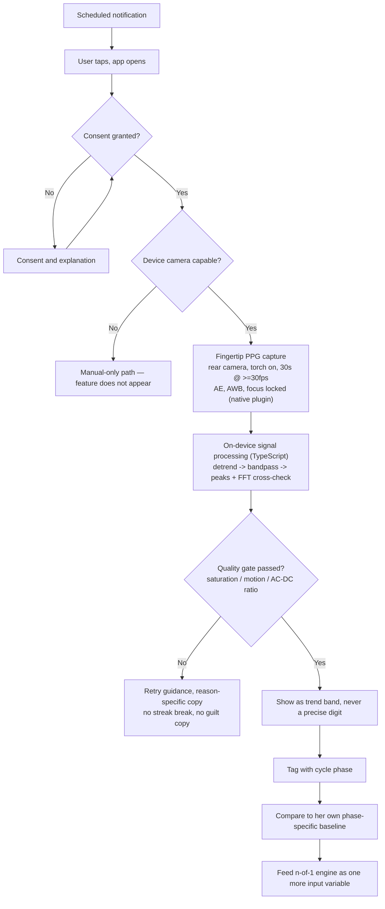

# Phase 6: Camera vitals — fingertip PPG - Research

**Researched:** 2026-08-03
**Domain:** Remote photoplethysmography (contact PPG) signal processing on native mobile camera + torch hardware, inside a Capacitor 6 shell; plus the clinical-evidence question gating release (PPG-07)
**Confidence:** HIGH on signal-processing pipeline and native-camera architecture. MEDIUM on device-capability boundaries (some platform guarantees needed runtime verification rather than a single authoritative citation). MEDIUM on the clinical-rebuttal evidentiary base — real literature exists, but only a qualified clinician can close PPG-07; this research supplies raw material, not a verdict.

## Summary

Phase 6 builds one thing precisely: a 30-second, torch-lit, finger-over-rear-camera heart-rate
capture that turns into a trustworthy range, and does nothing else if the phone or the situation
can't support it. The underlying technique — contact PPG from a phone's rear camera with the torch
on — is the *one* camera vital sign in this whole product with large, real, prospective clinical
validation behind it (Google's 95-participant study in Communications Medicine, 2022: MAPE 1.6% ±
4.3%, **no significant accuracy difference across skin-tone groups**). That is the opposite
situation from face rPPG (deferred, v2, 25–45% expected failure for MST 5–8 users) — this project's
own prior feasibility audit already worked this out and the PRD (FR-301–FR-312) already encodes the
exact pipeline: rear camera, torch on, lock AE/AWB/focus, red-channel spatial mean, detrend with
smoothness priors (λ≈10, the Tarvainen et al. 2002 method), 4th-order Butterworth bandpass 0.7–3.5
Hz, peak detection cross-checked against FFT, output as a range never a digit. Nothing in this
research contradicts that spec; this document fills in the *how* — exact native APIs, exact
failure modes, exact device-capability boundaries, exact packages worth using vs. hand-rolling —
and the *whether-it-should-ship-at-all* question, which is a currently-unmet, explicitly-gated
blocker (PPG-07), not a formality.

Two things make this phase harder than "reimplement the PRD spec": (1) no application code exists
in this repository yet — `src/`, the Capacitor project, and the frozen types all come from Phases
1–5, which have not executed at research time — so every architectural recommendation here is a
proposal for code that doesn't exist yet, not a description of what's already built; and (2) the
clinical objection this phase ships over is real, specific, and was raised by a practising
clinician who reviewed this exact proposal: *a resting heart rate is not a marker for PCOS/PMOS,
is not in the guideline, and would not change her care* (verbatim, from
`hackathon/PMOS-clinical-review.pdf`). This research found genuine, recent, peer-reviewed
literature on autonomic/sympathetic dysfunction and resting-HR abnormalities in PCOS — but that
literature itself concedes it is an emerging research signal, explicitly *not* an established
clinical management tool, and does not appear in the 2023 International PCOS Guideline's
recommended cardiovascular assessments (BMI, glucose, blood pressure, lipids — no heart rate, no
HRV). A credible written rebuttal cannot claim the clinician was simply wrong. It can honestly
reposition the feature: not as a clinical marker, but as one more n-of-1 input variable — held to
exactly the same "still learning" / confidence-gated standard as every symptom this app already
logs — with the emerging autonomic-dysfunction literature as the reason this specific population is
scientifically interesting to watch, not as proof the number itself is actionable. That reframe,
plus the anxious-population safety question the clinician was never shown a direct answer to, is
what the plan's PPG-07 task needs to hand to Satheeshkumar and a second clinician — not a rebuttal
already drafted by an AI research pass.

**Primary recommendation:** build one fully custom native Capacitor plugin (Swift + Kotlin) that
owns the camera session, torch, and locked AE/AWB/focus, and reduces every frame to a single
red-channel scalar before it ever crosses the JS bridge — no raw video, ever. Do all detrending,
filtering, peak/FFT detection and confidence calculation in TypeScript on the numeric array the
native side produces. Gate the whole feature behind a runtime capability probe (not a static
device-model list), fail closed (feature absent, not degraded) on unsupported hardware, and do not
let a single line of "camera heart rate" code ship to a store build until a real clinician's
written answer to PPG-07 exists in the repo.

<phase_requirements>
## Phase Requirements

| ID | Description | Research Support |
|----|-------------|------------------|
| PPG-01 | Fingertip PPG heart rate: rear camera + torch, 30s ≥30fps, red-channel spatial mean → detrend (smoothness priors λ≈10) → 4th-order Butterworth 0.7–3.5Hz → peak detection cross-checked against FFT. MAPE ≤5%, result ≤3s after capture ends | Full pipeline sourced from `product/00-PRD.md` FR-301 and `product/03-complete-features-spec.md` §3.14.2, cross-verified against the Communications Medicine 2022 study (MAPE 1.6%±4.3%) and the Tarvainen et al. 2002 detrending method. See Architecture Patterns, Code Examples |
| PPG-02 | Lock AE/AWB/focus before capture begins; AE hunting is the #1 signal killer | Exact iOS (`AVCaptureDevice.exposureMode = .locked`, `lockForConfiguration()`) and Android (`CONTROL_AE_LOCK`, `CONTROL_AWB_LOCK`) APIs identified, with a documented pitfall: locked exposure is not always honoured by hardware in the first ~1s of capture on some devices. See Common Pitfalls #1, Code Examples |
| PPG-03 | Live pulse waveform renders during capture | Architecturally this needs no camera preview at all (finger covers the lens) — the "live view" is the native plugin streaming per-frame scalar samples to a React waveform component, Belson's ownership. See Architecture Patterns |
| PPG-04 | Heart rate displayed as a range with confidence, never a single digit | Recommend a discriminated-union result type mirroring the project's own existing MEASUREMENT/INSIGHT confidence+observations pattern (`product/04-data-model.md`) and HACK-01's "not enough data as a value of the type" philosophy — not a nullable-field-plus-if-statement. See Don't Hand-Roll, Code Examples |
| PPG-05 | Reject captures failing saturation, motion or AC/DC checks; rejection reads as normal, with guidance, never breaks streaks | Concrete, implementable gate conditions specified per failure mode, each mapped to specific coaching copy. See Architecture Patterns, Common Pitfalls |
| PPG-06 | Gate camera features on device capability at install; fully functional non-camera path | Camera2 hardware-level research (LEGACY/LIMITED/FULL/LEVEL_3) plus a recommendation to probe actual capability keys at runtime rather than gate on hardware level or a device allowlist. See Architecture Patterns, Common Pitfalls, Assumptions Log |
| PPG-07 | Written clinical rebuttal or second clinical opinion answering "what would resting HR tell a woman with PMOS?" must exist before release | Real literature found (autonomic/sympathetic dysfunction, RHR/HRV abnormalities in PCOS) — genuine but explicitly research-grade, not clinical-management-grade, and absent from the 2023 Guideline's recommended CV assessments. This is raw material for the rebuttal, not the rebuttal itself. See "PPG-07: What a Credible Rebuttal Needs" below |
</phase_requirements>

## Architectural Responsibility Map

| Capability | Primary Tier | Secondary Tier | Rationale |
|------------|-------------|----------------|-----------|
| Camera session ownership, torch control, AE/AWB/focus lock | Native (Client, Swift/Kotlin plugin) | — | OS-level camera APIs are native-only; Capacitor's own JS `Camera`/community preview plugins expose no frame buffer or exposure-lock control (verified — see Standard Stack) |
| Per-frame red-channel scalar extraction | Native (Client, Swift/Kotlin plugin) | — | Must happen before crossing the JS bridge — shipping raw frames would be slow and violates NFR-305/PRIV-05 (raw media never persists beyond the processing window) |
| Detrending, bandpass filtering, peak/FFT detection, confidence calc | Client (TypeScript, in-app, on-device) | — | ADR-004 (on-device inference) and CON-BUILD-02 (interpretable, deterministic TypeScript) both apply; this is classical DSP, not a native-only concern, and keeping it in TS keeps it inspectable/testable without a native rebuild per change |
| Live waveform rendering, capture UI, failure-state copy, result screen | Browser/Client (React) | — | Standard UI-layer work; consumes the numeric stream and result object the native+TS layers produce |
| Device-capability gate (does this phone qualify at all) | Native (Client, plugin capability-check method) | Browser/Client (conditional render) | The check itself must query real native camera characteristics; the UI decision (show/hide the feature) is a thin client-side consumer of that native answer |
| Result persistence (as a MEASUREMENT-shaped row) | Client (on-device store, IndexedDB via Dexie) | — | Per ADR-004/PRIV-05, physiological readings are local-first; only the fact that a reading exists, never raw signal or images, could ever sync, and only with consent |
| Clinical rebuttal / second opinion (PPG-07) | N/A — release-process gate, not software | — | This is a documentation/governance deliverable that blocks a feature flag, not a code tier. Treat it as a CI-checkable release gate (see Validation Architecture) so it is enforced, not just remembered |

## Standard Stack

### Core

| Library | Version | Purpose | Why Standard |
|---------|---------|---------|--------------|
| Capacitor (`@capacitor/core`, `@capacitor/cli`) | **6.x** (locked, ADR-001) — pin explicitly; npm `latest` is 8.5.0 as of this research [VERIFIED: npm registry, this session] | Native shell + plugin bridge | Already the project's locked architecture decision; do not `npm install` without a version pin — see Common Pitfalls #6 |
| Hand-written native plugin (Swift + Kotlin) | N/A (no package — custom code) | Camera session, torch, locked AE/AWB/focus, per-frame red-channel scalar extraction | Confirmed by research: no existing Capacitor plugin exposes both frame-buffer access AND exposure/WB/focus lock (see Alternatives Considered). This is a genuine build-not-buy case |
| `fft.js` | 4.0.4 [VERIFIED: npm registry, `package-legitimacy check` → OK — 735K weekly downloads, real repo `github.com/indutny/fft.js`] | FFT/PSD for the peak-detection cross-check step | Small, focused, actively-depended-on FFT implementation; don't hand-roll a DFT — it's easy to get subtly wrong (windowing, zero-padding, bin-to-Hz mapping) |

### Supporting

| Library | Version | Purpose | When to Use |
|---------|---------|---------|-------------|
| `androidx.camera.core` (CameraX) `ImageAnalysis` | `setOutputImageFormat(OUTPUT_IMAGE_FORMAT_RGBA_8888)`, available since CameraX 1.1.0-alpha08 [CITED: developer.android.com/media/camera/camerax/analyze] | Android frame acquisition, direct RGBA per-pixel access | Avoids hand-rolling YUV→RGB conversion entirely — request RGBA_8888 output directly instead |
| `AVCaptureVideoDataOutput` with `kCVPixelFormatType_32BGRA` | Part of AVFoundation (no separate package) [CITED: developer.apple.com forums + AVFoundation docs] | iOS frame acquisition, direct BGRA per-pixel access | `CMSampleBufferGetImageBuffer` → `CVPixelBuffer` → lock base address → read red-channel bytes directly |
| `@capacitor/cli` plugin generator (`npx cap plugin:generate`) | Bundled with `@capacitor/cli` 6.x | Scaffolds the JS-bridge boilerplate for a new custom native plugin | Don't hand-write the Capacitor plugin bridge structure from scratch — generate it, then fill in the native camera/DSP logic |

### Alternatives Considered

| Instead of | Could Use | Tradeoff |
|------------|-----------|----------|
| Fully custom native plugin | `@capacitor-community/camera-preview` (v6.0.1 for Capacitor 6; latest is 8.0.1) [VERIFIED: npm registry, `package-legitimacy check` → OK] | **Rejected for this pipeline** — confirmed via direct inspection: exposes `captureSample()` (single base64 still image) and flash-mode toggle only. No frame-buffer stream API, no exposure/WB/focus lock API. Usable only as a reference for Capacitor plugin bridge structure, not as a dependency |
| Custom native torch control | `@capawesome/capacitor-torch` (8.0.1) or `@capgo/capacitor-flash` (8.0.35) [VERIFIED: npm registry; legitimacy verdicts OK and SUS respectively — see Package Legitimacy Audit] | **Not recommended for the capture pipeline** — torch must be opened by the *same* native session that owns the camera and locks exposure, to avoid two plugins fighting over one hardware resource. A separate torch plugin is fine for unrelated in-app torch use, out of scope here |
| Hand-rolled Butterworth coefficients | `fili` (2.0.3) | **Use with caution, flagged SUS** (no declared repository field, last real update years old — see Package Legitimacy Audit). Either gate its adoption behind `checkpoint:human-verify`, or hand-implement the 4th-order Butterworth bandpass via the standard bilinear-transform design formula and cross-validate the coefficients against a reference (e.g. `scipy.signal.butter(4, [0.7, 3.5], btype='band', fs=30)` run once offline) as a Wave-0 test fixture |
| NuraLogix Anura Core SDK / Binah.ai / VitalLens (commercial rPPG SDKs) | In-house classical DSP | **Rejected**, consistent with the project's own prior feasibility audit: NuraLogix requires Camera2 FULL/LEVEL_3 (excludes budget Indian Android devices), VitalLens is priced per-frame and economically inviable at consumer scale with no Android SDK, Binah is per-seat licensed. None of the three is needed — the validated technique (contact PPG) is "classical DSP, not deep learning" per the project's own sensing-science audit finding |

**Installation:**
```bash
npm install @capacitor/core@6 @capacitor/cli@6   # explicit pin — do not take "latest"
npm install fft.js
npx cap plugin:generate                           # scaffolds the custom native plugin package
```

**Version verification:** `@capacitor/core`/`@capacitor/cli` latest on the npm registry is
**8.5.0** as of this research session [VERIFIED: `npm view @capacitor/core version` → `8.5.0`,
published 2026-07-31] — two majors ahead of the ADR-001-locked Capacitor 6. This is a real,
concrete risk: any dependency added in this phase (including `@capacitor-community/camera-preview`
if ever referenced) must be pinned to its Capacitor-6-compatible major version line (confirmed:
that plugin's `6.0.0`/`6.0.1` releases correspond to Capacitor 6; its `8.x` releases do not
[VERIFIED: `npm view @capacitor-community/camera-preview versions --json`, this session]).

## Package Legitimacy Audit

| Package | Registry | Age | Downloads | Source Repo | Verdict | Disposition |
|---------|----------|-----|-----------|--------------|---------|--------------|
| `fft.js` | npm | first published ~2013, last release 2021 | 735,465/wk | `github.com/indutny/fft.js` | **OK** | Approved — recommended for FFT/PSD peak-detection cross-check |
| `fili` | npm | first published 2018 (per registry `publishedAt`), effectively unmaintained | 3,365/wk | no `repository` field declared in package metadata (actual source appears to be `github.com/markert/fili`, not machine-verifiable from the registry entry) | **SUS** (`no-repository`) | Flagged — planner must add `checkpoint:human-verify` before adopting. Default recommendation instead: hand-implement the Butterworth coefficients and cross-validate against a known-good reference implementation as a Wave-0 test |
| `@capacitor-community/camera-preview` | npm | active since 2018, last publish 2026-04-17 | 41,520/wk | `github.com/capacitor-community/camera-preview` | **OK** | Not recommended for the PPG pipeline itself (confirmed no frame-buffer/exposure-lock API) — reference only, not installed as a runtime dependency |
| `@capawesome/capacitor-torch` | npm | active, last publish 2026-02-19 | 3,607/wk | `github.com/capawesome-team/capacitor-plugins` | **OK** | Not required for this phase — the custom plugin should own torch directly. Legitimate if the team ever wants standalone torch control elsewhere in the app |
| `@capgo/capacitor-flash` | npm | last publish 2026-07-11 | 13,017/wk | `github.com/Cap-go/capacitor-flash` | **SUS** (`too-new`) | Not recommended; noted only for completeness against the torch-plugin landscape |
| `@capacitor/core`, `@capacitor/cli` | npm | est. 2017, extremely active (3.7M+/wk) | 3,725,023 / 3,751,383/wk | `github.com/ionic-team/capacitor` | **SUS** (`too-new` — mechanical false positive) | **Approved.** The `too-new` flag fires because the checker looked at the most recent patch release (2026-07-31); this is the project's own already-locked core framework (ADR-001), not a new phase-introduced dependency. Pin to the `6.x` line explicitly rather than treating the flag as a reason to distrust the package |

**Packages removed due to [SLOP] verdict:** none.
**Packages flagged as suspicious [SUS]:** `fili` (genuine staleness/no-repo signal — gate behind
`checkpoint:human-verify` if adopted), `@capgo/capacitor-flash` (not recommended for use here
regardless), `@capacitor/core`/`@capacitor/cli` (false-positive explained above — do not gate,
this is the existing locked dependency).

*Packages discovered via WebSearch (the Capacitor community plugins, `fili`, `fft.js`) are tagged
`[ASSUMED]` as *names* until cross-checked against the registry, which was done this session for
every package above; the underlying package-name provenance is WebSearch, so treat the choice to
adopt any of them — even the `OK`-verdict ones — as a decision the plan should still confirm with
a quick manual look at the repo before the first `npm install`, per the package-name provenance
rule.*

## Architecture Patterns

### System Architecture Diagram

This is the project's own planning-doc architecture for this exact feature
[VERIFIED: `product/00-PRD.md:347-384`, §9.3], reproduced because it is the authoritative flow this
phase must implement — not something this research is proposing fresh:



Two things this research adds to that diagram that aren't visible in the box-and-arrow view: (1)
the `CAP` capability check and the `F` capture step are two *separate* native calls into the same
plugin — capability check should be cheap/cacheable (run once, e.g. at first navigation to the
feature), capture is the expensive 30-second session; and (2) the arrow from `F` to `DSP` crosses
the Capacitor JS bridge as a plain numeric array (per-frame red-channel means, ~900 floats for
30s@30fps), never as image/video data.

### Team Scope Mapping (from this research)

The team assignment given for this phase maps cleanly onto the architecture above, and the plan
should assign tasks along exactly this boundary:

| Person | Owns | Boundary |
|--------|------|----------|
| Dhodraj Sundaram | Everything inside the `DSP` box: detrend, Butterworth design, peak detection, FFT cross-check, confidence calculation, the result type | Consumes a plain `number[]` from the native plugin; never touches camera/torch APIs directly |
| Belson Johnson | Everything inside `T`, `OB`, the waveform render during `F`, `RT` copy, `OUT` result screen | Consumes a live numeric stream (for the waveform) and the final discriminated-union result (for the range/confidence display); never touches native camera code |
| Rahul Ramakrishnan | The native plugin itself (Swift + Kotlin): camera session, torch, AE/AWB/focus lock, per-frame scalar extraction, the `CAP` capability-check method, build/deploy across the device fleet | Owns everything that must be native; ships a numeric stream and a capability boolean/enum to the JS side, nothing else |
| Satheeshkumar | PPG-07 (rebuttal/second opinion) as a real deliverable; QA on whether `RT` failure copy reads as reassuring, not alarming, for a population with ~6x baseline anxiety (per `hackathon/clinician-review-brief.md` Q5) | Not a code owner on this feature; owns a release gate and a UX-safety review pass |

### Recommended Project Structure

No `src/` exists in this repository yet (Phases 1–5 have not executed) — this is a proposed
convention for where Phase 6 code should live once the app scaffold exists, following the same
plugin-generator layout Capacitor's own tooling produces:

```
src/
├── features/
│   └── camera-vitals/           # Belson + Dhodraj — UI + DSP
│       ├── capture-screen.tsx   # capture UI, waveform, guidance copy
│       ├── result-screen.tsx    # range + confidence display
│       ├── pipeline/            # Dhodraj — detrend, filter, peak/FFT, confidence
│       │   ├── detrend.ts
│       │   ├── bandpass.ts
│       │   ├── peak-detect.ts
│       │   └── confidence.ts
│       └── types.ts             # PPGResult discriminated union
packages/
└── capacitor-plugin-ppg-camera/ # Rahul — generated via `cap plugin:generate`
    ├── ios/Plugin/              # Swift: AVCaptureSession, torch, AE/AWB/focus lock
    ├── android/.../PpgCameraPlugin.kt  # Kotlin: CameraX/Camera2, torch, AE lock
    └── src/definitions.ts       # capture() + checkCapability() JS interface
```

### Pattern 1: Capability-gated feature visibility, not a disabled button

**What:** The camera-vitals entry point (nav item / dashboard card) must not render at all on an
unsupported device — not appear greyed out, not show an error state. PPG-06 and the phase's own
success criteria are explicit: "on a phone whose camera cannot do this at all, the feature never
appears."
**When to use:** Any time a capability check can fail — run it once (cached), fail closed.
**Example:**
```typescript
// Source: derived from product/00-PRD.md FR-311 + FR-206 (NFR-205 graceful degradation),
// pattern generalized from the project's own MEASUREMENT/INSIGHT discriminated-value convention
// in product/04-data-model.md
type CameraVitalsCapability =
  | { supported: true }
  | { supported: false; reason: 'no-torch' | 'no-camera' | 'lock-unsupported' | 'check-failed' };

async function getCapability(): Promise<CameraVitalsCapability> {
  try {
    return await PpgCamera.checkCapability(); // native call, cached by the caller
  } catch {
    // Fail closed: an inconclusive check means the feature does not appear, ever.
    return { supported: false, reason: 'check-failed' };
  }
}
```
Render the dashboard entry point only when `capability.supported === true`. Do not render a
disabled variant for the `false` branch.

### Pattern 2: Discriminated-union result type (no nullable fields, no "not enough data" if-statement)

**What:** PPG-04 requires a range with confidence, never a single digit. PPG-05 requires specific,
actionable rejection reasons. HACK-01 already established this project's own convention: express
"not enough data" as a value of the type, not as a special case bolted on with an `if`.
**When to use:** The shape the DSP pipeline (Dhodraj) hands to the UI (Belson).
**Example:**
```typescript
// Source: pattern generalized from product/04-data-model.md MEASUREMENT/INSIGHT fields
// (confidence, source, observations are mandatory — see verbatim quote below) and HACK-01's
// finding-type philosophy in .planning/REQUIREMENTS.md
type PPGResult =
  | { status: 'ok'; bpmLow: number; bpmHigh: number; confidence: 'low' | 'medium' | 'high' }
  | { status: 'rejected'; reason: 'saturated' | 'motion' | 'weak-ac-dc' | 'capture-interrupted' }
  | { status: 'unsupported' };
```
This makes the "never a single precise digit" and "rejection is normal, not an error" requirements
enforceable at the type level — a UI component that tries to render `result.bpm` as a bare number
simply doesn't compile, because no such field exists.

### Pattern 3: Reason-specific rejection copy (PPG-05)

**What:** Every rejection needs a *specific* cause and a *specific* piece of guidance, not a generic
"capture failed, try again."
**When to use:** Mapping the quality gate's rejection reason to Belson's coaching copy.
**Example mapping** (copy is illustrative, Belson/Satheesh own final wording and the anxiety-safety
review of it):

| Gate failure | Likely cause | Guidance copy direction |
|---|---|---|
| `saturated` | Finger pressed too hard, occluding the capillary bed, or torch reflecting off a nail/ring | "Rest your finger lightly — pressing hard can block the reading" |
| `motion` | Hand movement during the 30s window | "Try to hold still for the next attempt" |
| `weak-ac-dc` | Poor peripheral perfusion (cold hands), finger not fully covering the lens, or torch too dim | "Warm your hands for a moment, then try again" |
| `capture-interrupted` | Camera resource lost (call came in, app backgrounded) | "That got interrupted — let's try again" |

### Anti-Patterns to Avoid

- **Citing Google's PHRM (face-unlock, passive) accuracy or skin-tone figures as this feature's
  own numbers.** They are a *different signal* (face rPPG on unlock, Nature 2026, licensed
  non-commercial/non-clinical, IRB-gated) from the contact PPG this phase builds (Communications
  Medicine 2022, the shipped Google Fit feature). The project's own prior audit already flagged
  this exact conflation as a "CITATION-PROBLEM." Only cite accuracy measured on the team's own
  pipeline in any user-facing copy.
- **Gating device capability on a hardware-level allowlist that goes stale.** The Android camera
  fleet fragments faster than any static list can track. Probe actual capability keys at runtime
  instead (see Common Pitfalls #3).
- **Shipping raw frames or images across the Capacitor bridge "just for debugging."** Violates
  NFR-305/PRIV-05 even transiently, and is unnecessary — the DSP layer never needs more than the
  per-frame scalar.
- **Treating the aggregated, multi-clip Google accuracy figures as this phase's single-capture
  error bound.** See Common Pitfalls #5 — plan for wider single-measurement error than the
  headline MAPE number implies.

## Don't Hand-Roll

| Problem | Don't Build | Use Instead | Why |
|---------|-------------|--------------|-----|
| FFT / spectral peak detection | A hand-written DFT | `fft.js` | DFT implementations are easy to get subtly wrong (windowing, zero-padding, bin→Hz mapping); a small, real, actively-depended-on library removes a whole class of arithmetic bugs |
| Butterworth bandpass filter coefficients | Hand-derived bilinear-transform math with no cross-check | `fili` (flagged SUS, gate behind `checkpoint:human-verify`) **or** hand-implement and cross-validate against a known-good reference (`scipy.signal.butter`) as a Wave-0 fixture | Filter-design math has subtle stability/gain-normalization failure modes that "looks right" but is wrong; either use a maintained library or prove correctness against an external reference, don't trust a fresh derivation unverified |
| YUV→RGB conversion for per-frame pixel access on Android | Manual YUV_420_888 plane math | `ImageAnalysis.setOutputImageFormat(OUTPUT_IMAGE_FORMAT_RGBA_8888)` (CameraX, available since 1.1.0-alpha08) | Removes an entire, well-documented class of color-conversion bugs (chroma subsampling, plane strides) that this project doesn't need to solve itself |
| Capacitor plugin JS-bridge boilerplate | Hand-written `.aidl`/bridge glue | `npx cap plugin:generate` scaffold | Standard, maintained tooling for exactly this; no reason to hand-write the bridge plumbing |
| Confidence/range representation for a physiological reading | A `bpm: number \| null` field plus scattered `if (bpm === null)` checks | The discriminated-union `PPGResult` pattern (Pattern 2 above), matching the project's own existing MEASUREMENT/INSIGHT convention | This project already solved this exact problem once (the finding type, HACK-01) — reuse the pattern rather than re-deriving a worse one for PPG specifically |
| Device-capability detection heuristics | A static list of "known good" phone models | Runtime capability probing (query actual `CameraCharacteristics`/`AVCaptureDevice` support, not a device-model string) | A model allowlist requires ongoing maintenance against a market that IDC reports is contracting and reshuffling (budget Android brands >50% share, per the project's own prior device-dependency audit); it also silently fails for models released after the list was written |

**Key insight:** almost every "don't hand-roll" item above exists because this project already
had to solve the general version of the problem once (frozen finding type, existing MEASUREMENT
schema, existing device-dependency audit discipline) — the risk in this phase specifically is
re-deriving a bespoke, worse version of a pattern the project has already established, under time
pressure, because "it's just PPG, it's different."

## Common Pitfalls

### Pitfall 1: Locked exposure isn't always honoured by the hardware

**What goes wrong:** Calling the lock APIs (`AVCaptureDevice.exposureMode = .locked` on iOS,
`CONTROL_AE_LOCK = true` on Android) does not guarantee the sensor stops adjusting immediately.
An Apple developer forum thread reports ISO continuing to drift for roughly the first second of
recording despite a prior lock call, causing over-saturated frames early in the capture
[CITED: developer.apple.com/forums/thread/749574]. A reported workaround only worked on older
device generations (iPad 8, iPhone XR) and not on newer ones (iPad 9, iPhone 15), meaning this is
not a single fixed bug but an ongoing, device-generation-dependent behavior.
**Why it happens:** The camera pipeline has its own internal settling time even after a lock
command is issued; the OS doesn't guarantee the *next* frame reflects the locked state.
**How to avoid:** Discard the first ~1 second of frames (≈30 frames at 30fps) from the DSP input
before computing anything — treat it as a mandatory warm-up window, not optional.
**Warning signs:** Saturation-gate rejections cluster suspiciously at the very start of captures
during device testing; look at the raw red-channel trace, not just the aggregate BPM output.

### Pitfall 2: Conflating two different Google rPPG studies

**What goes wrong:** Marketing or in-app copy accidentally borrows accuracy numbers, skin-tone
claims, or "Google-validated" framing from the *wrong* one of two genuinely distinct Google studies.
**Why it happens:** Both involve a phone camera and heart rate, and both are Google Research
papers, but they are different techniques with different validated numbers: contact PPG (finger on
rear camera + torch, Communications Medicine 2022, MAPE 1.6%±4.3%, shipped in Google Fit,
user-initiated) vs. PHRM (face on unlock, Nature 2026, free-living MAPE 4.83%, only 43.1% of clips
valid, licensed non-commercial/non-clinical, never shipped to third parties). This project's own
feasibility audit already flagged this exact confusion once
[VERIFIED: `research/05-feasibility-audit/audit-findings.json`, `phrm-third-party` section].
**How to avoid:** Every place this feature is described — pitch deck, store listing, in-app
onboarding copy — must name the Communications Medicine study specifically when citing accuracy,
and must never invoke "PHRM" or "passive heart rate" language at all.
**Warning signs:** Any copy draft containing the words "passive" or "on unlock" near "heart rate."

### Pitfall 3: Gating on Camera2 hardware support level instead of specific capability keys

**What goes wrong:** Android's Camera2 hardware levels are LEGACY / LIMITED / FULL / LEVEL_3, and
FULL is the level that *guarantees* `MANUAL_SENSOR` (true manual exposure-time/ISO control)
[CITED: developer.android.com camera versioning docs]. This phase's own algorithm, per PPG-02,
only needs to *lock* the currently-computed AE/AWB values (`CONTROL_AE_LOCK`/`CONTROL_AWB_LOCK`),
which is a materially lower bar than full manual sensor control — evidence suggests AE/AWB lock is
implemented even in the LEGACY compatibility shim [CITED: gitlab.e.foundation LEGACY camera2 commit
implementing "ae compensation step ranges and ae/awb locks"], but this research did **not** find a
single authoritative Android doc stating "AE_LOCK is guaranteed on every hardware level including
LEGACY" — this remains genuinely unresolved from documentation alone (logged as Assumption A1).
**Why it happens:** It's tempting to copy NuraLogix's FULL/LEVEL_3 requirement as a "safe" bar,
which would needlessly exclude a large share of the India-targeted budget Android fleet that this
product explicitly targets (per ADR-003, "works on a ₹10,000 phone").
**How to avoid:** Query the actual capability keys at runtime
(`CameraCharacteristics.CONTROL_AE_AVAILABLE_MODES` contains `CONTROL_AE_MODE_OFF`? Is
`CONTROL_AE_LOCK_AVAILABLE` true?) rather than branching on the coarse hardware-level enum, and
empirically test AE/AWB lock behavior across the team's actual device fleet before finalizing the
PPG-06 gate logic.
**Warning signs:** The capability gate excludes a device that a manual test shows works fine
(over-exclusion), or accepts a device where the torch clearly hunts/flickers during capture
(under-exclusion).

### Pitfall 4: Sustained torch use — thermal throttling and the 1% battery budget

**What goes wrong:** NFR-107 sets a ≤1% battery-drain budget per 30-second capture. Continuous
torch-on for 30 seconds is a real power and heat load; some devices throttle flash brightness or
camera frame rate under sustained thermal load, which would visibly change signal amplitude
mid-capture in a way that looks like a data problem but is actually a hardware-protection response.
**Why it happens:** OEM thermal-management firmware varies widely across the fragmented Android
fleet this product targets; this is exactly the kind of device-specific behavior a single-device
dev machine won't surface.
**How to avoid:** The detrending step (smoothness-priors, already in the pipeline for baseline
wander) should absorb slow amplitude drift; but explicitly test the full 30-second capture on the
lowest-end device in the team's fleet, and budget QA time for this rather than assuming the
30s-@-30fps target is met identically across devices.
**Warning signs:** BPM confidence degrading specifically in the second half of longer captures,
or a torch that visibly dims partway through testing.

### Pitfall 5: Confusing aggregated study accuracy with single-capture accuracy

**What goes wrong:** The headline "MAPE 1.6%" figure is a controlled-study number
[VERIFIED via prior project audit + Communications Medicine 2022 paper, PMC9053269]. The *other*
Google study this research distinguishes (PHRM) makes the aggregation effect explicit: free-living
accuracy figures assumed ~231 clips averaged per participant per day, of which only 43.1% passed
quality gating — single-clip error is materially worse than the aggregated number
[VERIFIED: `research/05-feasibility-audit/audit-findings.json`, `phrm-third-party` section,
citing arXiv:2503.03783v3]. This project's own feature spec already internalizes this lesson for
the *fingertip* feature too, planning for "5–8 bpm single-measurement error," not the lab MAPE.
**Why it happens:** It's easy to quote the headline accuracy figure from the validation paper
without checking whether it was computed per-reading or aggregated over many readings.
**How to avoid:** Size the displayed confidence range (PPG-04) using single-capture error
expectations, not the lab study's aggregate MAPE; treat the 1.6% figure as evidence the underlying
signal science is sound, not as this app's actual expected per-reading error.
**Warning signs:** A displayed range narrower than ±5 bpm on a single 30-second capture.

### Pitfall 6: Installing "latest" instead of the Capacitor-6-pinned version

**What goes wrong:** `@capacitor/core`/`@capacitor/cli` latest on the registry is 8.5.0
[VERIFIED: npm registry, this session], two majors ahead of the ADR-001-locked Capacitor 6. Any
`npm install` without an explicit version pin during this phase risks silently upgrading the whole
app's Capacitor major version as a side effect of adding a phase-6-specific dependency, or
installing a Capacitor-8-only version of a supporting plugin against a Capacitor-6 app.
**Why it happens:** `npm install <package>` defaults to `latest` unless pinned; the discrepancy is
invisible until a build breaks or a plugin's native code doesn't match the shell's Capacitor major.
**How to avoid:** Pin every Capacitor-ecosystem install explicitly (`@capacitor/core@6`,
`@capacitor-community/camera-preview@6.0.1` if ever referenced, etc.).
**Warning signs:** `package.json` shows a Capacitor plugin dependency with a major version number
that doesn't match the shell's own Capacitor major.

## Code Examples

### iOS: locked exposure/WB/torch + per-frame BGRA capture (skeleton)

```swift
// Source: constructed from Apple Developer Documentation (AVCaptureDevice.ExposureMode.locked,
// lockForConfiguration/unlockForConfiguration, torchMode) and AVCaptureVideoDataOutput pixel
// format guidance [CITED: developer.apple.com]. This is a skeleton, not verbatim SDK sample code.
func configureForContactPPG(device: AVCaptureDevice) throws {
    try device.lockForConfiguration()
    if device.isExposureModeSupported(.locked) { device.exposureMode = .locked }
    if device.isWhiteBalanceModeSupported(.locked) { device.whiteBalanceMode = .locked }
    if device.isFocusModeSupported(.locked) { device.focusMode = .locked }
    if device.hasTorch { try device.setTorchModeOn(level: 1.0) }
    device.unlockForConfiguration()
}

// AVCaptureVideoDataOutput, configured for direct pixel access:
let output = AVCaptureVideoDataOutput()
output.videoSettings = [
    kCVPixelBufferPixelFormatTypeKey as String: Int(kCVPixelFormatType_32BGRA)
]
// In the sample-buffer delegate:
func captureOutput(_ output: AVCaptureOutput, didOutput sampleBuffer: CMSampleBuffer, from connection: AVCaptureConnection) {
    guard let pixelBuffer = CMSampleBufferGetImageBuffer(sampleBuffer) else { return }
    // lock base address, read red-channel bytes at BGRA stride, compute the frame's spatial
    // mean of the R channel, discard the pixel buffer immediately — never retain raw frames.
}
```
Known pitfall: don't trust the lock to take effect on the very next frame — discard the first
~30 frames (see Common Pitfalls #1).

### Android: CameraX RGBA analysis + Camera2Interop AE lock + torch (skeleton)

```kotlin
// Source: constructed from Android Developers CameraX ImageAnalysis docs and Camera2 CaptureRequest
// docs [CITED: developer.android.com/media/camera/camerax/analyze,
// developer.android.com Camera2 CaptureRequest reference]. Skeleton, not verbatim sample code.
val analysis = ImageAnalysis.Builder()
    .setOutputImageFormat(ImageAnalysis.OUTPUT_IMAGE_FORMAT_RGBA_8888) // direct RGBA, no manual YUV conversion
    .setTargetFrameRate(30) // request >=30fps per PPG-01
    .build()

// Camera2Interop extension to lock AE/AWB before starting analysis:
Camera2Interop.Extender(previewBuilder)
    .setCaptureRequestOption(CaptureRequest.CONTROL_AE_MODE, CaptureRequest.CONTROL_AE_MODE_OFF)
    .setCaptureRequestOption(CaptureRequest.CONTROL_AE_LOCK, true)
    .setCaptureRequestOption(CaptureRequest.CONTROL_AWB_LOCK, true)
    .setCaptureRequestOption(CaptureRequest.FLASH_MODE, CaptureRequest.FLASH_MODE_TORCH)
```
Verify `CONTROL_AE_LOCK`/`CONTROL_AWB_LOCK` support via `CameraCharacteristics` at runtime before
relying on it (see Common Pitfalls #3) rather than assuming it from the hardware-level enum alone.

### TypeScript: detrend → bandpass → peak/FFT cross-check skeleton

```typescript
// Source: pipeline structure from product/00-PRD.md FR-301 and
// product/03-complete-features-spec.md §3.14.2; Tarvainen et al. 2002 method for the detrend step
// [CITED: PubMed 12066885, DOI 10.1109/10.979357]; fft.js for the spectral step.
import FFT from 'fft.js';

function detrendSmoothnessPriors(signal: number[], lambda = 10): number[] {
  // Tarvainen et al. 2002: regularized least-squares detrending, acts as a time-varying
  // high-pass filter whose cutoff is set by lambda. lambda≈10 matches this project's own
  // frozen parameter choice (product/00-PRD.md FR-301: "smoothness priors at lambda 10").
  // ... implementation per the cited method ...
  return signal; // placeholder
}

function butterworthBandpass(signal: number[], fs: number, low = 0.7, high = 3.5): number[] {
  // 4th-order Butterworth, 0.7-3.5 Hz (42-210 bpm). Use `fili` (flagged SUS — see Package
  // Legitimacy Audit) or hand-implement and cross-validate coefficients against a reference.
  return signal; // placeholder
}

function crossCheckedBpm(signal: number[], fs: number): { bpm: number; agree: boolean } {
  const peaks = detectPeaks(signal, fs);           // time-domain peak detection
  const fft = new FFT(nextPow2(signal.length));
  const spectrum = /* run fft on zero-padded signal */ [];
  const fftBpm = dominantPeakToBpm(spectrum, fs);
  const peakBpm = peaksToBpm(peaks, fs);
  return { bpm: (fftBpm + peakBpm) / 2, agree: Math.abs(fftBpm - peakBpm) < 3 };
}
```

## State of the Art

| Old Approach | Current Approach | When Changed | Impact |
|--------------|------------------|---------------|--------|
| Manual YUV_420_888 plane math for per-pixel color access on Android | Request `RGBA_8888` output directly via `ImageAnalysis.setOutputImageFormat` | Available since CameraX 1.1.0-alpha08 [CITED] | Removes a whole class of chroma-subsampling/stride bugs for this exact use case |
| Treating "camera-based heart rate" as a single undifferentiated technique | Contact PPG (validated, skin-tone-fair, shippable) vs. face rPPG (contested, skin-tone-sensitive, beta-only) are now understood as materially different techniques with different evidence bases | Established by this project's own feasibility audit, 2026 | Directly determines why this phase builds fingertip capture as the flagship and defers face rPPG |
| "Passive/PHRM-inspired" camera HR as an achievable third-party feature | Confirmed platform-blocked on iOS and Android for any third party; foreground, user-initiated, 20-60s sessions are the ceiling every commercial rPPG SDK (Binah, NuraLogix, VitalLens) also converges on | Reconfirmed via this project's own platform-policy audit, 2026 | Removes any temptation to revisit passive capture; the entire UX (notification → tap → 30s capture) follows from this constraint |

**Deprecated/outdated:** Any reference to Google Fit (developer sign-ups closed May 2024, support
ends 2026) as an Android health-data bridge is already dead; Health Connect is the replacement, but
neither is in scope for this phase (write-back to Health Connect/HealthKit is FR-1206, deferred
v2).

## PPG-07: What a Credible Rebuttal Needs

This is the section the additional context specifically asked for: the actual clinical literature
on whether resting heart rate has *any* relevance to PMOS/PCOS management, so the plan can include
drafting a rebuttal (or securing a second opinion) as a real, gated task — not a checkbox.

**The recorded objection, verbatim** [VERIFIED: `hackathon/PMOS-clinical-review.pdf`, jury-questions
section]: *"We planned camera heart rate and cut it. A clinician asked what a resting heart rate
would tell a woman with PMOS, and it is not a marker for this condition, not in the guideline, and
would not change her care."*

**What this research found, and its honest weight:**

1. **Real, recent, peer-reviewed literature does establish autonomic/sympathetic nervous system
   dysfunction as a genuine, replicated finding in PCOS** — increased sympathetic activity,
   decreased parasympathetic (vagal) activity, and elevated muscle sympathetic nerve activity
   (measured directly via microneurography) in PCOS patients vs. controls, independent of BMI
   [CITED: Yu, Chen, Zheng et al., "The role of the autonomic nervous system in polycystic ovary
   syndrome," *Frontiers in Endocrinology*, 19 Jan 2024, PMC10834786]. A second, more recent focused
   review synthesizes 32 studies finding elevated resting heart rate and impaired HRV "even in
   normal-weight or metabolically mild PCOS phenotypes" [CITED: Islam, Motdhare, Bejoy, Wilkhoo,
   "Autonomic dysfunction and resting heart rate abnormalities as early cardiovascular signals in
   polycystic ovary syndrome (PCOS): a focused review," *Exploration of Cardiology*, 12 Feb 2026].

2. **Both sources explicitly stop short of claiming current clinical actionability.** The 2024
   review states larger-scale, long-term studies are needed "before applying these treatments in
   clinical practice" and describes autonomic testing only as having "good clinical application
   *prospect*" — future potential, not current use. The 2026 focused review is more direct: RHR
   "holds promise as a supportive early risk signal; however, it should not be used in isolation,"
   is "a non-specific marker influenced by multiple physiological and behavioral variables," and
   should be "considered supportive rather than definitive." Neither paper disagrees with the
   clinician; both would likely agree with them on today's standard of care.

3. **The 2023 International Evidence-Based PCOS Guideline's actual recommended cardiovascular risk
   assessments are BMI, glucose screening, annual blood pressure, and lipid screening** — this
   research did not find resting heart rate or HRV named as a recommended assessment anywhere in
   guideline-summary sources [CITED: summarized via MJA/JCEM guideline-recommendation coverage;
   the primary JAHA source itself returned HTTP 403 to direct fetch this session — see Assumptions
   Log A5, this is not independently confirmed against the primary text]. This is consistent with,
   not contradictory to, the clinician's "not in the guideline" claim.

4. **Conclusion for the plan:** a rebuttal that argues "the clinician was wrong, resting HR is a
   validated PCOS marker" would not survive a second clinician's scrutiny and would not be honest.
   A rebuttal that could survive scrutiny has to reposition the feature, not re-litigate the
   clinical claim:
   - Never claim clinical/diagnostic significance for the reading (already required by DOC-04,
     REG-02: label as a wellness trend, not a clinical measurement).
   - Frame the HR trend as **one more n-of-1 input variable**, held to the *same* confidence-gated,
     "still learning"-capable standard as every symptom this app already logs (NOF1-01–05) — its
     legitimacy as a per-user correlate doesn't depend on RHR being an established *population-level*
     clinical marker, only on the correlation engine's existing honesty standard.
   - Cite the emerging autonomic-dysfunction literature as the reason this *specific* population is
     more scientifically interesting to watch than a generic wellness-app user, while being explicit
     that this is a research signal, not a guideline-endorsed assessment.
   - Directly address the anxious-population safety question the original clinician brief raised
     (Q5: "is presenting an objective cardiac number to this group wise?", "is a visible pulse
     waveform reassuring or alarming?") — the visible clinical-review record answered only the
     "what would it tell her" objection; this second question appears unresolved and should be
     explicitly put to whoever gives the second opinion, alongside Satheeshkumar's own QA pass on
     the failure-state copy.

**What this research is not:** a finished rebuttal, or a substitute for a real clinician's
judgment. Treat every claim in this section as raw material for Satheeshkumar's task, tagged
`[CITED]` at best (these are WebFetch-summarized academic sources, not primary texts read in
full) — the actual rebuttal-drafting task should involve reading the cited papers directly, not
relying on this summary.

## Assumptions Log

| # | Claim | Section | Risk if Wrong |
|---|-------|---------|---------------|
| A1 | `CONTROL_AE_LOCK`/`CONTROL_AWB_LOCK` are usable even on Android's LEGACY Camera2 hardware level, not just FULL/LEVEL_3 | Common Pitfalls #3, Standard Stack | If wrong, the device-capability gate (PPG-06) under-excludes: some budget devices thought to support locked capture actually can't, producing bad captures that "pass" the gate. Mitigation already recommended: runtime capability probing + empirical fleet testing before finalizing the gate |
| A2 | The Communications Medicine 2022 study's "no significant skin-tone difference" finding generalizes to this team's own from-scratch DSP implementation, not just Google's original algorithm on Pixel 3/4 hardware | Summary, Standard Stack | If the team's own implementation behaves differently, the "skin-tone-fair flagship" framing — repeated across this project's own docs as the reason fingertip PPG beats face rPPG — needs re-validation on the team's actual build and device fleet, not assumed from the paper alone |
| A3 | If `fili` is adopted for Butterworth filter design, its coefficients are numerically correct for a 4th-order 0.7–3.5Hz bandpass at the app's actual sample rate | Don't Hand-Roll, Package Legitimacy Audit | Wrong filter coefficients silently corrupt every reading without an obvious symptom (looks like "noisy readings," not a crash). Mitigation already recommended: cross-validate against `scipy.signal.butter` regardless of which implementation path is chosen |
| A4 | The autonomic-dysfunction/RHR literature found (Yu et al. 2024, Islam et al. 2026, MSNA studies) constitutes sufficient basis for a rebuttal a real clinician would accept | PPG-07 section | This is explicitly NOT something research can determine — only a clinician can close PPG-07. Treat this literature as a starting point handed to Satheeshkumar and the second clinician, never as "the gate is satisfied" |
| A5 | The 2023 International Evidence-Based PCOS Guideline does not mention resting heart rate or HRV among its recommended cardiovascular assessments | PPG-07 section | The primary JAHA guideline paper returned HTTP 403 to direct fetch this session; this claim rests on secondary summary sources (MJA, JCEM guideline-recommendation coverage), not a direct read of the primary text. If the guideline does mention HR/HRV in some capacity not surfaced by the summaries, the rebuttal's framing changes |
| A6 | `Exploration of Cardiology` (the journal hosting the Islam et al. 2026 focused review) is a legitimate, live academic venue | PPG-07 section | The page was successfully fetched and is a real, resolvable publication (not a fabricated URL), but this research did not verify its indexing status (e.g. PubMed) or impact factor, which matters for how much weight a clinician would give it relative to the Frontiers in Endocrinology source |

**None of these are blocking for planning** — they're specifically the items the plan should turn
into verification tasks (device-fleet testing, filter cross-validation, and — most importantly —
routing PPG-07 to an actual clinician rather than treating this section as sufficient on its own).

## Open Questions

1. **Who is the second clinician, and on what timeline?**
   - What we know: Satheeshkumar owns coordinating PPG-07. A first clinician's review already
     happened once (recorded in `hackathon/PMOS-clinical-review.pdf`) and can plausibly be asked a
     follow-up question rather than requiring an entirely new reviewer.
   - What's unclear: Whether re-engaging the same clinician with the reframed argument (n-of-1 input
     variable + anxious-population safety question) is the intended path, or whether a genuinely
     independent second opinion is required. The phase's own success criteria say "a written
     clinical rebuttal **or** a second clinical opinion" — either satisfies it.
   - Recommendation: the plan should make this an explicit early task (not deferred to the end of
     the phase), since it has an unknown, possibly long, external turnaround time that the rest of
     the phase's engineering work does not depend on waiting for — but release does.

2. **What are the concrete test devices for the fleet-testing pitfalls above?**
   - What we know: ADR-003 establishes "₹10,000 phone" as the affordability bar; CON-NFR-01
     establishes Android 8.0+ as the floor.
   - What's unclear: No specific device models are named anywhere in the project's planning docs.
   - Recommendation: the plan should pick 2–3 concrete representative devices (a common budget
     Indian-market Android model plus one mid-range) so PPG-06's capability gate and the Common
     Pitfalls above are testable against real hardware, not left abstract.

3. **What literal enum values does the MEASUREMENT entity's `source`/`kind` field take for a PPG
   reading?**
   - What we know: `product/04-data-model.md` defines `MEASUREMENT { enum kind; enum source; ... }`
     as a type placeholder in its ERD — confidence and source are mandatory fields
     [VERIFIED: `product/04-data-model.md:48-55`, quoted in full: `MEASUREMENT { uuid id PK; enum
     kind; float value; float confidence; enum source; string phase_tag }`].
   - What's unclear: The enum's literal member list is not specified anywhere found in this
     session — no frozen values like `'fingertip_ppg'` exist yet in any artifact.
   - Recommendation: this is a genuine gap, not something to invent silently. The plan should
     include a small task to extend/define these enum literals (coordinating with whoever owns the
     data model by Phase 6) rather than assuming a value.

## Environment Availability

| Dependency | Required By | Available (this research session's machine) | Version | Fallback |
|------------|--------------|-----------------------------------------------|---------|----------|
| Xcode / iOS build toolchain | Native Swift plugin build & test | ✗ (Linux research machine, no macOS) | — | Not a research blocker — this session is planning-only. The plan must confirm at least one macOS machine exists among the team's four laptops before Phase 6 execution begins (this is the same class of check HACK-12 already runs for Android, just not yet extended to iOS/Phase 6) |
| Android SDK / `adb` | Native Kotlin plugin build & test | ✗ (not installed on this research machine; `ANDROID_HOME` unset) | — | HACK-12 already requires Android toolchain on all four team machines for the hackathon axis; the plan should confirm this is still true by the time Phase 6 (PRD MVP window) executes |
| Physical Android device fleet, varied OEM/camera hardware | PPG-05/PPG-06 empirical quality-gate and capability testing | Unknown from this session | — | Team must assemble a small device-diversity fleet — camera/torch behavior is documented as highly fragmented across Indian-market OEM Android devices (see Common Pitfalls #3, #4) |
| At least one physical iPhone | iOS-side PPG capture testing | Unknown from this session | — | Needed regardless of simulator use, since camera/torch hardware behavior cannot be tested in the iOS Simulator |
| Existing Capacitor 6 project scaffold, `src/types/` frozen types | This entire phase builds on top of them | Not yet created anywhere in this repository (confirmed: no `src/`, no root `package.json`, `.planning/` shows Phases 1–5 all "Pending") | — | Not a blocker for *research*, but the plan must not assume this scaffold exists — Phase 6 execution needs to verify Phases 1–5's outputs are actually in place first |

**Missing dependencies with no fallback:** none identified that block *research*; the items above
are pre-flight checks the plan should carry forward, not blockers to writing the plan itself.

**Missing dependencies with fallback:** all of the above have a stated fallback/mitigation path.

## Validation Architecture

### Test Framework

| Property | Value |
|----------|-------|
| Framework | None detected in the repository — no `package.json`, `src/`, `pytest.ini`, `jest.config.*`, or `vitest.config.*` exist anywhere outside `hackathon/` (a metrics script, unrelated to the app) [VERIFIED: `fd`/`find` scan this session] |
| Recommended framework | **Vitest** for the TypeScript DSP/UI layer (pairs naturally with the locked Vite build tool); **XCTest** for the iOS native plugin; **JUnit/AndroidX Test** for the Android native plugin — all are the default/standard choice for the already-locked stack, not new decisions this phase introduces |
| Config file | none yet — Wave 0 |
| Quick run command | `npx vitest run src/features/camera-vitals` (once scaffolded) |
| Full suite command | `npx vitest run` (TS) + platform-native test runners (Xcode/Gradle) for the plugin, run separately since they require the respective native toolchains |

### Phase Requirements → Test Map

| Req ID | Behavior | Test Type | Automated Command | File Exists? |
|--------|----------|-----------|---------------------|--------------|
| PPG-01 | Pipeline recovers a known BPM from a synthetic clean signal, AND reports low confidence (not a hallucinated rate) on pure noise — mirrors the project's own HACK-03 blind-test philosophy | unit | `npx vitest run pipeline/pipeline.synthetic.test.ts` | ❌ Wave 0 |
| PPG-02 | AE/AWB/focus lock APIs return success; visual QA confirms no exposure hunting on a real device | native instrumented + manual QA | Xcode/Gradle test runner + device-fleet checklist | ❌ Wave 0 |
| PPG-03 | Waveform component redraws as new sample data arrives | component test | `npx vitest run capture-screen.test.tsx` | ❌ Wave 0 |
| PPG-04 | Result type never exposes a bare BPM number; only the discriminated union | unit + type-level | `npx vitest run types.test.ts` (plus TypeScript compiler itself enforces this structurally) | ❌ Wave 0 |
| PPG-05 | Each synthetic bad-signal fixture (saturated, high-motion, weak-AC/DC) triggers its specific rejection reason | unit | `npx vitest run pipeline/quality-gate.test.ts` | ❌ Wave 0 |
| PPG-06 | Feature entry point does not render when capability check reports unsupported; native instrumented matrix across the device fleet | unit (JS conditional render) + manual device matrix | `npx vitest run capability.test.ts` + fleet checklist | ❌ Wave 0 |
| PPG-07 | A non-empty clinical rebuttal/second-opinion document exists in the repo before the camera-vitals feature flag can be enabled in a release build | **CI release-gate check**, not a code test | a small script asserting the doc path exists and is non-empty, wired into the release pipeline | ❌ Wave 0 — this script itself doesn't exist yet and should be a first-class deliverable, not an afterthought |

### Sampling Rate

- **Per task commit:** the synthetic-signal unit tests (fast, well under 30s).
- **Per wave merge:** full TS suite plus at least one native instrumented test run on a connected
  device or emulator.
- **Phase gate:** full suite green, device-fleet manual QA checklist signed off, **and** the
  PPG-07 CI release-gate script passing, before `/gsd:verify-work`.

### Wave 0 Gaps

- [ ] Vitest install + config — nothing exists yet anywhere in this repo.
- [ ] Synthetic PPG test fixtures: a clean sine wave at a known BPM, a pure-noise signal, and one
      fixture per PPG-05 rejection reason (saturated, high-motion, weak-AC/DC).
- [ ] `scipy.signal.butter` (or equivalent) reference-coefficient cross-check script, run once
      offline to validate whatever Butterworth implementation is chosen.
- [ ] Native test scaffolding (XCTest target, AndroidX Test target) — doesn't exist because the
      native plugin project doesn't exist yet.
- [ ] The PPG-07 CI release-gate script itself.
- [ ] A concrete, named 2–3 device test fleet (see Open Questions #2).

## Security Domain

### Applicable ASVS Categories

| ASVS Category | Applies | Standard Control |
|---------------|---------|-------------------|
| V2 Authentication | No | Not relevant — local, same-user, foreground capture only |
| V3 Session Management | No | Not relevant |
| V4 Access Control | No | Not relevant — no multi-tenant access surface in this feature |
| V5 Input Validation | Yes | Validate the native-bridge payload (frame-sample array: length, type, numeric bounds) before it reaches the DSP layer; validate the capability-check response shape before trusting it to gate UI |
| V6 Cryptography | Yes (reuse existing pattern) | Any persisted MEASUREMENT row reuses the already-established AES-256/Secure-Enclave/Android-Keystore pattern (NFR-301) from earlier phases — do not hand-roll new encryption for this phase specifically |

### Known Threat Patterns for this stack

| Pattern | STRIDE | Standard Mitigation |
|---------|--------|-----------------------|
| Raw camera frames or a physiological reading value retained in logs/crash reports | Information Disclosure | NFR-304 compliance: strip health values from every logging/crash-reporting sink; add this as an explicit code-review checklist item for this phase |
| A single faulty detection method (peak-only, or FFT-only) silently producing a wrong BPM | Tampering (of the derived signal's integrity) | PPG-01's own "cross-checked against FFT" requirement — never accept a reading where the two methods disagree beyond a threshold |
| Raw frame buffer retained in native memory/cache beyond the immediate processing loop | Information Disclosure / violates NFR-305, PRIV-05 | Explicit buffer release immediately after computing the per-frame scalar; never accumulate raw pixel arrays outside the tight per-frame loop |
| Capability-detection probe throwing or returning an inconclusive result, feature attempts capture anyway | Denial of Service (bad experience) / safety concern for an anxious population | Fail closed: any error or inconclusive result from the capability check means the feature does not appear — see Pattern 1 |
| Camera resource contention with another app already holding the camera | Denial of Service | Handle session-acquisition failure with a specific `capture-interrupted` result and clear retry messaging, not a crash |

## Sources

### Primary (HIGH confidence)

- `product/00-PRD.md` §9.3 Camera vitals (FR-300 family, FR-301–FR-312), §10 NFRs (NFR-101–107,
  NFR-205, NFR-301–306) — read directly this session, lines cited throughout
- `product/03-complete-features-spec.md` §3.14 Camera Check-In build spec, §5.1–5.3 evidence base
  — read directly this session
- `product/04-data-model.md` — read directly this session, full file
- `research/05-feasibility-audit/audit-findings.json` — `sensing-science`, `phrm-third-party`,
  `platform-policy` sections, read directly this session
- `hackathon/PMOS-clinical-review.pdf`, `hackathon/proposal.md`, `hackathon/clinician-review-brief.md`
  — read directly this session; the recorded clinical objection and the Q5 anxious-population
  question both sourced here
- Apple Developer Documentation — `AVCaptureDevice.ExposureMode.locked`,
  `lockForConfiguration()`/`unlockForConfiguration()`, torch/`torchMode`
  ([developer.apple.com](https://developer.apple.com/documentation/avfoundation/avcapturedevice/exposuremode-swift.enum/locked))
- Android Developers — CameraX `ImageAnalysis` RGBA output format
  ([developer.android.com/media/camera/camerax/analyze](https://developer.android.com/media/camera/camerax/analyze)),
  Camera2 hardware support levels
  ([source.android.com/docs/core/camera/versioning](https://source.android.com/docs/core/camera/versioning))
- Chen, X. et al., "Video-based heart rate measurement..." — Google's contact-PPG validation,
  Communications Medicine 2022
  ([pmc.ncbi.nlm.nih.gov/articles/PMC9053269](https://pmc.ncbi.nlm.nih.gov/articles/PMC9053269/))
  — cited via project's own prior audit, cross-referenced this session
- npm registry, via `npm view` and the `package-legitimacy check` seam, this session — all package
  versions and verdicts in Standard Stack / Package Legitimacy Audit

### Secondary (MEDIUM confidence)

- Yu, Chen, Zheng, Jia, Liao, Ren, Liu, Liu, "The role of the autonomic nervous system in
  polycystic ovary syndrome," *Frontiers in Endocrinology*, 19 Jan 2024
  ([pmc.ncbi.nlm.nih.gov/articles/PMC10834786](https://pmc.ncbi.nlm.nih.gov/articles/PMC10834786/))
  — fetched and summarized this session
- Islam, Motdhare, Bejoy, Wilkhoo, "Autonomic dysfunction and resting heart rate abnormalities as
  early cardiovascular signals in polycystic ovary syndrome (PCOS): a focused review",
  *Exploration of Cardiology*, 12 Feb 2026
  ([explorationpub.com/Journals/ec/Article/101295](https://www.explorationpub.com/Journals/ec/Article/101295))
  — fetched and summarized this session; journal indexing status not independently verified (A6)
- 2023 International Evidence-Based PCOS Guideline cardiovascular-risk-assessment recommendations
  — summarized via secondary coverage (MJA, JCEM); primary JAHA source
  ([ahajournals.org/doi/10.1161/JAHA.123.033572](https://www.ahajournals.org/doi/10.1161/JAHA.123.033572))
  returned HTTP 403 to direct fetch this session (A5)
- Tarvainen, Ranta-aho, Karjalainen, "An advanced detrending method with application to HRV
  analysis," IEEE Trans. Biomed. Eng., PubMed 12066885, DOI 10.1109/10.979357 — confirmed via
  WebSearch this session, not fetched in full
- Apple Developer Forums — locked-exposure-not-honoured bug reports (threads 749574, 718848)
- `npm` package pages for `@capacitor-community/camera-preview`, `@capawesome/capacitor-torch`,
  `@capgo/capacitor-flash`, `fili`, `fft.js` — capability claims (frame access, exposure lock)
  verified via direct WebFetch of the camera-preview repository this session

### Tertiary (LOW confidence)

- `product/03-complete-features-spec.md` §5.2 "Why camera HR matters for PMOS" — this is the
  project's own **pre-clinical-review** justification for keeping the feature (RHR trend ~
  insulin resistance/stress, OSA referral strength, etc.); it predates and was partly overridden by
  the clinician's cut, and its individual claims were not independently re-verified against
  primary literature this session. Treated as candidate material for the rebuttal task, not as
  settled fact.

## Metadata

**Confidence breakdown:**
- Standard stack / native architecture: HIGH — cross-verified against official Apple/Android docs,
  npm registry, and the project's own detailed prior feasibility audit
- Signal-processing pipeline: HIGH — the PRD already specifies exact parameters (λ≈10, 4th-order
  Butterworth 0.7–3.5Hz); this research confirmed the Tarvainen attribution and the FFT/library
  choices independently
- Device-capability boundaries: MEDIUM — Camera2 hardware-level guarantees for AE/AWB lock
  specifically (as opposed to full manual sensor control) could not be pinned to one authoritative
  citation; runtime verification is the recommended mitigation, logged as Assumption A1
- Clinical rebuttal evidentiary base: MEDIUM — real, recent, peer-reviewed literature found and
  fairly represented (including its own caveats), but this is explicitly not a substitute for a
  clinician's judgment, and one primary source (the 2023 Guideline itself) could not be directly
  fetched this session

**Research date:** 2026-08-03
**Valid until:** ~60 days for the clinical-literature framing (slow-moving field, but a new
guideline revision or a directly-relevant new study could change the picture); ~30 days for the
native API/package specifics (fast-moving ecosystem — Capacitor and CameraX both release
frequently, re-verify exact versions before implementation)
