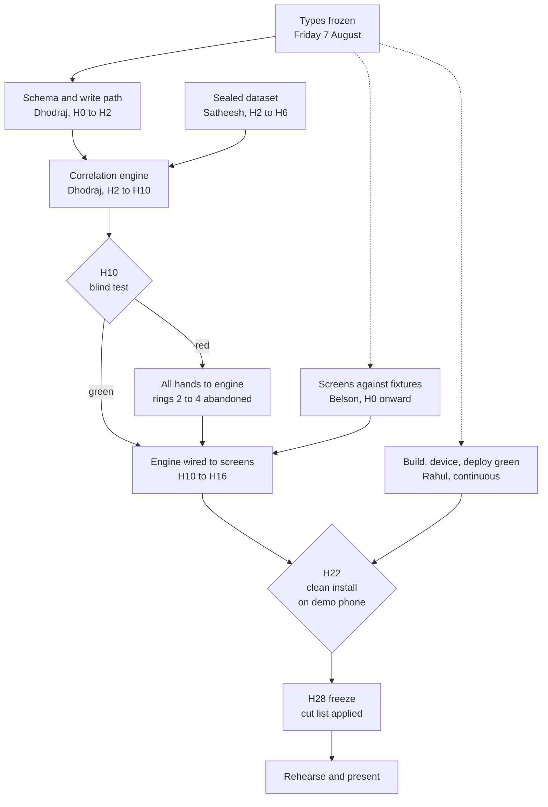

# Build plan

Single source of truth for who builds what and when. If this document and a message in the group disagree, this document wins. If this document is wrong, change it here first.

**Lead:** Dhodraj. One person calls cuts and unblocks. That person is him.
**Build:** Saturday 8 to Sunday 9 August, GRD College. **Prep:** Sunday 2 to Friday 7 August.
**Code** is written in the team repo. **Planning** lives here.

Everything below serves one sentence from the reviewer: *decide now which single one must be working when you demo, and build outward from it.*

---

## 1. The one thing that must be true

**The correlation engine runs, recovers a real lagged relationship it was never told about, and correctly reports nothing on a pair where nothing exists.**

If that is true at the demo, we have a project. If it is not, the other six components are a period tracker with a nice export.

Every decision below follows from protecting it.

### The blind test

The engine needs months of history to find anything, and we have none. So we generate fourteen months for a demo user.

Dhodraj writes the generator, because he is the only one who can. But he does not choose what goes in it. **Satheesh picks the planted pair from a list of six candidates, rolls for the lag and the strength, runs the generator with a random seed, and hands Dhodraj the dataset alone.** The parameters stay sealed in a file only Satheesh has until after the engine has reported.

Blindness needs the author not to know the parameters. It does not need him to not know the code. This version fits the constraint and keeps the claim intact.

That claim is the one sentence in the pitch that cannot be faked: *the person who wrote the engine did not know what was in the data.* Without the split the positive control proves nothing, because the engine author could fit to it without meaning to.

The negative control matters more than the positive one. Any engine can find a pattern. Ours has to be able to say there isn't one.

---

## 2. Who does what

| | Scope | The one rule |
|---|---|---|
| **Dhodraj** | Everything complex. Data model, correlation engine, Worker, D1, Gemini proxy, integration | Never touches the toolchain or the UI. Not once, not for five minutes |
| **Belson** | Frontend only. Every screen, in the order in section 7 | Never blocks on Dhodraj. Codes against the frozen types with hand-written fixtures |
| **Rahul** | DevOps only. Build, deploy, device, CI, secrets, seeding, backups | Owns the sentence "it runs on the demo phone". Nobody else touches that |
| **Satheesh** | Dhodraj's second. Pairs on the engine, takes mechanical work off him, holds the sealed parameters, runs the demo | Reviews every commit Dhodraj makes after hour twenty |

Directory ownership is how four people share one repo without merge conflicts. `src/core/` and `worker/` are Dhodraj's. `src/app/` and `src/ui/` are Belson's. `ops/` and everything CI is Rahul's. Stay inside yours.

Lab report capture has no owner on purpose. It happens only if the hour-22 checkpoint passes early, and it is the first thing cut.

---

## 3. The real risk is that Dhodraj is the only one who can do the hard parts

That is the plan, not a complaint about it. But it means the project has a bus factor of one, and the failure it produces is specific and predictable: **the core developer gets pulled into something that is not core work, and the critical path stops for four hours.**

It is almost never dramatic. It is a Gradle error, an expired token, a broken Capacitor sync, a teammate asking him to look at a CSS bug. Each costs twenty minutes. Six of them cost the engine.

Four rules, and Rahul enforces all of them because he is the only person not cognitively loaded on product code:

**Dhodraj never debugs the build.** Android, Wrangler, npm, certificates, the device. All Rahul, always, even when Dhodraj thinks he can fix it faster himself. He probably can. That is not the point.

**Dhodraj never writes UI.** Not even one card, not even when Belson is behind. If Belson is behind, something gets cut instead.

**Dhodraj commits every hour, minimum.** Nothing that matters lives only on his laptop. A dead battery at hour nineteen should cost sixty minutes, not the weekend.

**Satheesh pairs on the engine from hour two.** Two people who understand it. If Dhodraj is unavailable for any reason at all, Satheesh can still explain it on stage, and explaining it is most of the demo.

---

## 4. Working without sleep

The team has decided not to sleep. Taking that as given, the schedule is built around what actually degrades.

Reaction time and typing hold up reasonably well past twenty hours. Judgement does not. What goes first is the ability to notice that an approach is wrong, which is exactly the skill the engine needs and exactly the skill the last third of a hackathon punishes.

So the work is ordered by how much thinking it takes, not by how the product is structured:

**H0 to H16.** Everything genuinely hard. The engine is finished inside this window or it is not finished at all.
**H16 to H22.** Assembly. Wiring things that already work to each other.
**H22 onward.** Mechanical only. Copy, styling, seeding, rehearsal, deletion.

**Hard rule: no new complex logic after H20.** If it is not working by then it gets cut instead of debugged. This is not a guideline, it is the cut trigger, and Rahul calls it because he will be the clearest-headed person in the room.

Two cheap things that buy back real hours: fifteen minutes off-screen every four hours, which is not sleep and is not optional; and Satheesh reviewing every one of Dhodraj's commits after H20, because error rates roughly double past twenty hours awake and a second pair of eyes is the cheapest insurance available at that point.

---

## 5. Interface contracts, frozen Friday 7 August

This is the part that decides whether the weekend works. Belson cannot build frontend in parallel against types that do not exist. Everything in `src/types/` is frozen Friday evening and nobody changes it during the build without Dhodraj agreeing out loud.

**The log entry.** What a check-in writes and what the engine reads. Dhodraj owns it. Belson and Satheesh need it at hour zero.

**The finding.** What the engine emits: the two variables, the lag in days, the direction, the strength, the observation count, and a confidence band that can fall below the floor. This has the most dependents, so it gets written first. Belson's insight card and the export both render from it.

**The export payload.** Everything the doctor summary renders from.

A finding must be able to say *not enough data* as a value of the type, not as an `if` statement written at three in the morning. The honesty of the whole product lives in that field.

Once these are frozen, Belson builds every screen against hand-written fixtures and never waits for the engine. That is the single most valuable thing the pre-week produces.

---

## 6. Critical path

---

## 7. Sunday 2 to Friday 7 August

Assume two to three hours a night on weekdays. Sunday the 2nd is the only full day before the event and carries more weight than any other day on this plan.

**Before anything else, Dhodraj asks the organizers what pre-event code is permitted.** Both branches are below. We hold to whatever they say, and if the answer is ambiguous we take the stricter reading.

### If pre-event code is permitted

| Day | Dhodraj | Belson | Rahul | Satheesh |
|---|---|---|---|---|
| **Sun 2** | Engine algorithm on paper: per-phase baselines, 1 to 14 day lags, confidence floor, FDR correction. Types drafted | Vite, React and Capacitor building to a real Android phone | Cloudflare account, Pages, Workers, D1 provisioned. Gemini key in Worker secrets | Candidate list of six variable pairs for the blind test |
| **Mon 3** | Dexie schema against the types | Check-in screen, tap only, writing to fixtures | Android SDK verified on all four machines | Test fixtures for every type |
| **Tue 4** | Engine skeleton, baselines working | Insight card against a hand-written finding | GitHub Action building on push | Engine test harness |
| **Wed 5** | Lagged correlation | Export view | One-command deploy. One-command seed load | Clinical copy written and fixed: 90-day sentinel, PHQ-4, GAD-2, crisis text |
| **Thu 6** | Worker, D1 schema, Gemini proxy | Cycle view | Demo phone chosen, set up, wiped, ready | Tele-MANAS 14416 dialled and confirmed live. Demo narrative v1 |
| **Fri 7** | **Types frozen. Engine runs end to end** | Screens merged, all rendering from fixtures | **Green build, deployed, installed on the demo phone** | **Parameters sealed. Dataset handed over** |

If this branch runs, Saturday becomes integration rather than a scramble and the H10 gate moves to H4.

### If pre-event code is not permitted

Same six days, no code, and it matters less than it sounds. Almost everything above that saves time on Saturday is not code.

Types written out in a markdown file. Engine algorithm specified to the point where writing it is transcription. The six candidate pairs chosen and the parameters sealed. Wireframes for all five demo screens. Every word of clinical copy written, because words are not code. Cloudflare account, D1 and Gemini key provisioned, because accounts are not code either. Android toolchain installed and verified on all four machines, because losing four hours on Saturday to a broken SDK has killed better teams than ours.

Then Saturday runs exactly as written in section 8.

---

## 8. Saturday 8 to Sunday 9 August

Clock times assume a 09:00 Saturday start. **Confirm the real start time and shift every row by the difference.**

| | Dhodraj | Belson | Rahul | Satheesh |
|---|---|---|---|---|
| **H0 to H4** Sat 09:00 | Schema live and committed first, so nobody waits. Then engine baselines | Shell, routing, running on a real phone. Then check-in | Build green, demo phone claimed, CI running, seed script working | Types transcribed. Generator parameters sealed |
| **H4 to H10** Sat 13:00 | Engine: lagged correlation, confidence floor, FDR correction | Check-in done. Insight card against fixtures | Deploy pipeline. First signed APK cut as a rollback point | Test harness. Hands the dataset over at H6, then pairs on the engine |
| **H10** Sat 19:00 | **Blind test. See gates below** | continues | continues | Runs the test with Dhodraj, opens the sealed file |
| **H10 to H16** Sat 19:00 | Worker, D1, Gemini phrasing. Engine wired to real screens | Export view rendering real findings | APK every four hours. Offline path verified with the radio off | Seeding scripts, D1 migrations, Gemini prompt wiring |
| **H16 to H22** Sun 01:00 | Integration. Assembly only, no new architecture | Cycle view | Keeps the build green. Records a working run at H22 | Demo script v1 against what exists |
| **H22 to H28** Sun 07:00 | Mechanical only. Reviews, does not architect | Safety layer screens, pasting pre-written copy | Clean-install test, spare device, cables, adapter | Content QA. Every clinical claim on screen checked or removed |
| **H28** Sun 13:00 | **Freeze. Cut list applied. Nothing new after this line** | | | |
| **H28 to H31** | Three full rehearsals on the demo phone, one of them in flight mode | | | |
| **H31 onward** | Buffer. Something will have broken | | | |

---

## 9. Five gates

One checkpoint is a milestone. Five is a plan. Each has a trigger, a decision and a named owner, and each is decided within ten minutes. If people disagree they get five minutes, then Dhodraj calls it.

**H4. The write path.** A check-in writes a real row and the engine can read it back. If not, Belson stops UI work and everyone lands on the write path until it works. Nothing else matters until data can move.

**H10. The blind test.** Dhodraj runs the engine on Satheesh's data and says out loud what it found. Satheesh then opens the sealed file.

- **Green.** The lag is recovered within a day either side, and the null pair returns nothing. Everyone stays on their track.
- **Amber.** The lag is found but the null pair also fires. This is a threshold problem, not an engine problem. Dhodraj raises the confidence floor alone while everyone else continues. Retest at H13.
- **Red.** Nothing found, or the wrong thing found. All hands to the engine. Belson and Satheesh take instruction from Dhodraj, rings 2 to 4 are abandoned that evening, and the demo becomes the engine, the check-in and the export. That is still a project.

**H16. End to end.** A finding produced by the engine renders on a real screen from a real check-in. If not, the cycle view is cut on the spot to buy the hours back.

**H22. Clean install.** Rahul installs the current APK on a wiped phone and the whole path works, including with the radio off. If not, the last good APK becomes the demo build and everything after H22 is polish on top of it.

**H28. Freeze.** Cut list applied, no exceptions, no "it's nearly working". Rahul enforces this one, not Dhodraj, because by then Dhodraj will want to keep going and should not.

---

## 10. If everything goes wrong

Decide this now, while everyone is rested, so that nobody has to decide it at hour thirty.

**The minimum we present:** the engine running on the seeded dataset, showing the recovered lag and the correctly empty null pair, alongside the doctor export as a static file. No app, no phone, no live entry.

That is still an honest demonstration of the only thing we claimed was hard, and it is a better outcome than a broken app being clicked through in front of a jury. Rahul's H22 screen recording exists so that this version is always available.

The spine never gets cut: check-in, engine, insight card, export. If those four are gone there is nothing to present.

**Cut list, in order:** lab capture, then voice entry drops to tap, then the safety layer UI comes off while the logic stays and gets one slide, then the cycle view degrades to a plain list.

Dhodraj calls each cut. Not a vote.

---

## 11. Working rules

**Blocked for twenty minutes, say so.** Sitting quietly with a broken build is the most expensive thing anyone can do this weekend.

**Commit to main every hour.** Small commits, your own directory. No long-lived branches, there is no time to merge them.

**No new dependencies after H10** without Dhodraj agreeing. An `npm install` that breaks the build at hour twenty is how teams lose.

**Nothing on a crisis path is generated.** Fixed text, real numbers, written in the pre-week. This is the one rule with no exceptions.

**One phone is the demo phone,** and it is tested on from hour two. Not an emulator.

**Nobody interrupts Dhodraj with anything Rahul could answer.** Route it through Rahul first.

---

## 12. Risks

| Risk | Owner | Trigger | Response |
|---|---|---|---|
| Dhodraj pulled into toolchain or UI work | Rahul | Any | Rahul takes it back, immediately, even mid-sentence |
| Engine finds nothing real | Dhodraj | H10 red | All hands to engine, rings 2 to 4 abandoned |
| Engine fires on the null pair | Dhodraj | H10 amber | Raise the confidence floor, retest H13 |
| Belson blocked waiting on the engine | Belson | Any | He should not be. Fixtures exist from Friday. If he is, the types were not frozen properly |
| Capacitor or Android build breaks | Rahul | Any | Fall back to the PWA in a mobile browser and say so on stage rather than hiding it |
| Gemini quota or latency | Dhodraj | Any | Pre-generated phrasing on the demo path. The engine is what we are showing, not the wording |
| Judgement degrading past H20 | Rahul | H20 | No new complex logic. Cut instead of debug. Satheesh reviews every commit |
| Demo device fails on stage | Satheesh | Sunday | H22 screen recording, spare device, and the section 10 fallback |
| Lab OCR eats Sunday | whoever picked it up | Sun 11:00 | It was optional. Drop it without discussion |

---

## 13. The demo, five minutes

1. Her problem, in her words. Twenty seconds, no slides
2. Log one entry live on the phone
3. The seeded user's insight card. The recovered finding, with its uncertainty stated
4. **The null pair. The engine reports that it found nothing.** Then explain that the person who wrote the engine did not know what was in the data
5. The doctor export
6. What we cut and why, briefly, because it is the strongest thing about us

Satheesh owns the laptop, the cable, the adapter, the spare device, and the recording of a working run.

---

## 14. Definition of done

A thing is done when it runs on the demo phone from a clean install, works with the radio off if it is meant to, and someone other than the author has used it without being told how.

Not when it works on your laptop.

---

## 15. Open items

- [ ] **Confirm the hackathon start time.** Every clock time above shifts with it
- [ ] **Ask the organizers what pre-event code is permitted.** Section 7 has both branches
- [ ] **Three collaborator invites are unaccepted.** Belson, Rahul, Satheesh, from GitHub notifications
- [ ] **The team repo is private and the organizers' own README says to keep it public.** Ask which is right
- [ ] Android toolchain installed and verified on all four machines before Friday
- [ ] Demo phone chosen and wiped
- [ ] Confirm the four scopes in section 2 with all four people

---

*Problem, architecture and evidence: [proposal.md](./proposal.md). Requirements: [PRD](../product/00-PRD.md). Why ten features were cut: [feasibility audit](../research/05-feasibility-audit/). Clinician review: [clinician-review-brief.md](./clinician-review-brief.md).*

*Code is built in the team repo, [Build-with-AI-Code-for-Communities/health-team-311-war-room](https://github.com/Build-with-AI-Code-for-Communities/health-team-311-war-room). Planning stays here.*
