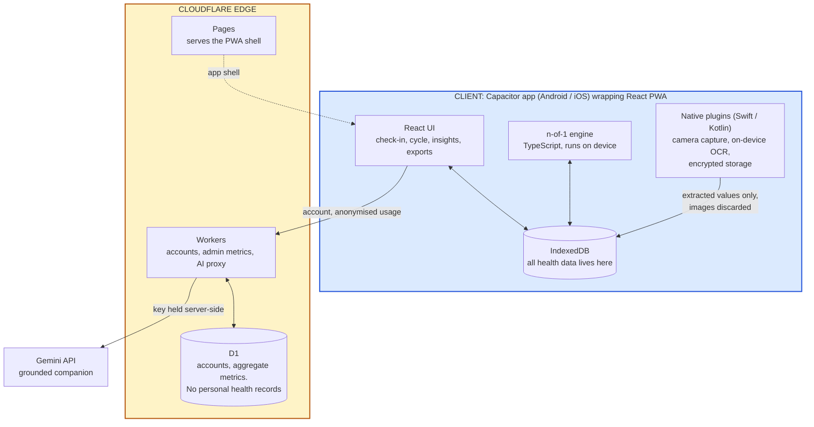

# Project proposal: submission copy

**Deadline: Saturday 1 August 2026, 11:59 PM IST.**

Team: War Room. Track: AI for Good Health & Well-being.

---

## Project name

**PMOS Companion** (working name)

---

## Problem statement

A woman notices her periods have stopped being predictable. Then the acne starts, and the hair thinning, and a tiredness that sleep does not fix. She downloads a period app, because that is what you do. It asks when her last period was, assumes a 28-day cycle, and a few weeks later tells her she is 47 days late. It will keep telling her that, every day, until she deletes it.

She sees a doctor. She is told it is stress, or to lose some weight. Seven months later, on average in India, she gets a name for it. The appointment that gives her the diagnosis gives her almost nothing else, because the clinical conversation is about fertility: come back when you want a baby. She is 24 and does not want a baby. She wants to know why she is exhausted.

So she manages it herself. She reads Reddit. She buys inositol because a stranger said it worked. She takes it for six months and never finds out whether it did anything, because nothing she uses can connect what she takes to how she feels. A year later she sits in front of a doctor for seven minutes and tries to summarise eighteen months of her life from memory.

**This is the problem: the condition is lifelong and systemic, but every tool she has treats it as an event, and nothing accumulates.** She generates a year of relevant data and arrives at the clinic with none of it.

### Scale, with sources

| Claim | Figure | Source |
|---|---|---|
| Prevalence | 10 to 13% of women globally, roughly 1 in 8, with up to 70% undiagnosed | [WHO fact sheet, Jan 2026](https://www.who.int/news-room/fact-sheets/detail/polycystic-ovary-syndrome). Pooled meta-analysis: 7.9% under NIH criteria, 12.1% Rotterdam ([Hum Reprod Update 2026](https://academic.oup.com/humupd/article/32/3/277/8424333)) |
| Sleep apnoea | Substantially more common than in women without PMOS. Pooled prevalence around 37%, odds ratio 9.52. We avoid a direct headline comparison because OSA prevalence varies by age, BMI, sex, ethnicity and diagnostic method | [Frontiers in Endocrinology, 2025 meta-analysis](https://www.frontiersin.org/journals/endocrinology/articles/10.3389/fendo.2025.1532519/full) |
| Anxiety and depression | ~6x and ~4x general population; 75% and 58% elevated screening scores | [Body image and mental health in PCOS, PMC](https://www.ncbi.nlm.nih.gov/pmc/articles/PMC12176914/) |
| Prevalence in India | Ranges from 13.6% to 19.6% depending on the diagnostic criteria used, AE-PCOS and Rotterdam respectively | [ICMR national survey, JAMA Netw Open 2024](https://pmc.ncbi.nlm.nih.gov/articles/PMC11581580/), n=8,993, stratified sampling across 8 states |
| Body-image distress | Significantly worse than controls on every MBSRQ-AS subscale, persisting after adjustment for BMI, and mediating the elevated anxiety and depression | [Meta-analysis, Eur J Endocrinol 2023](https://academic.oup.com/ejendo/article/189/2/R1/7250436) and [Alur-Gupta, Fertil Steril 2019](https://pubmed.ncbi.nlm.nih.gov/31395311/). One 587-woman survey found 84.5% in the pathological range on appearance evaluation ([Hofmann 2025](https://pmc.ncbi.nlm.nih.gov/articles/PMC12176914/)), though that sample was self-selected and uncontrolled |
| Diagnostic delay | ~7 months average in India; 2 months to 13 years in focus groups | [Think Global Health](https://www.thinkglobalhealth.org/article/india-unprepared-pcos-crisis) |

### Why this is solvable now, and was not before

In May 2026, a Monash-led global consensus published in The Lancet renamed PCOS to **PMOS, Polyendocrine Metabolic Ovarian Syndrome**. It ran fourteen years, involved 56 organisations, and surveyed more than 14,300 people living with the condition. The rename exists specifically to reject the old framing: this is a lifelong metabolic and endocrine condition, not a cysts-and-fertility problem. ([Lancet, 12 May 2026](https://www.thelancet.com/journals/lancet/article/PIIS0140-6736(26)00717-8/fulltext))

NICE has already adopted the name. Guideline [GID-NG10436](https://www.nice.org.uk/guidance/indevelopment/gid-ng10436) is titled *Polyendocrine Metabolic Ovarian Syndrome*, its consultation is open from 1 July to 11 August 2026, and publication is expected 9 December 2026.

Medicine has redefined the condition. No product has caught up. Every app on the market is still built for the old definition, and that gap is the opening.

### What she asks for

Women with PMOS consistently describe assembling their own picture across several apps and a notes file, logging cycles, food, supplements, mood, sleep and skin, to work out what affects *them* specifically.

A peer-reviewed analysis of 70,685 reviews of the leading cycle apps found users complaining that these apps track symptoms but "do not explain how they correlate to your cycle", and that their charts cannot be customised or correlated across cycles ([JAMIA Open, 2021](https://doi.org/10.1093/jamiaopen/ooab013)). In community threads about what a PMOS app should do, the most-upvoted requests are for one place to log lifestyle changes alongside symptoms and see how they relate.

We should be straight about where this sits. The largest survey of what women with this condition want from an app (n=264) ranked **trustworthy, evidence-based information** as the most important feature, ahead of tracking ([Seminars in Reproductive Medicine, 2018](https://pubmed.ncbi.nlm.nih.gov/30189452/)). Correlation is a real and repeatedly expressed need, but it is not the top-ranked one. That is why the product does both: the evidence-graded library and grounded companion answer the first need, and the n-of-1 engine answers the second.

PMOS is an n-of-1 condition, where what works differs substantially between individuals, and no product personalises.

---

## Who it helps

**Primary.** Indian women aged 18 to 35 with PMOS, diagnosed or suspecting it, phone-first, on mid-range Android. India's national survey puts prevalence at 13.6 to 19.6% depending on criteria, so this is not a niche.

**Secondary.** Her clinician, who never opens the app but receives its output. A seven-minute outpatient consultation cannot reconstruct eighteen months of symptoms.

**Excluded at launch: users under 18.** India's DPDP Act treats anyone under 18 as a child and prohibits profiling of children, and our correlation engine is profiling. This costs us a group where the condition often first presents, and we are choosing to bear that cost rather than breach the Act. Serving them properly requires a verifiable-parental-consent framework, which is funded roadmap work rather than something to improvise.

---

## Proposed solution

An app she opens for thirty seconds a day, which turns that into an explanation of her own body and a record she can hand to a doctor.

**What it does for her, ordered by how much it matters:**

**1. It stops telling her she is broken.** The cycle view is built for irregularity. A 47-day cycle reads as "day 47 of your usual 30 to 60 range", never as a failure. There is no "late" badge anywhere in the product. For someone who has deleted three apps over exactly this, that alone is why she stays.

**2. It gives her a record from week one.** Her symptom timeline becomes something structured and shareable long before any pattern emerges. Four weeks in, she can walk into an appointment with an actual history instead of trying to remember.

**3. It tells her what affects her.** Daily logging feeds an engine that finds *her* correlations and states its own uncertainty: *"your skin flares two to three days after nights under six hours, based on 12 observations, weak signal."* When there is not enough data it says so rather than inventing something.

**4. It answers "did that supplement work?"** Experiment Mode runs a pre-declared outcome over 8 to 12 weeks with a washout period and returns a verdict. "No detectable change" is a valid result and we show it. She has never been able to get this answer anywhere.

**5. It walks into the consultation with her.** One tap produces a doctor-ready PDF: cycle history, interval statistics, symptom timeline, medication log, and the tests she can ask for by name.

**6. It catches what everyone else misses.** A sentinel prompts review when cycles exceed 90 days, because prolonged anovulation exposes the endometrium to unopposed oestrogen. Its behaviour was specified with a clinician: it says "please discuss this with your healthcare provider", it first asks whether pregnancy is possible, whether she is taking hormonal medication, and whether she is already under treatment for irregular periods, and it reminds again after two to four weeks if no period is logged, with a snooze. Mental-health screening runs monthly and on demand. Sleep apnoea gets a screen-and-refer.

**7. The camera does the typing for her.** Photograph a printed lab report and the values land in her record and flow into the doctor export. Photograph a medicine strip and it identifies what she has been given, logs it, and explains in plain language what it is for and what to expect, which matters in a system where strips are handed over with no explanation. Skin tracking sits here too, off by default.

This replaced an earlier plan to measure heart rate from the camera. A clinician reviewing this proposal asked what a resting heart rate would actually tell a woman with PMOS, and the honest answer is nothing that changes her care. We cut it. The camera now removes work rather than generating a number nobody would act on.

**8. It connects her to someone, on her terms.** Isolation is one of the most consistent themes in this condition. She can nominate a support circle, anyone she chooses, and tap once to send "thinking of you, call me?" Her supporter can also opt into a recurring check-in reminder that fires on a fixed schedule. Alongside this sit simple routine nudges for hydration, movement and medication timing.

Throughout: weight is opt-in behind a permission prompt rather than a headline metric, there is no calorie counting, and we sell no supplements, which is precisely why we can grade evidence honestly.

### The support circle, and why it is built the way it is

The obvious version of this feature is an app that detects low mood and alerts her family. We will not build that, and the reason is a design position worth stating.

A women's health app that notifies a third party about her emotional state can be turned into a monitoring tool by whoever holds the other end. A controlling partner who set up the link during onboarding receives alerts about her mood and she cannot disable it without a confrontation. Defaulting the contact by marital status, parents if unmarried and spouse if married, makes it worse, because it assumes her confidant is determined by her status rather than her choice, and it fails every woman estranged from her family or unsafe in her marriage.

So the design inverts it. **She initiates, always.** Her supporter sees only that she would like to hear from them, never a mood, a score or a symptom. She chooses anyone, or nobody, and can change it silently with no notification to the person removed. The optional recurring reminder to her supporter fires on a fixed schedule regardless of how she is, so it produces the phone call without carrying any information about her state.

The emotional value survives. The surveillance capability never exists. We would rather ship the version that cannot be misused than the version that demonstrates better in a two-minute pitch.

### How it holds her attention before the patterns arrive

The correlation engine needs data before it can say anything confident, and health apps typically lose most users in the first month. So value is laddered rather than deferred:

| When | What she gets |
|---|---|
| Day 1 | A cycle view that does not shame her. The reason she stops deleting apps |
| Week 1 | A structured symptom timeline she can already read and share |
| Week 4 | A doctor-ready export for her next appointment |
| Week 6+ | First weak-signal observations, stated honestly |
| Month 3+ | Confident patterns and experiment verdicts |

Patterns are the reward for staying, not the price of entry. Logging is never streak-gated and lapses are never punished, because a cohort with 4x depression rates will lapse and shame accelerates uninstalls.

---

## What we are building

Nine modules. The five marked MVP are the build-weekend target.

| Module | What it is |
|---|---|
| **Onboarding and consent** MVP | Age gate, granular per-class consent |
| **Daily check-in** MVP | One screen, ~12 curated dimensions, 30 seconds, pause mode that never guilts her |
| **Cycle view** MVP | Irregular-native timeline, interval distribution, bleeds per year |
| **Insights** MVP | Weekly pattern reveal with observation counts and confidence, or an honest "still learning" |
| **Lab report capture** MVP | Photograph a printed report, values extracted on device, confirmed by her before saving, then carried into the doctor export |
| Medicine strip capture | Photograph a strip, identify the medication, log it, explain what it is for and what to expect |
| Doctor exports | One-page summary and full cycle history PDF |
| Experiments | Pre-declared outcome, baseline, washout, verdict |
| Safety layer | PHQ-4 and GAD-2 monthly or user-initiated. Immediate escalation on any suicidality or self-harm response, routed to Tele-MANAS, then prompting her to contact a trusted person or her clinician, with a single check-in nudge after 24 hours. Sleep-apnoea screen. 90-day cycle sentinel |
| Companion | Evidence-grounded question answering with citations |
| Support circle | User-initiated outreach to a self-chosen contact, state-independent check-in reminders, routine nudges for hydration and medication |
| Emotional continuity | "You have felt this way six times before and it lifted within four days", drawn from her own history. Progress measured in cycle variance and questions asked, never in weight. An anonymous daily count of others logging the same symptom |
| Skin tracking (fully optional) | Off by default. If she turns it on, we state plainly at that moment: no beauty or attractiveness scores, no cross-user comparison, no before-and-after collages. She can turn it off and delete everything at any time |
| Being understood | A shareable plain-language card explaining the condition so she does not have to. Scripts for hard conversations with an employer, a relative or a dismissive clinician. A post-appointment debrief that explains what the doctor actually said |
| Discretion | Neutral app naming and a fast exit, for users whose phones are not private |

The last four modules share one idea: **the product supports the person, not just the condition.** Most of the burden of PMOS is not clinical. It is explaining yourself repeatedly, doing everything right and seeing nothing change in the mirror, being asked about your fertility by relatives, and having a bad day that feels permanent. Two of these cost us very little to build, because they reuse machinery we already need. Telling her "you have felt this way before and it passed" is the correlation engine pointed at mood rather than skin, and it is something no competitor can say, because none of them holds her history.

---

## High-level architecture

Three tiers. The organising principle: **her health data stays on her phone, and only what is needed for accounts and operations crosses the network.**



### Plain-text version

```
CLIENT   Capacitor app (Android/iOS) wrapping a React PWA
         - React UI: check-in, cycle view, insights, exports
         - n-of-1 correlation engine (TypeScript) runs ON DEVICE
         - IndexedDB holds ALL health data. App works fully offline
         - Native plugins (Swift/Kotlin): camera capture, on-device OCR,
           encrypted local storage
                    |
                    |  accounts + anonymised usage metrics only
                    |  NO personal health records cross this line
                    v
EDGE     Cloudflare
         - Pages ....... serves the PWA shell
         - Workers ..... accounts, admin metrics, AI proxy
         - D1 .......... user accounts, aggregate product metrics
                    |
                    v
AI       Gemini API called FROM the Worker, key never on the client
```

### What runs where, and why

| Concern | Where | Why |
|---|---|---|
| Camera images | Device, discarded after the values are extracted | Nothing is gained by moving them and a great deal is risked |
| All health records | Device, IndexedDB | The app must work offline, and her log never has to leave |
| Correlation engine | Device | It reads her full history. Keeping it local means the raw log stays local |
| Accounts, admin metrics | Cloudflare Workers to D1 | We need user management and product analytics. Neither requires her health data |
| Grounded companion | Worker calls Gemini | **The API key lives in a Worker secret binding and never ships to the client** |
| PDF generation | Client-side in the MVP | Avoids a Worker CPU timeout on long histories |

**Multi-device sync is deliberately out of the MVP.** Offline-first bidirectional sync with conflict resolution is a genuinely hard problem, and a half-built version fails visibly. Single device for the hackathon, sync designed properly afterwards.

**Health Connect and HealthKit are out entirely.** Since we require no wearable, the only thing those APIs would give us is phone step count, which does not justify a native plugin plus a Play Console health-data declaration and its review latency. Movement is logged in the check-in.

### One constraint that shaped the design

No third-party app on iOS or Android can capture camera frames in the background or on device unlock. That is an operating-system privilege, not something an SDK unlocks, and it is why we never designed anything ambient or passive. Every camera action in this product is something she deliberately starts, and every image is processed on the device and discarded once the values are read.

We established this before writing code rather than discovering it mid-build.

---

## Tech stack

Chosen for what four people can ship in a weekend and still run afterwards.

| Layer | Choice | Why |
|---|---|---|
| Frontend | React 18, TypeScript, Vite, Tailwind | The team's existing stack. No learning curve |
| Client shell | Capacitor 6 | One codebase for web, Android and iOS. Sensing runs in native plugins |
| Local store | IndexedDB via Dexie | Offline-first. Fully usable with no network |
| Hosting | **Cloudflare Pages** | Git-push deploys, global CDN, free tier |
| API | **Cloudflare Workers** | Serverless. Nothing to operate during a 36-hour build. Edge presence in India |
| Database | **Cloudflare D1** | Serverless SQLite for accounts and aggregate metrics |
| Secrets | Worker secret bindings | The Gemini key never reaches the client |
| **Google / AI** | **Gemini API** for the grounded companion, retrieval over a curated guideline corpus with citations. **Gemini Nano** for on-device inference where hardware supports it | |
| Native | Swift and Kotlin plugins for camera capture, on-device OCR and encrypted storage | |
| Text recognition | On-device OCR via ML Kit, with a curated Indian medicine and lab-analyte vocabulary for post-correction. Values are always shown for her confirmation before saving | Printed-page recognition is mature and reliable, unlike real-time signal processing, and every extracted value stays on the device |
| Correlation engine | Interpretable time-series statistics in TypeScript: per-user baselines, lagged cross-correlation, bootstrap confidence intervals, false-discovery-rate correction | Explainable to her and defensible to her doctor |
| Testing | Unit tests on the correlation engine against synthetic series with known correlations and known noise; OCR checked against a fixed set of real Indian lab reports and medicine strips, measuring both extraction accuracy and how often it wrongly claims confidence | An engine that finds patterns in pure noise is worse than useless, and an OCR that misreads a dose is worse than one that admits it cannot read |

**On the two AI decisions.** The LLM handles language, not inference about her body. Gemini answers questions and explains evidence; it never computes a pattern, scores a risk or suggests a dose. The correlation engine is deterministic statistics precisely because every insight must survive "how do you know that?"

**On statistical honesty.** Testing many lag-and-symptom pairs will surface spurious correlations by chance, so the engine applies false-discovery-rate correction and reports observation counts alongside every claim. We would rather show "still learning" than a confident result that is noise.

---

## Scope discipline

The workshop made the point that the demo which impresses on Sunday often cannot survive Monday. We ran a feasibility audit against platform policy, primary literature and store guidelines before committing, and cut features that would not have survived:

- **Camera heart rate, passive and active.** The passive version is blocked on iOS, Android and web, being an OS-vendor privilege. The active version we did plan was removed after clinical review, because resting heart rate is not a PMOS marker and would not change her care.
- **Blood oxygen and blood pressure from the camera.** App Store guideline 1.4.1 forbids both by name, and phone sensors lack the wavelengths oximetry requires.
- **Overnight ballistocardiography, facial-expression stress inference, voice mood biomarkers, automated hirsutism scoring.** Each fails on evidence rather than policy.
- **CGM integration.** One vendor is not sold in India, the other publishes no legal third-party API, and it costs about ₹8,400 a month regardless.
- **Multi-device sync and platform health-store integration.** Cut from the MVP on effort-to-value grounds, as above.

### Demo plan and fallback

Camera capture is built and tested on all four team members' phones by Saturday afternoon. Printed-page recognition is far more predictable than the real-time signal processing we originally planned, but lighting and print quality still vary, so we hold a validated device and a pre-captured report as a fallback. Nothing in the demo depends on a single feature working: the check-in, the pattern reveal and the doctor export each stand alone.

---

## Beyond the weekend

We are not starting from zero, though we want to be precise about what that means.

One of us built and runs **mycyclesafe.ai**, an AI cycle tracker on the same stack this product will use: Astro, Cloudflare, Firebase. It was built as a cause rather than a commercial product, has never been marketed, and carries no account system or analytics, so we have no basis on which to claim traction either way. Site traffic runs at a few dozen visitors a day across 52 countries, with almost no Indian audience.

What it gives us is not distribution. It is a live deployment in exactly this domain, infrastructure and a codebase we already operate, and first-hand experience of where cycle prediction breaks down, which is what pointed us at this problem. Every irregular cycle that our own predictor gets wrong is a user the category is failing.

PMOS Companion is the product. mycyclesafe is the reason we know it needs to exist. If it later becomes a route to early users, any cross-promotion would need fresh purpose-bound consent under DPDP rather than inherited consent.

Before any pilot with real users we will seek a **CDSCO pre-submission classification opinion**. Running validated screening instruments and escalating on a clinical threshold may place this above the wellness-software line, and we would rather establish that before building than during licensing. The mental-health escalation pathway, including cadence, follow-up and named clinical oversight, is a pilot prerequisite we are treating as design work rather than a detail.

---

## Clinical review

A practising clinician has reviewed this proposal. Their input changed it in five places.

- **The sleep-apnoea comparison was removed.** We previously led with "37% against 6%". OSA prevalence varies by age, BMI, sex, ethnicity and diagnostic method, so a direct headline comparison is not sound. We now say substantially more common, and give the pooled figure with its caveat.
- **Indian prevalence is stated as a range**, 13.6% to 19.6%, tied to the diagnostic criteria, rather than a single number.
- **The 90-day sentinel was approved** as a reasonable threshold for prompting review, and its behaviour was specified: ask about pregnancy, hormonal medication and existing treatment before anything else, use "please discuss this with your healthcare provider", and repeat after two to four weeks with a snooze.
- **The mental-health protocol was specified**: monthly or user-initiated screening, immediate escalation on any suicidality or self-harm response, and after showing Tele-MANAS, prompt her to contact a trusted person or clinician, with one nudge after 24 hours. The clinician was explicit that this is the appropriate scope for now and that we should not build more than this.
- **The screen-and-refer language was confirmed** as improved over an earlier draft that claimed to "find patterns".

They also challenged the camera heart-rate feature directly, asking what it would tell a woman with PMOS. We agreed and removed it. The camera now captures lab reports and medicine strips instead, which serves the doctor-advocacy work the same clinician endorsed.

One item remains open. They have not yet formed a view on the CDSCO classification question, so our position stands as stated: we will seek a pre-submission opinion rather than assume the answer.

## Supporting documents

This proposal is a summary. Detail sits in a Product Requirements Document covering 102 functional, 48 non-functional and 14 regulatory requirements with four architecture decision records; a data model; a feasibility audit recording every removed feature and the evidence behind it; and a full feature specification. These will be in the project repository.

---

## Team

| Name | GitHub |
|---|---|
| Dhodraj Sundaram | [dhodraj](https://github.com/dhodraj) |
| Belson Johnson | [Belsonselva](https://github.com/Belsonselva) |
| Rahul Ramakrishnan | [Rahul-ramakrishnan06](https://github.com/Rahul-ramakrishnan06) |
| Satheeshkumar | [SatheeshKumarSSK](https://github.com/SatheeshKumarSSK) |

**Staying overnight:** yes, all four.

**MSI raffle:** yes, entering.

---

## Anticipated jury questions

1. **Why does the camera read documents rather than vital signs?** We planned camera heart rate and cut it. A clinician asked what a resting heart rate would tell a woman with PMOS, and it is not a marker for this condition, not in the guideline, and would not change her care. Reading her lab report and her medicine strip removes real work and makes the doctor export better, which is where this product is strongest.
2. **Can four people build this in a weekend?** Five screens and one loop, after cutting sync and platform health integrations. The correlation engine is classical statistics. The infrastructure is serverless, so nothing is spent on operations.
3. **Why does she still use it on day 35 when there is no pattern yet?** Because the cycle view is useful on day one and the export is useful by week four. Patterns are the reward for staying, not the entry price.
4. **Is it a medical device?** We position as screen-and-refer, with no diagnosis, no likelihood scores and no dosing. We will seek a CDSCO pre-submission classification opinion before any pilot rather than assume the answer.
5. **What stops a competitor copying it?** Honestly, the engine is standard statistics and could be replicated. The harder parts are the domain judgement about what to screen for, the clinical safety layer, India-native execution, zero-commerce evidence grading which supplement-funded rivals structurally cannot match, and an existing distribution channel. The features built on her own accumulated history, telling her a feeling has passed before, are the ones a new entrant cannot ship on day one at any budget.
6. **What is the biggest risk?** Retention, which is what kills consumer health apps, made harder by a cohort with elevated depression rates. Our answer is the value ladder above, and it is the metric we would watch first.
7. **You already run a cycle app. How many users does it have?** We cannot tell you, because it has no account system or analytics. Site traffic is a few dozen visitors a day. It was built as a cause, never marketed, and we are not presenting it as traction. It gives us a working deployment in this domain and the stack we will build on, nothing more.
8. **Why not notify her family when she is struggling, since that would drive engagement?** Because the same mechanism lets someone monitor her, and we cannot control who holds the other end. Our support circle is user-initiated, discloses no state to the contact, and its scheduled reminders are independent of how she is feeling. We took the version that cannot be misused over the version that demos better.
