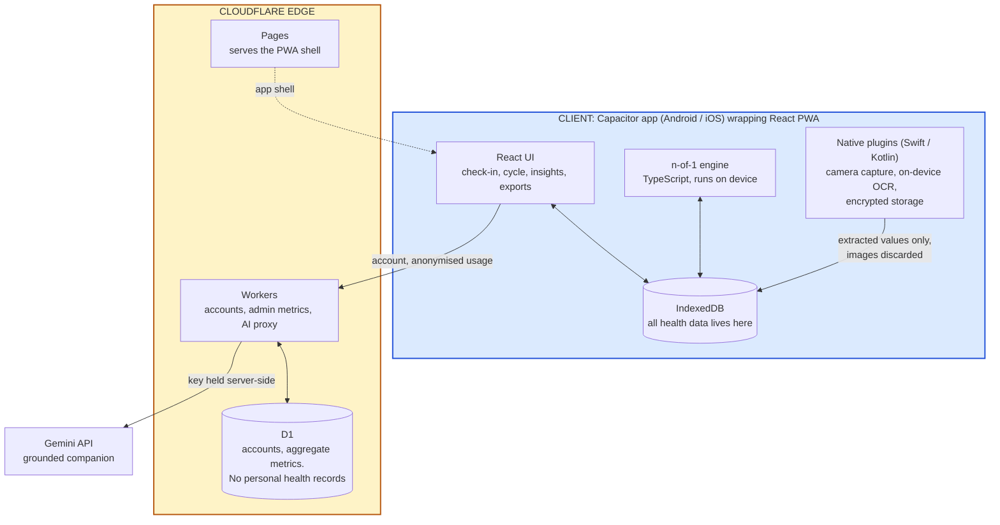

# Project proposal: full version

> **For submission, use [proposal-short.md](./proposal-short.md).** A first-round jury triaging dozens of teams will skim, and a long document risks reading as over-engineered before it reaches the parts that prove otherwise. This full version is the appendix: the reasoning, the sourcing and the decisions behind the short one.

**Deadline: Saturday 1 August 2026, 11:59 PM IST.**

Team: War Room. Track: AI for Good Health & Well-being.

---

## Project name

**PMOS Companion** (working name)

---

## Problem statement

A woman notices her periods have stopped being predictable. Then the acne starts, and the hair thinning, and a tiredness that sleep does not fix. She downloads a period app, because that is what you do. It asks when her last period was, assumes a 28-day cycle, and a few weeks later tells her she is 47 days late. It will keep telling her that, every day, until she deletes it.

She sees a doctor. She is told it is stress, or to lose some weight. Seven months later, on average in India, she gets a name for it. The appointment that gives her the diagnosis gives her almost nothing else, because the clinical conversation is about fertility: come back when you want a baby. She is 24 and does not want a baby. She wants to know why she is exhausted.

So she manages it herself. She reads Reddit. She buys inositol because a stranger said it worked. She takes it for six months and never finds out whether it did anything, because nothing she uses can connect what she takes to how she feels. A year later she sits in front of a doctor for seven minutes and tries to summarise eighteen months of her life from memory.

**This is the problem: the condition is lifelong and systemic, but every tool she has treats it as an event, and nothing accumulates.** She generates a year of relevant data and arrives at the clinic with none of it.

### Scale, with sources

| Claim | Figure | Source |
|---|---|---|
| Prevalence | 10 to 13% of women globally, roughly 1 in 8, with up to 70% undiagnosed | [WHO fact sheet, Jan 2026](https://www.who.int/news-room/fact-sheets/detail/polycystic-ovary-syndrome). Pooled meta-analysis: 7.9% under NIH criteria, 12.1% Rotterdam ([Hum Reprod Update 2026](https://academic.oup.com/humupd/article/32/3/277/8424333)) |
| Sleep apnoea | Substantially more common than in women without PMOS. Pooled prevalence around 37%, odds ratio 9.52. We avoid a direct headline comparison because OSA prevalence varies by age, BMI, sex, ethnicity and diagnostic method | [Frontiers in Endocrinology, 2025 meta-analysis](https://www.frontiersin.org/journals/endocrinology/articles/10.3389/fendo.2025.1532519/full) |
| Anxiety and depression | ~6x and ~4x general population; 75% and 58% elevated screening scores | [Body image and mental health in PCOS, PMC](https://www.ncbi.nlm.nih.gov/pmc/articles/PMC12176914/) |
| Prevalence in India | Ranges from 13.6% to 19.6% depending on the diagnostic criteria used, AE-PCOS and Rotterdam respectively | [ICMR national survey, JAMA Netw Open 2024](https://pmc.ncbi.nlm.nih.gov/articles/PMC11581580/), n=8,993, stratified sampling across 8 states |
| Body-image distress | Significantly worse than controls on every MBSRQ-AS subscale, persisting after adjustment for BMI, and mediating the elevated anxiety and depression | [Meta-analysis, Eur J Endocrinol 2023](https://academic.oup.com/ejendo/article/189/2/R1/7250436) and [Alur-Gupta, Fertil Steril 2019](https://pubmed.ncbi.nlm.nih.gov/31395311/). One 587-woman survey found 84.5% in the pathological range on appearance evaluation ([Hofmann 2025](https://pmc.ncbi.nlm.nih.gov/articles/PMC12176914/)), though that sample was self-selected and uncontrolled |
| Diagnostic delay | ~7 months average in India; 2 months to 13 years in focus groups | [Think Global Health](https://www.thinkglobalhealth.org/article/india-unprepared-pcos-crisis) |

### Why this is solvable now, and was not before

In May 2026, a Monash-led global consensus published in The Lancet renamed PCOS to **PMOS, Polyendocrine Metabolic Ovarian Syndrome**. It ran fourteen years, involved 56 organisations, and surveyed more than 14,300 people living with the condition. The rename exists specifically to reject the old framing: this is a lifelong metabolic and endocrine condition, not a cysts-and-fertility problem. ([Lancet, 12 May 2026](https://www.thelancet.com/journals/lancet/article/PIIS0140-6736(26)00717-8/fulltext))

NICE has already adopted the name. Guideline [GID-NG10436](https://www.nice.org.uk/guidance/indevelopment/gid-ng10436) is titled *Polyendocrine Metabolic Ovarian Syndrome*, its consultation is open from 1 July to 11 August 2026, and publication is expected 9 December 2026.

Medicine has redefined the condition. No product has caught up. Every app on the market is still built for the old definition, and that gap is the opening.

### What she asks for

Women with PMOS consistently describe assembling their own picture across several apps and a notes file, logging cycles, food, supplements, mood, sleep and skin, to work out what affects *them* specifically.

A peer-reviewed analysis of 70,685 reviews of the leading cycle apps found users complaining that these apps track symptoms but "do not explain how they correlate to your cycle", and that their charts cannot be customised or correlated across cycles ([JAMIA Open, 2021](https://doi.org/10.1093/jamiaopen/ooab013)). In community threads about what a PMOS app should do, the most-upvoted requests are for one place to log lifestyle changes alongside symptoms and see how they relate.

We should be straight about where this sits. The largest survey of what women with this condition want from an app (n=264) ranked **trustworthy, evidence-based information** as the most important feature, ahead of tracking ([Seminars in Reproductive Medicine, 2018](https://pubmed.ncbi.nlm.nih.gov/30189452/)). Correlation is a real and repeatedly expressed need, but it is not the top-ranked one. That is why the product does both: the evidence-graded library and grounded companion answer the first need, and the n-of-1 engine answers the second.

PMOS is an n-of-1 condition, where what works differs substantially between individuals, and no product personalises.

---

## Who it helps

**Primary.** Indian women aged 18 to 35 with PMOS, diagnosed or suspecting it, phone-first, on mid-range Android. India's national survey puts prevalence at 13.6 to 19.6% depending on criteria, so this is not a niche.

**Secondary.** Her clinician, who never opens the app but receives its output. A seven-minute outpatient consultation cannot reconstruct eighteen months of symptoms.

**Excluded at launch: users under 18.** India's DPDP Act treats anyone under 18 as a child and prohibits profiling of children, and our correlation engine is profiling. This costs us a group where the condition often first presents, and we are choosing to bear that cost rather than breach the Act. Serving them properly requires a verifiable-parental-consent framework, which is funded roadmap work rather than something to improvise.

---

## Proposed solution

An app she opens for thirty seconds a day, which turns that into an explanation of her own body and a record she can hand to a doctor.

**What it does for her, ordered by how much it matters:**

**1. It stops telling her she is broken.** The cycle view is built for irregularity. A 47-day cycle reads as "day 47 of your usual 30 to 60 range", never as a failure. There is no "late" badge anywhere in the product. For someone who has deleted three apps over exactly this, that alone is why she stays.

**2. She can speak it instead of typing it.** The daily check-in takes voice, transcribed on the device, for anyone who would rather talk than fill a form at the end of a long day. English in Phase 1; Hindi and Tamil follow.

**3. It gives her a record from week one.** Her symptom timeline becomes something structured and shareable long before any pattern emerges. Four weeks in, she can walk into an appointment with an actual history instead of trying to remember.

**4. It tells her what affects her.** Daily logging feeds an engine that finds *her* correlations and states its own uncertainty: *"your skin flares two to three days after nights under six hours, based on 12 observations, weak signal."* When there is not enough data it says so rather than inventing something.

**5. It answers "did that supplement work?"** Experiment Mode runs a pre-declared outcome over 8 to 12 weeks with a washout period and returns a verdict. "No detectable change" is a valid result and we show it. She has never been able to get this answer anywhere.

**6. It walks into the consultation with her.** One tap produces a doctor-ready PDF: cycle history, interval statistics, symptom timeline, medication log, and the tests she can ask for by name.

**7. It catches what everyone else misses.** A sentinel prompts review when cycles exceed 90 days, because prolonged anovulation exposes the endometrium to unopposed oestrogen. Its behaviour was specified with a clinician: it says "please discuss this with your healthcare provider", it first asks whether pregnancy is possible, whether she is taking hormonal medication, and whether she is already under treatment for irregular periods, and it reminds again after two to four weeks if no period is logged, with a snooze. Mental-health screening runs monthly and on demand. Sleep apnoea gets a screen-and-refer.

**8. The camera does the typing for her.** Photograph a printed lab report and the values land in her record and flow into the doctor export. Photograph a medicine strip and it identifies what she has been given and logs it, so her medication history reaches her doctor instead of living in her memory. Where we show information about a drug, it is the approved patient leaflet, attributed to its source, not our own account of what to expect. We do not counsel her on a medicine another clinician prescribed. Skin tracking sits here too, off by default.

This replaced an earlier plan to measure heart rate from the camera. A clinician reviewing this proposal asked what a resting heart rate would actually tell a woman with PMOS, and the honest answer is nothing that changes her care. We cut it. The camera now removes work rather than generating a number nobody would act on.

**9. It connects her to someone, on her terms.** Isolation is one of the most consistent themes in this condition. She can nominate a support circle, anyone she chooses, and tap once to send "thinking of you, call me?" Her supporter can also opt into a recurring check-in reminder that fires on a fixed schedule. Alongside this sit simple routine nudges for hydration, movement and medication timing.

Throughout: weight is opt-in behind a permission prompt rather than a headline metric, there is no calorie counting, and we sell no supplements, which is precisely why we can grade evidence honestly.

### The support circle, and why it is built the way it is

The obvious version of this feature is an app that detects low mood and alerts her family. We will not build that, and the reason is a design position worth stating.

A women's health app that notifies a third party about her emotional state can be turned into a monitoring tool by whoever holds the other end. A controlling partner who set up the link during onboarding receives alerts about her mood and she cannot disable it without a confrontation. Defaulting the contact by marital status, parents if unmarried and spouse if married, makes it worse, because it assumes her confidant is determined by her status rather than her choice, and it fails every woman estranged from her family or unsafe in her marriage.

So the design inverts it. **She initiates, always.** Her supporter sees only that she would like to hear from them, never a mood, a score or a symptom. She chooses anyone, or nobody, and can change it silently with no notification to the person removed. The optional recurring reminder to her supporter fires on a fixed schedule regardless of how she is, so it produces the phone call without carrying any information about her state.

The emotional value survives. The surveillance capability never exists. We would rather ship the version that cannot be misused than the version that demonstrates better in a two-minute pitch.

### How it holds her attention before the patterns arrive

The correlation engine needs data before it can say anything confident, and health apps typically lose most users in the first month. So value is laddered rather than deferred:

| When | What she gets |
|---|---|
| Day 1 | A cycle view that does not shame her. The reason she stops deleting apps |
| Week 1 | A structured symptom timeline she can already read and share |
| Week 4 | A doctor-ready export for her next appointment |
| Week 6+ | First weak-signal observations, stated honestly |
| Month 3+ | Confident patterns and experiment verdicts |

Patterns are the reward for staying, not the price of entry. Logging is never streak-gated and lapses are never punished, because a cohort with 4x depression rates will lapse and shame accelerates uninstalls.

---

## What we are building

Phase 1 is the complete core product, built across the two days. Phase 2 is enhancement on top of a working system, not the missing half of one.

| Module | What it is | Phase |
|---|---|---|
| Onboarding and consent | Age gate, granular per-class consent | **1** |
| Daily check-in | One screen, ~12 curated dimensions, 30 seconds, pause mode that never guilts her. Voice entry transcribed on device, English in Phase 1 | **1** |
| Cycle view | Irregular-native timeline, interval distribution, bleeds per year | **1** |
| Insights, the correlation engine | Weekly pattern reveal with observation counts and confidence, or an honest "still learning". This is the core engine and the reason the product exists | **1** |
| Doctor export | Cycle history, symptom timeline, medication log, and the tests she can ask for by name | **1** |
| Safety layer | PHQ-4 and GAD-2 monthly or user-initiated. Immediate escalation on any suicidality or self-harm response, routed to Tele-MANAS, then prompting her to contact a trusted person or her clinician, with a check-in nudge after 24 hours. Sleep-apnoea screen. 90-day cycle sentinel | **1** |
| Lab report capture | Photograph a printed report, values extracted on device, confirmed by her before saving, then carried into the doctor export | **1** |
| Medicine strip capture | Photograph a strip, identify the medication, log it into her history and the doctor export. Any drug information shown is the approved patient leaflet, attributed, never our own counselling | 2 |
| Experiment Mode | Pre-declared outcome, baseline, washout, verdict. "No detectable change" is a valid result | 2 |
| Companion | Evidence-grounded question answering with citations | 2 |
| Support circle | User-initiated outreach to a self-chosen contact, state-independent check-in reminders, routine nudges for hydration and medication | 2 |
| Emotional continuity | "You have felt this way six times before and it lifted within four days", drawn from her own history. Progress measured in cycle variance and questions asked, never in weight | 2 |
| Skin tracking | Off by default. If she turns it on, we say plainly at that moment: no beauty or attractiveness scores, no cross-user comparison, no before-and-after collages. She can turn it off and delete everything at any time | 2 |
| Being understood | A shareable plain-language card explaining the condition so she does not have to. Scripts for hard conversations. A post-appointment debrief that explains what the doctor actually said | 2 |
| Discretion | Neutral app naming and a fast exit, for users whose phones are not private | 2 |
| Multi-device sync and platform health integration | Cross-device sync, Health Connect and HealthKit. Deliberately last. Offline-first sync with conflict resolution is a hard problem that fails visibly when half-built, and since the product needs no wearable, those APIs add little until they add a lot | 3 |

The last four modules share one idea: **the product supports the person, not just the condition.** Most of the burden of PMOS is not clinical. It is explaining yourself repeatedly, doing everything right and seeing nothing change in the mirror, being asked about your fertility by relatives, and having a bad day that feels permanent. Two of these cost us very little to build, because they reuse machinery we already need. Telling her "you have felt this way before and it passed" is the correlation engine pointed at mood rather than skin, and it is something no competitor can say, because none of them holds her history.

---

## High-level architecture

Three tiers. The organising principle: **her health data stays on her phone, and only what is needed for accounts and operations crosses the network.**

### What runs where, and why

| Concern | Where | Why |
|---|---|---|
| Camera images | Device, discarded after the values are extracted | Nothing is gained by moving them and a great deal is risked |
| All health records | Device, IndexedDB | The app must work offline, and her log never has to leave |
| Correlation engine | Device | It reads her full history. Keeping it local means the raw log stays local |
| Accounts, admin metrics | Cloudflare Workers to D1 | We need user management and product analytics. Neither requires her health data |
| Grounded companion | Worker calls Gemini | **The API key lives in a Worker secret binding and never ships to the client** |
| PDF generation | Client-side in the | Avoids a Worker CPU timeout on long histories |

---

## Tech stack

Chosen for what four people can ship in a weekend and still run afterwards.

| Layer | Choice | Why |
|---|---|---|
| Frontend | React 18, TypeScript, Vite, Tailwind | The team's existing stack. No learning curve |
| Client shell | Capacitor 6 | One codebase for web, Android and iOS. Sensing runs in native plugins |
| Local store | IndexedDB via Dexie | Offline-first. Fully usable with no network |
| Hosting | **Cloudflare Pages** | Git-push deploys, global CDN, free tier |
| API | **Cloudflare Workers** | Serverless. Nothing to operate during a 36-hour build. Edge presence in India |
| Database | **Cloudflare D1** | Serverless SQLite for accounts and aggregate metrics |
| Secrets | Worker secret bindings | The Gemini key never reaches the client |
| **Google / AI** | **Gemini API** for the grounded companion, retrieval over a curated guideline corpus with citations. **Gemini Nano** for on-device inference where hardware supports it | |
| Native | Swift and Kotlin plugins for camera capture, on-device OCR and encrypted storage | |
| Text recognition | On-device OCR via ML Kit, with a curated Indian medicine and lab-analyte vocabulary for post-correction. Values are always shown for her confirmation before saving | Printed-page recognition is mature and reliable, unlike real-time signal processing, and every extracted value stays on the device |
| Correlation engine | Interpretable time-series statistics in TypeScript: per-user baselines, lagged cross-correlation, bootstrap confidence intervals, false-discovery-rate correction | Explainable to her and defensible to her doctor |
| Testing | Unit tests on the correlation engine against synthetic series with known correlations and known noise; OCR checked against a fixed set of real Indian lab reports and medicine strips, measuring both extraction accuracy and how often it wrongly claims confidence | An engine that finds patterns in pure noise is worse than useless, and an OCR that misreads a dose is worse than one that admits it cannot read |

**What Gemini actually does.** It is a fair question when the correlation engine is deterministic statistics and the OCR runs on device. Gemini handles language, not inference about her body. The engine finds the association numerically; Gemini turns it into "your skin flares two to three days after nights under six hours" while preserving the uncertainty, and writes the doctor-facing summary from structured data. It never computes a pattern, scores a risk, or suggests a dose. One job, done well, rather than sprinkled across the product.

The correlation engine is deterministic precisely because every insight must survive "how do you know that?"

**On statistical honesty.** Testing many lag-and-symptom pairs will surface spurious correlations by chance, so the engine applies false-discovery-rate correction and reports observation counts alongside every claim. We would rather show "still learning" than a confident result that is noise.

---

## Scope discipline

The workshop made the point that the demo which impresses on Sunday often cannot survive Monday. We ran a feasibility audit against platform policy, primary literature and store guidelines before committing, and cut features that would not have survived:

- **Camera heart rate, passive and active.** The passive version is blocked on iOS, Android and web, being an OS-vendor privilege. The active version we did plan was removed after clinical review, because resting heart rate is not a PMOS marker and would not change her care.
- **Blood oxygen and blood pressure from the camera.** App Store guideline 1.4.1 forbids both by name, and phone sensors lack the wavelengths oximetry requires.
- **Overnight ballistocardiography, facial-expression stress inference, voice mood biomarkers, automated hirsutism scoring.** Each fails on evidence rather than policy.
- **CGM integration.** One vendor is not sold in India, the other publishes no legal third-party API, and it costs about ₹8,400 a month regardless.
- **Multi-device sync and platform health-store integration.** Deferred past Phase 1 on effort-to-value grounds, as above.

### What state Phase 1 will be in by Sunday

We would rather say this than be asked.

| Phase 1 module | State on Sunday |
|---|---|
| Cycle engine, check-in, cycle view | Working code |
| Correlation engine | Working. Lagged correlation with a confidence floor over a fixed symptom set. False-discovery-rate correction and bootstrap intervals are specified and partially implemented |
| Doctor export | Working, one template |
| Safety layer | Screeners and escalation working with real Tele-MANAS routing. The 24-hour follow-up nudge may not be finished |
| Lab report capture | Working on printed reports we have tested. Not robust to every layout |
| Voice check-in | Working in English. On-device transcription, no audio leaves the phone |

Phase 2 modules are specified, not built, and we will say so rather than demo a mock.

Everything in the second half of the module table is roadmap. We are not going to present a mock as a build.

### Demo plan and fallback

Camera capture is built and tested on all four team members' phones by Saturday afternoon. Printed-page recognition is far more predictable than the real-time signal processing we originally planned, but lighting and print quality still vary, so we hold a validated device and a pre-captured report as a fallback. Nothing in the demo depends on a single feature working: the check-in, the pattern reveal and the doctor export each stand alone.

---

## Clinical review

A practising clinician reviewed this proposal and changed it in five places. Most visibly, the sleep-apnoea headline comparison came out, Indian prevalence became a criteria-tied range, and camera heart rate was cut after they asked what a resting heart rate would actually tell a woman with PMOS.

The 90-day sentinel behaviour, the mental-health protocol and the screen-and-refer language described above were all specified with their input, including their instruction that the crisis pathway as written is the right scope for now and that we should not build more than it.

---

## Beyond the weekend

We are not starting from zero, though we want to be precise about what that means.

One of us built and runs **mycyclesafe.ai**, an AI cycle tracker on the same stack this product will use: Astro, Cloudflare, Firebase. It was built as a cause rather than a commercial product, has never been marketed, and carries no account system or analytics, so we have no basis on which to claim traction either way. Site traffic runs at a few dozen visitors a day across 52 countries, with almost no Indian audience.

What it gives us is not distribution. It is a live deployment in exactly this domain, infrastructure and a codebase we already operate, and first-hand experience of where cycle prediction breaks down, which is what pointed us at this problem. Every irregular cycle that our own predictor gets wrong is a user the category is failing.

PMOS Companion is the product. mycyclesafe is the reason we know it needs to exist. If it later becomes a route to early users, any cross-promotion would need fresh purpose-bound consent under DPDP rather than inherited consent.

**The load-bearing legal risk is classification, and we want to name it rather than bury it.** Running PHQ-4 and GAD-2 on a cadence, escalating on suicidality, and prompting clinical review at a 90-day cycle threshold are exactly the behaviours that can tip software from wellness into medical device under CDSCO. We do not think our position is obviously wrong, but we do not think it is obviously safe either, and the honest answer is that it is unresolved. Before any pilot with real users we will seek a **CDSCO pre-submission classification opinion** rather than assume. If the answer is medical device, that changes our timeline and our obligations, and we would rather know that in month one than month twelve. The mental-health escalation pathway, including cadence, follow-up and named clinical oversight, is a pilot prerequisite we are treating as design work rather than a detail.

---

## How it sustains itself

Free forever: logging, the cycle engine, the doctor export, and every safety path. We will not paywall a crisis flow or a 90-day escalation.

Paid: the personalisation depth, meaning Experiment Mode, the full pattern engine and the richer specialist exports. Anchor around 200 to 500 rupees a month, which sits between supplement subscriptions that sell you pills and coaching programmes that cost ten times more.

We sell no supplements and take no affiliate revenue, which is a deliberate constraint rather than an oversight: it is the only reason we can grade the evidence on inositol honestly. It also means our revenue has to come from the product being useful, which we prefer.

We are not claiming this is proven. It is the model we would test, and the first thing we would want to learn from a pilot is whether she will pay for insight once she has seen it.

## Supporting documents

This proposal is a summary. Detail sits in a Product Requirements Document covering 102 functional, 48 non-functional and 14 regulatory requirements with four architecture decision records; a data model; a feasibility audit recording every removed feature and the evidence behind it; and a full feature specification. These will be in the project repository.

---

## Team

| Name | GitHub |
|---|---|
| Dhodraj Sundaram | [dhodraj](https://github.com/dhodraj) |
| Belson Johnson | [Belsonselva](https://github.com/Belsonselva) |
| Rahul Ramakrishnan | [Rahul-ramakrishnan06](https://github.com/Rahul-ramakrishnan06) |
| Satheeshkumar | [SatheeshKumarSSK](https://github.com/SatheeshKumarSSK) |

---

