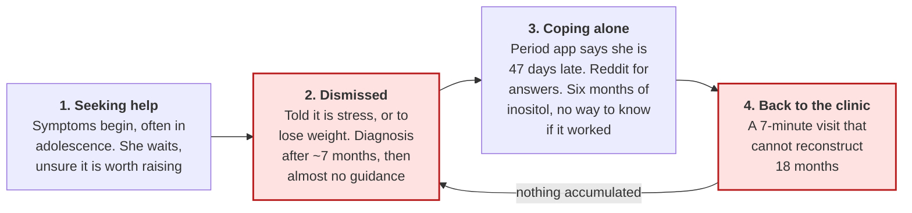
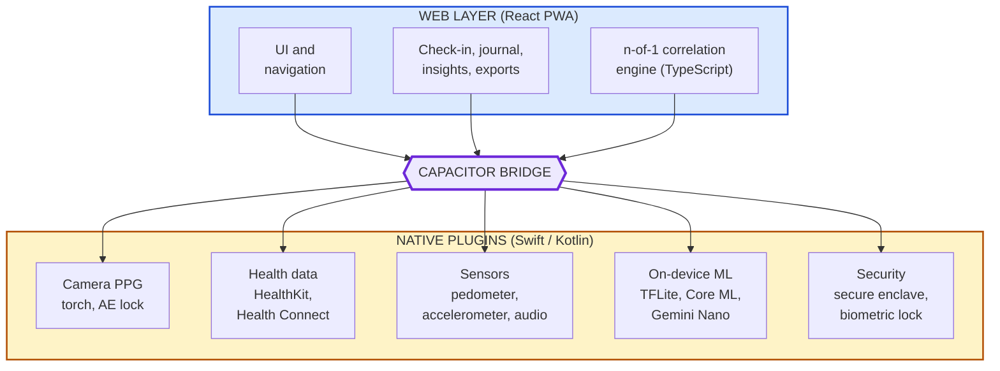
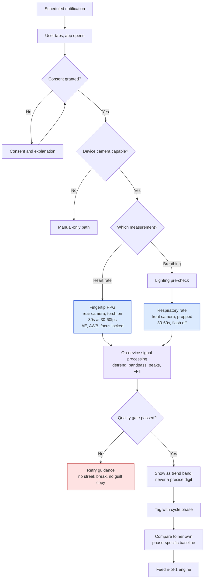
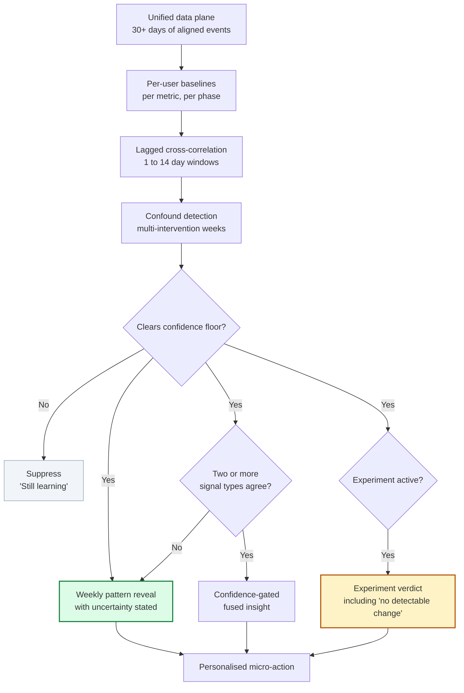
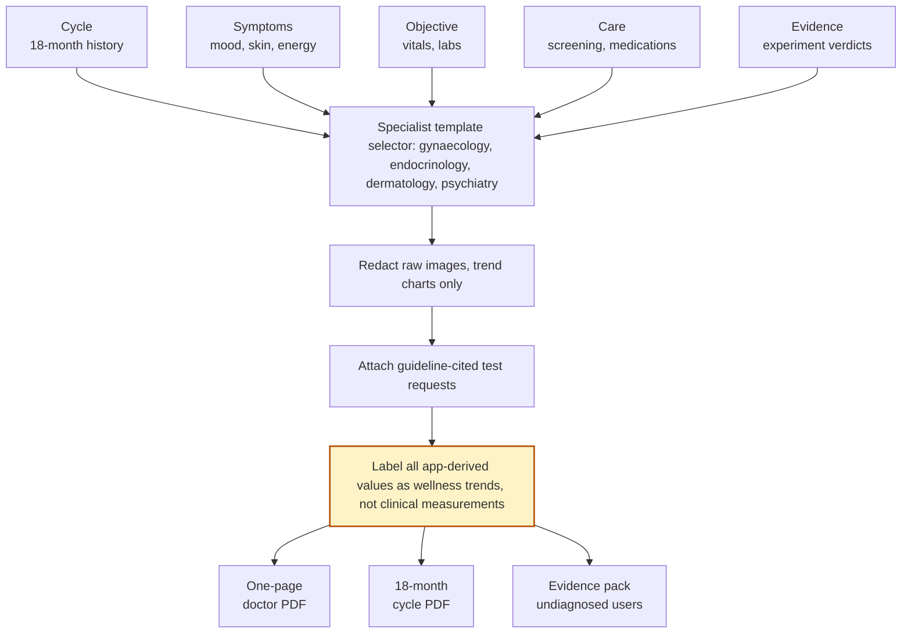
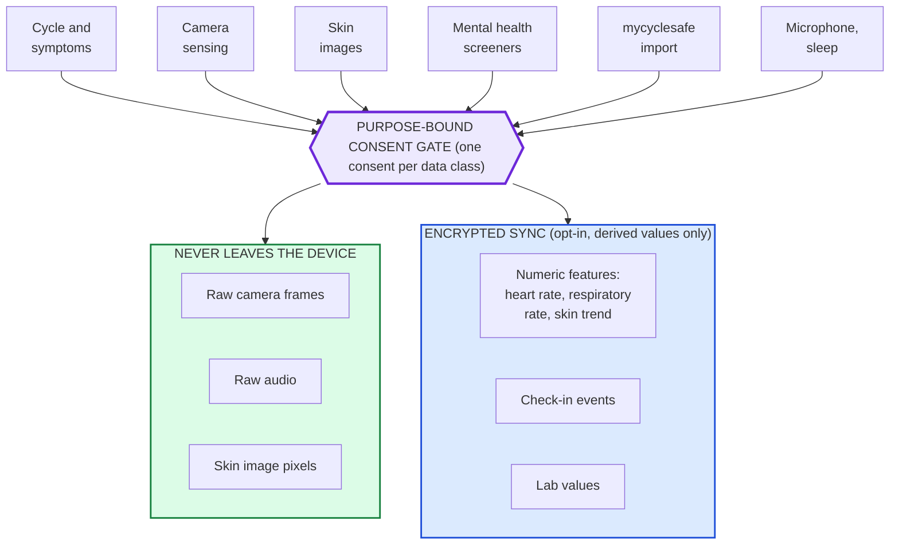

# PMOS Companion
## Product Requirements Document

Version 1.0, July 2026. Single source of truth.

| Field | Value |
|---|---|
| Team | War Room |
| Owners | Dhodraj, Belson, Rahul, Satheesh Kumar |
| Launch vehicle | Tech for Good 2026, GDG Coimbatore, 8 to 9 August |
| Distribution | mycyclesafe.ai (an existing cycle tracker, unmarketed) |

This document supersedes the product definition, build spec, and complete-features spec. Where those conflict with this one, this one governs.

---

## Contents

| § | Section | § | Section |
|---|---|---|---|
| 1 | Executive summary | | |
| 2 | The problem | 9 | Functional requirements |
| 3 | Goals and success metrics | 10 | Non-functional requirements |
| 4 | Users | 11 | Regulatory and compliance |
| 5 | Competitive position | 12 | Release plan |
| 6 | Architecture decisions | 13 | Risks |
| 7 | Scope | 14 | Open decisions |
| 8 | What we removed and why | 15 | Appendix |

---

# 1. Executive summary

A daily well-being companion for women with PMOS. It treats an irregular cycle as signal rather than error, learns each user's personal cause-and-effect patterns, measures vitals from a bare phone camera, and produces evidence a doctor accepts in a seven-minute consultation. It runs on a ₹10,000 phone and requires no purchased hardware.

## 1.1 Why now

Three things converged inside eighteen months.

| Date | What happened |
|---|---|
| 2023 | International Guideline establishes the metabolic framing |
| **May 2026** | **Monash-led global consensus renames PCOS to PMOS, published in The Lancet.** A 14-year global consensus across 56 organisations, surveying over 14,300 people with the condition, explicitly rejecting the cysts-and-fertility framing |
| Jul 2026 | NICE draft guideline adopts PMOS. Consultation open 1 July to 11 August |
| Aug 2026 | Tech for Good hackathon. We build |
| Dec 2026 | NICE publishes. Three-year global rollout begins |

The rename carries the entire thesis. Medicine spent eleven years concluding that this condition was never about cysts or fertility. It is a lifelong metabolic-endocrine condition. Every product on the market still treats it the old way, and NICE has already adopted the new name in its draft guideline. We build for the new definition.

## 1.2 What holds up under scrutiny

Six positions survived a competitive audit against products that already ship.

| # | Position | Why it holds |
|---|---|---|
| 1 | Experiment Mode | Competitors surface patterns. None reach a verdict. Pre-declared outcomes, washout periods, and honest results including "no detectable change" |
| 2 | Camera vitals, no hardware | No PMOS competitor captures any objective physiological signal |
| 3 | Clinical safety depth | Mental-health crisis routing, OSA screen-and-refer, guideline screening ledger. Absent across the category |
| 4 | India-native | Vernacular, Indian cuisine, Tele-MANAS, rupee pricing. The closest competitor ships iPhone-only |
| 5 | Zero-commerce evidence grading | We can grade evidence honestly because we never sell the supplements. Rivals funded by product sales cannot copy this |
| 6 | The mycyclesafe funnel | its existing user base, and the irregular-cycle segment is by definition this audience |

---

# 2. The problem

## 2.1 The care pathway loses her at every stage

This is a loop rather than a funnel. She keeps returning to dismissal, and nothing accumulates.

## 2.2 Evidence

| Problem | Evidence | Severity |
|---|---|---|
| Diagnostic delay | ~7 months in India. Focus groups report 2 months to 13 years | Critical |
| Fertility-only framing | Clinicians emphasise weight loss and future fertility. Teenagers need help with acne, anxiety and cycles now | Critical |
| Mental-health burden | Anxiety ~6x and depression ~4x general population. 75% and 58% elevated scores | Critical |
| Body-image distress | 84.5% score pathologically on appearance evaluation. Marriage-prospect pressure amplifies this in India | Critical |
| Anovulatory cycles | Gaps of 60 to 200+ days. Spotting confused with periods. Medication bleeds counted as cycles | Critical |
| Endometrial protection gap | Gaps over 90 days or fewer than 4 bleeds a year, with users unaware of the clinical significance | Critical |
| Sleep apnoea undetected | 37% prevalence in PMOS against 6% general population. No app screens for it | High |
| Generic advice for an n-of-1 condition | What works differs substantially between individuals, and nothing personalises | Critical |
| No doctor-ready output | Users maintain spreadsheets by hand. A seven-minute consultation cannot reconstruct eighteen months | Critical |
| Tracker burnout | 80-field symptom logs. Users quit by week three | High |
| Hardware paywalls | Metabolic insight sits behind a ₹4,000 wearable or a ₹8,400 monthly CGM | High |

## 2.3 What she asks for

Across communities and app reviews, one request recurs almost verbatim: help me identify what personally influences my wellbeing, by logging periods, skin, mood, food, sleep and supplements to find correlations.

Nobody builds it. That sentence is the product.

---

# 3. Goals and success metrics

## 3.1 Goals

| ID | Goal |
|---|---|
| G1 | Make her irregular cycle legible, never framed as failure |
| G2 | Tell her something true about her own body that nobody has told her |
| G3 | Convert eighteen months of lived experience into evidence a doctor accepts in seven minutes |
| G4 | Deliver objective physiological signal with no purchased hardware |
| G5 | Cause no harm: no shame, no false precision, no missed crisis |

## 3.2 Non-goals

Diagnosing PMOS. Replacing a clinician. Fertility and conception as a primary use case. Weight loss as an outcome. Selling supplements.

## 3.3 Metrics

| Metric | MVP | v1 | v2 |
|---|---|---|---|
| D7 retention | >40% | >50% | >55% |
| D90 retention | not measured | >25% | >35% |
| Weekly active loggers | >60% of MAU | >70% | >75% |
| Pattern reveals viewed | >1 per user per week | >1.5 | not set |
| Doctor exports | not measured | >1 per user per quarter | >2 |
| Experiment completion | not measured | >30% of started | >40% |
| Fingertip PPG success rate | >85% | >88% | >90% |
| Camera check-in adoption | not measured | >15% of DAU | >20% |
| Crisis-path integrity | 100% scripted | 100% | 100% |
| NPS in beta | >50 | >60 | >65 |

Counter-metrics, where a rise means we are failing: uninstalls within 48 hours of a pattern reveal, reported distress following a skin capture, streak-related complaints, and any crisis path served by generated text.

---

# 4. Users

Primary users are Indian women aged 18 to 35 with PMOS, diagnosed or suspecting it, phone-first, poorly served by generic apps and dismissive care. The secondary user is her clinician, who receives exports but never uses the product directly in v1.

| Persona | Situation | What she needs |
|---|---|---|
| Priya, 26, Bengaluru | Diagnosed two years ago. Cycles run 30 to 60 days. Her doctor said to lose weight. Takes inositol without knowing whether it helps | Does this actually work for me? |
| Ananya, 21, Coimbatore | Undiagnosed. Acne, hair loss, irregular cycles. Told it is normal for her age. Deleted Flo after repeated pregnancy scares | Evidence to be taken seriously |
| Meera, 34, tier-2 city | Diagnosed eight years ago. Fatigue, poor sleep, snoring. Never screened for sleep apnoea or lipids. Sees four doctors who never coordinate | Nothing falls through |

Users under 18 are excluded at launch. [REG-001](#111-age) explains why, and treats it as a cost we are choosing to bear, not a design preference.

---

# 5. Competitive position

## 5.1 What competitors actually ship

| Product | Status | What it actually does |
|---|---|---|
| PMOS Vera | Shipped | iPhone-only, $5.99/month. Irregular-native framing, lab tracking, photo journal, doctor PDF, weight-neutral. No servers at all, so its privacy position is stronger than ours |
| Josie | Waitlist | Claims specialist prep reports, evidence-pack mode, four cycle states. Not shipped |
| Flo, Clue | Shipped | 28-day assumption, the "you are late" harm, no metabolic layer |
| Veera, Gynoveda | Shipped | Clinic coaching or supplement commerce. Episodic, fertility-leaning |

## 5.2 Where each product sits

| Product | PMOS-native depth | Reaches a verdict | Position |
|---|---|---|---|
| Flo, Clue | Low | No | Commodity tracker |
| Veera, Gynoveda | Medium | No | Coaching, no cycle intelligence |
| PMOS Vera | High | No | Depth without conclusion |
| Josie (unshipped) | High | Partial | Depth without conclusion |
| **PMOS Companion** | **High** | **Yes** | **The abandoned middle** |

## 5.3 Parity against advantage

Internally we should be honest about which is which.

| Capability | Position |
|---|---|
| Irregular-native, doctor export, weight-neutral, photo journal, lab tracking, specialist reports | Parity. PMOS Vera and Josie already claim these |
| Privacy architecture | Behind. Vera runs with zero servers |
| Experiment Mode, camera vitals, crisis routing, OSA screening, screening ledger, vernacular, zero-commerce, mycyclesafe funnel | Advantage |

Two phrases in earlier drafts, a "Day 47" cycle framing and the label "Building My Case", appear near-verbatim in competitor marketing. Both need rewriting before anything ships publicly.

---

# 6. Architecture decisions

## ADR-001: Capacitor shell with native plugins

The sensing core cannot run in a pure PWA. No web API exists for HealthKit or Health Connect, `getUserMedia` is unreliable inside WKWebView, and a documented WebKit defect blanks the camera preview when the torch is enabled.

We ship a Capacitor shell wrapping the web application, with native plugins for every sensing capability. The reasoning matters: a Capacitor native plugin runs the same Swift and Kotlin code a fully native app would run. For the PPG pipeline there is no capability or performance difference, because the plugin is native code. Going fully native changes only what renders the interface, at the cost of two codebases for a four-person team, and discards both the team's React experience and the existing mycyclesafe web assets.

Roughly 85% of the product lives in the web layer. Only the sensing capabilities cross the bridge.

Consequences: one codebase, React skills retained, native performance where it matters, any screen replaceable with native later, and store distribution which health-data permissions require regardless.

Rejected alternatives. A pure PWA cannot deliver the sensing core. React Native is workable, and `react-native-vision-camera` frame processors suit PPG well, but it requires rebuilding the interface layer. Separate Swift and Kotlin codebases buy nothing that native plugins do not already provide.

## ADR-002: Camera capture is always foreground and user-initiated

| Platform | Blocker |
|---|---|
| iOS | No unlock event API exists. `AVCaptureSession` interrupts with `videoDeviceNotAvailableInBackground` when the app backgrounds. The green recording indicator cannot be suppressed |
| Android | Background camera blocked since API 28. Android 14 and later throw `SecurityException` when a camera foreground service starts from the background, because `CAMERA` is a while-in-use permission |
| Web | More restricted than either |

Google's PHRM works because Google owns the operating system's face-unlock hook. No PHRM SDK, API, ML Kit feature or Health Connect type exists, and the released model is licensed for non-commercial, non-clinical research under IRB approval, so we cannot use it. Every commercial rPPG SDK on the market (Binah.ai, NuraLogix, VitalLens) requires a foreground, user-held, still session, which is the strongest available evidence that no passive path exists for third parties.

The interaction model follows: notification, tap, foreground capture screen, 30 to 60 seconds, result.

## ADR-003: No external devices

The claim: works on a ₹10,000 phone. No watch, no sensor, no strips, no cuff, nothing to buy.

| Removed | Reason |
|---|---|
| CGM sync (Dexcom Stelo, Abbott Libre) | Stelo is not sold in India. Libre publishes no third-party API, so every working integration violates the LibreView terms. Cost runs about ₹8,400 a month, roughly half average per-capita monthly income. The 2023 Guideline names the OGTT at ₹100 to ₹300 as the accurate glycaemic test |
| Wearable dependency | India's wearables market contracted 4.0% in 2025, with smartwatches down 17.6%. Budget brands holding over half the market often ship no Health Connect integration |
| Glucometer, BP cuff | Recurring consumable cost, poor adherence |

Laboratory tests are not a device dependency. They are a one-off service, mandated by the 2023 Guideline whether or not this product exists, and inexpensive in India at roughly ₹800 for fasting insulin. The constraint that follows: no insight, pattern, verdict, coaching action or export may be gated behind a laboratory value.

## ADR-004: On-device inference as the privacy position

PMOS Vera runs with no servers. We cannot claim stronger privacy while sending data to a cloud model, so inference moves onto the device.

| Layer | Location |
|---|---|
| PPG signal processing | On device, native |
| Skin scoring | On device, TFLite or Core ML |
| Sleep audio analysis | On device, raw audio discarded |
| n-of-1 correlation engine | On device |
| Companion question answering | On-device LLM where hardware allows, cloud RAG fallback |
| Encrypted sync | Derived numbers only, never raw video, audio or images |

---

# 7. Scope

| In scope | Out of scope |
|---|---|
| Irregular-native cycle engine | Diagnosis or condition-likelihood scores |
| 30-second daily check-in | Blood oxygen, blood pressure, glucose |
| n-of-1 pattern engine | Any purchased hardware |
| Experiment Mode | Users under 18 |
| Camera vitals: PPG and respiratory rate | Supplement sales |
| Doctor exports | Passive background camera |
| Mental health and crisis routing | Fertility-first funnel |
| Screening ledger and lab vault | Calorie or macro counting |
| Evidence-graded coaching | Facial emotion inference |
| On-device AI companion | Voice mood biomarkers |

---

# 8. What we removed and why

A permanent record, so these do not quietly return.

| Feature | Verdict | Reason |
|---|---|---|
| Passive heart rate on unlock | Platform-blocked | An OS-vendor privilege. Blocked on iOS, Android and web |
| Blood oxygen from camera | Banned and infeasible | App Store guideline 1.4.1 forbids it explicitly. Phone sensors lack the 660nm and 940nm wavelengths oximetry requires |
| Blood pressure via pulse transit time | Banned and invalid | Same guideline. Uncalibrated cuffless BP is not valid, and renaming the output to "BP trend" does not avoid classification |
| Overnight ballistocardiography | Research-only | Published evidence covers dedicated under-mattress hardware, not a phone on a mattress |
| Facial action unit stress inference | Construct-invalid | Barrett et al. 2019 rejects reading internal states from facial movement |
| Voice mood biomarkers | Research-only | Cross-lingual transfer collapses to roughly 49%, which is chance on a binary task |
| Automated hirsutism scoring | Research-only | No validated automated system exists, and the reference standard itself carries roughly 14 points of interobserver variance |
| CGM sync and glucose meal tagging | Hardware dependency | See ADR-003 |
| External keystroke capture | Platform-blocked | No iOS API. Android requires accessibility services, which fails store review |
| Google Fit | Retired | Sign-ups closed May 2024, support ends late 2026. Replaced by Health Connect |

---

# 9. Functional requirements

Priorities: P0 must-have, P1 high, P2 differentiator, P3 future. Each requirement is written to be independently testable.

## 9.1 Cycle engine, FR-100

| ID | Requirement | Phase | Pri |
|---|---|---|---|
| FR-101 | Estimate cycle windows probabilistically with confidence bands. The system SHALL NOT display a single predicted due-date | MVP | P0 |
| FR-102 | Present elapsed time as a day count relative to her own historical range. Copy SHALL NOT contain "late", "overdue", "missed", or pregnancy-scare language | MVP | P0 |
| FR-103 | Support named cycle states: regular, irregular, oligomenorrhea, amenorrhea, medically regulated, post-pill recovery. Each is valid, never an error | MVP | P0 |
| FR-104 | Distinguish period, spotting, withdrawal bleed and breakthrough bleeding, with flow intensity, clots and pain association | MVP | P0 |
| FR-105 | Maintain a rolling cycle-interval distribution and a bleeds-per-year counter | MVP | P0 |
| FR-106 | Raise a calm escalation at gaps over 90 days or fewer than 4 bleeds a year, with endometrial-protection education and a one-tap gynaecology export. SHALL NOT suggest any specific medication | MVP | P0 |
| FR-107 | Estimate cycle phase probabilistically with visible uncertainty. SHALL NOT present hard ovulation prediction | MVP | P1 |
| FR-108 | Track medication-induced bleeds separately so interval arithmetic stays correct | v1 | P1 |
| FR-109 | Surface cycle-variance reduction as the progress metric, not regularity against a population norm | v1 | P1 |

## 9.2 Daily check-in, FR-200

| ID | Requirement | Phase | Pri |
|---|---|---|---|
| FR-201 | Complete a full check-in in 30 seconds median, covering bleeding, sleep timing, movement, mood, energy, skin, cravings, pain and medications | MVP | P0 |
| FR-202 | Cap the symptom set at roughly 15 curated dimensions. SHALL NOT exceed 20 without an explicit scope decision | MVP | P0 |
| FR-203 | Provide one-tap severity entry and a "same as yesterday" shortcut | MVP | P1 |
| FR-204 | Provide pause mode as a first-class state. Returning SHALL NOT show guilt copy, broken streaks or backfill prompts | MVP | P0 |
| FR-205 | Detect obsessive tracking patterns and reduce prompting in response | v1 | P1 |
| FR-206 | Provide a home-screen widget for five-second logging | v1 | P1 |
| FR-207 | Provide the illustrated nine-area mFG hirsutism scale as a self-completed questionnaire, never automated | v1 | P1 |
| FR-208 | Support voice-note journaling with on-device transcription into the symptom log. Voice is an input method, never a mood biomarker | v2 | P2 |

## 9.3 Camera vitals, FR-300

All capture is foreground and user-initiated, per ADR-002.

| ID | Requirement | Phase | Pri |
|---|---|---|---|
| FR-301 | Fingertip PPG heart rate: rear camera with torch, 30 seconds. Red-channel spatial mean, detrend with smoothness priors at lambda 10, fourth-order Butterworth 0.7 to 3.5 Hz, peak detection cross-checked against FFT. Target accuracy MAPE at or below 5% | MVP | P0 |
| FR-302 | Lock auto-exposure, auto-white-balance and focus before capture begins. Exposure hunting is the primary cause of signal loss | MVP | P0 |
| FR-303 | Render a live pulse waveform during capture | MVP | P1 |
| FR-304 | Display heart rate as a range with confidence, never a single precise digit | MVP | P0 |
| FR-305 | Reject captures failing saturation, motion or AC/DC ratio checks. Rejection SHALL be presented as normal, with guidance on what to change, and SHALL NOT break streaks | MVP | P0 |
| FR-306 | Contactless respiratory rate: front camera, chest and shoulder region, optical flow bandpassed 0.1 to 0.7 Hz. Target MAE at or below 2 breaths per minute | v1 | P1 |
| FR-307 | Onboarding SHALL instruct the user to prop the phone for respiratory capture, since handheld capture is the main failure mode | v1 | P1 |
| FR-308 | Expose HRV from fingertip PPG only as a personal-baseline z-score, never as an absolute value, and never from face rPPG | v1 | P1 |
| FR-309 | Capture at the highest available frame rate, preferring 60 or 120fps, with peak interpolation for HRV | v1 | P1 |
| FR-310 | Face rPPG using MediaPipe regions and POS or CHROM projection, labelled experimental. SHALL NOT be the value symptoms are correlated against | v2 | P2 |
| FR-311 | Gate camera features on device capability at install, with a fully functional non-camera path | MVP | P0 |
| FR-312 | Handle expected failure rates gracefully. Between 25% and 45% of face rPPG attempts will fail for Monk Skin Tone 5 to 8 users under warm indoor lighting | v2 | P1 |

## 9.4 The n-of-1 engine, FR-400

| ID | Requirement | Phase | Pri |
|---|---|---|---|
| FR-401 | Compute per-user baselines for every metric, segmented by cycle phase. SHALL NOT compare against population norms | MVP | P0 |
| FR-402 | Discover lagged associations across 1 to 14 day windows: sleep to skin, supplement to mood, food to cycle | MVP | P0 |
| FR-403 | Apply a confidence floor. Suppress any pattern below threshold and display "still learning". SHALL NOT surface a pattern from insufficient observations | MVP | P0 |
| FR-404 | State observation count and signal strength in plain language on every reveal, for example "12 observations, weak signal" | MVP | P0 |
| FR-405 | Deliver at least one pattern reveal per active user per week once sufficient data exists | MVP | P0 |
| FR-406 | Provide Experiment Mode: pre-declared outcome, baseline period, 8 to 12 week window, washout, and a verdict. "No detectable change" is a valid first-class outcome | v1 | P0 |
| FR-407 | Ship experiment templates for myo-inositol, sleep window, spearmint, yoga, low-glycaemic eating and metformin adherence | v1 | P1 |
| FR-408 | Use pre-intervention weeks automatically as the baseline, with no manual setup | v1 | P1 |
| FR-409 | Warn when multiple interventions change within one window | v1 | P1 |
| FR-410 | Surface a fused insight only when two or more independent signal types agree, with thresholds tuned for the phone-only signal set | v1 | P1 |
| FR-411 | Provide aggregate-only, opt-in, k-anonymised cohort priors | Later | P2 |

## 9.5 Doctor advocacy, FR-500

| ID | Requirement | Phase | Pri |
|---|---|---|---|
| FR-501 | Provide a one-tap gynaecology export: 18-month cycle history, interval statistics and bleeding log, as PDF | MVP | P0 |
| FR-502 | Provide a doctor one-pager: symptom timeline, cycle history, medication log and guideline-cited test requests | MVP | P0 |
| FR-503 | Name the tests she can request: fasting insulin, free testosterone, DHEAS, 75g OGTT, AMH | MVP | P0 |
| FR-504 | Label all app-derived physiological values in exports explicitly as wellness trends, not clinical measurements | MVP | P0 |
| FR-505 | Include trend charts only in exports, never raw photographs | v1 | P0 |
| FR-506 | Provide specialist-specific templates for gynaecology, endocrinology, dermatology and psychiatry | v1 | P1 |
| FR-507 | Provide evidence-pack mode for undiagnosed users: symptom evidence, diagnostic criteria explainer and question scripts. Rename from the earlier label, per section 5.3 | v1 | P1 |
| FR-508 | Provide guideline-backed question scripts for asking a clinician directly | v1 | P0 |
| FR-509 | Provide localised referral pathways so "see a doctor" names a clinic she can reach, by city and budget | v1 | P1 |

## 9.6 Mental health and safety, FR-600

One mishandled crisis ends the product. This module carries zero tolerance.

| ID | Requirement | Phase | Pri |
|---|---|---|---|
| FR-601 | Run PHQ-4 and GAD-2 check-ins on a defined cadence | MVP | P0 |
| FR-602 | Pre-script and human-review the crisis flow. Generated text SHALL NOT appear on any crisis path under any circumstance | MVP | P0 |
| FR-603 | Crisis resources, Tele-MANAS 14416, SHALL NEVER be paywalled, login-gated or rate-limited | MVP | P0 |
| FR-604 | Gate food-tracking depth behind an eating-disorder screen. On a positive screen, suppress depth and surface support | MVP | P0 |
| FR-605 | Provide full PHQ-9 and GAD-7 on guideline cadence, using formally validated Hindi and Tamil translations | v1 | P0 |
| FR-606 | Suppress action-heavy prompts on low mental-health days | v1 | P1 |
| FR-607 | Frame CBT and ACT micro-skills explicitly as skills practice, not therapy | v1 | P1 |
| FR-608 | Provide a one-tap self-reported stress rating, replacing the removed facial inference feature | v1 | P1 |
| FR-609 | Escalate immediately on chest pain, fainting, drowsy driving, severe bleeding and suicidality, with localised guidance | MVP | P0 |

## 9.7 Coaching and treatment, FR-700

| ID | Requirement | Phase | Pri |
|---|---|---|---|
| FR-701 | Deliver one or two evidence-graded, phase-aware micro-actions daily from a curated set | MVP | P0 |
| FR-702 | Display a visible evidence grade and date on every health claim | MVP | P0 |
| FR-703 | Use additive, cuisine-native food language. SHALL NOT include calorie counting or macro targets by default | MVP | P1 |
| FR-704 | Track movement as weekly minutes, 150 to 300 plus two strength sessions, counting 10-minute entries. SHALL NOT display calories burned | MVP | P1 |
| FR-705 | Place weight entry behind an opt-in permission prompt, per the 2023 Guideline. SHALL NOT make it a default or headline metric | MVP | P0 |
| FR-706 | Derive personalised coaching from her own n-of-1 patterns | v1 | P0 |
| FR-707 | Provide OSA screen-and-refer with an urgent drowsy-driving flag. SHALL use unlicensed symptom questions unless ESS or STOP-BANG is properly licensed, per REG-004 | v1 | P0 |
| FR-708 | Provide an evidence-graded supplement library covering purpose, studied dose, certainty grade, and Indian availability and price. Zero commerce, zero affiliate links | v1 | P0 |
| FR-709 | Provide a prescribed-treatment companion: education, adherence and side-effect logging, prescriber question lists. SHALL NOT advise starting, stopping or dosing any prescription | v1 | P1 |
| FR-710 | Provide GLP-1 safety education covering restored ovulation and contraception, neutral and non-promotional | v1 | P0 |
| FR-711 | Provide a yoga and breathwork library as a logged intervention with honest evidence framing | v1 | P1 |

## 9.8 Labs and screening, FR-800

| ID | Requirement | Phase | Pri |
|---|---|---|---|
| FR-801 | Provide a guideline screening ledger: blood pressure annually, lipids at diagnosis, glycaemic status every one to three years, OGTT pre-pregnancy, tracked as due, done and trended | v1 | P0 |
| FR-802 | Provide a lab vault for fasting glucose, insulin, HOMA-IR, LH to FSH ratio, androgens, lipids, thyroid, vitamin D and HbA1c, with dates | v1 | P1 |
| FR-803 | Extract values from a photographed printed lab report on device, presented for user confirmation. SHALL NOT auto-save unconfirmed values | v2 | P1 |
| FR-804 | No feature SHALL be gated behind a laboratory value. Every downstream capability degrades gracefully to zero labs | v1 | P0 |
| FR-805 | Provide OGTT reminders, preparation guidance and a result-logging template. This is the guideline-recommended path and our substitute for CGM | v1 | P1 |
| FR-806 | Provide vitamin D test-then-correct guidance: push the test, never the supplement, with the clinician setting dose | v1 | P1 |
| FR-807 | Label blood-pressure entries as measured at a clinic or pharmacy, since we do not measure blood pressure | v1 | P0 |

## 9.9 Skin and visual tracking, FR-900

| ID | Requirement | Phase | Pri |
|---|---|---|---|
| FR-901 | Provide guided selfie capture with a fixed face outline and a lighting check that refuses poor shots | v1 | P1 |
| FR-902 | Provide a self-relative time-lapse the user interprets herself. This is the retention feature and requires no model | v1 | P1 |
| FR-903 | The system SHALL NOT display beauty, attractiveness or symmetry scores, SHALL NOT enable cross-user comparison, and SHALL NOT produce before-and-after collages | MVP | P0 |
| FR-904 | Require separate unbundled consent for skin images, with one-tap deletion and no training use without explicit opt-in | v1 | P0 |
| FR-905 | Run skin scoring on device. Images SHALL NOT leave the device in production | v2 | P0 |
| FR-906 | Provide a coarse four-level acne category only if fine-tuned on a purpose dataset. Lesion counts SHALL NOT be displayed, since detection mAP of roughly 0.54 makes them unreliable | v2 | P2 |

## 9.10 Sleep, FR-1000

| ID | Requirement | Phase | Pri |
|---|---|---|---|
| FR-1001 | Track sleep regularity by bed and wake consistency, using timing rather than duration alone | v1 | P1 |
| FR-1002 | Derive a sleep window and restlessness index from the accelerometer. This runs in the background and reports gross timing, not sleep stages | v2 | P2 |
| FR-1003 | Detect snoring from on-device audio during a user-started session. Raw audio SHALL be analysed on device and discarded, never uploaded | v2 | P2 |
| FR-1004 | Require explicit user initiation for sleep sessions, display the platform recording indicator, and handle OEM-truncated nights gracefully | v2 | P2 |

## 9.11 AI companion, FR-1100

| ID | Requirement | Phase | Pri |
|---|---|---|---|
| FR-1101 | Answer questions from a curated guideline corpus using retrieval, with visible source citations | MVP | P1 |
| FR-1102 | The companion SHALL NOT diagnose, estimate condition likelihood, or recommend or adjust any dose | MVP | P0 |
| FR-1103 | Run an on-device model where hardware supports it, with cloud retrieval as fallback. Model location SHALL be disclosed to the user | v2 | P1 |
| FR-1104 | Route out-of-scope questions to "discuss with your doctor" rather than answering them | MVP | P0 |

## 9.12 Privacy, trust and platform, FR-1200

Raw media is processed on the device and discarded. Only derived numbers ever sync, and only with consent. Four things are never collected under any configuration: ad-tech SDKs, third-party analytics on health events, cross-user identifiable data, and raw video or audio.

| ID | Requirement | Phase | Pri |
|---|---|---|---|
| FR-1201 | Collect purpose-bound granular consent per data class. Consent SHALL NOT be inherited from mycyclesafe | MVP | P0 |
| FR-1202 | Provide one-tap full export and full deletion | MVP | P0 |
| FR-1203 | The system SHALL NOT integrate ad-tech SDKs or third-party analytics on health events, and SHALL NOT sell data | MVP | P0 |
| FR-1204 | Provide a consented cycle-history import from mycyclesafe to remove cold-start | MVP | P0 |
| FR-1205 | Provide a user-configurable biometric application lock | v1 | P1 |
| FR-1206 | Write back to Health Connect and HealthKit so her data remains portable | v2 | P2 |
| FR-1207 | Raw video, audio and images SHALL NOT be uploaded under any configuration | MVP | P0 |
| FR-1208 | Provide a local-first mode with full offline operation and no account | v2 | P2 |

## 9.13 Notifications, FR-1300

| ID | Requirement | Phase | Pri |
|---|---|---|---|
| FR-1301 | Every notification SHALL carry a personal insight or a due action. Generic engagement prompts SHALL NOT be sent | MVP | P0 |
| FR-1302 | Send at most one or two notifications a day, with user-controlled quiet hours | MVP | P0 |
| FR-1303 | The system SHALL NOT use guilt-based streaks or punitive gamification | MVP | P0 |
| FR-1304 | Write re-engagement copy that expects lapses | v1 | P1 |

---

# 10. Non-functional requirements

## 10.1 Performance, NFR-100

| ID | Requirement | Target |
|---|---|---|
| NFR-101 | Application cold start | 2.5s or less on a ₹10,000-class Android |
| NFR-102 | Daily check-in completion | 30s median |
| NFR-103 | PPG result after capture ends | 3s or less |
| NFR-104 | Pattern-reveal computation | 5s or less over 18 months of data |
| NFR-105 | Doctor PDF generation | 10s or less |
| NFR-106 | Application bundle size | 60 MB or less initial download |
| NFR-107 | Battery drain per 30s capture | 1% or less |

## 10.2 Reliability, NFR-200

| ID | Requirement | Target |
|---|---|---|
| NFR-201 | Crash-free sessions | 99.5% or better |
| NFR-202 | Data loss on unexpected termination | Zero. Check-ins persist atomically |
| NFR-203 | Offline capability | Full logging, viewing and insight display |
| NFR-204 | Sync conflict resolution | Last-write-wins per field, with audit trail |
| NFR-205 | Graceful degradation | Every feature functions with zero sensor data |
| NFR-206 | OEM battery-killer resilience | Truncated background sessions handled without user-visible error |

## 10.3 Security, NFR-300

| ID | Requirement |
|---|---|
| NFR-301 | Encrypt data at rest with AES-256, keys held in Secure Enclave or Android Keystore |
| NFR-302 | Use TLS 1.3 or later with certificate pinning |
| NFR-303 | Offer an optional biometric application lock |
| NFR-304 | Exclude health data from logs, crash reports and analytics payloads |
| NFR-305 | Never persist raw media beyond the processing window |
| NFR-306 | Commission an annual third-party penetration test before any scale release |

## 10.4 Privacy, NFR-400

| ID | Requirement |
|---|---|
| NFR-401 | Collect only what a declared feature consumes |
| NFR-402 | Process all camera, audio and image data on device |
| NFR-403 | Provide granular per-class consent with independent revocation |
| NFR-404 | Provide full export in a machine-readable format |
| NFR-405 | Complete deletion within 72 hours across all systems |
| NFR-406 | Publish a plain-language privacy policy at eighth-grade reading level or below |

## 10.5 Accessibility, NFR-500

| ID | Requirement |
|---|---|
| NFR-501 | Meet WCAG 2.1 AA across all user-facing surfaces |
| NFR-502 | Support TalkBack and VoiceOver fully |
| NFR-503 | Maintain 4.5:1 contrast minimum, never using colour alone to convey state |
| NFR-504 | Support dynamic type to 200% without layout breakage |
| NFR-505 | Provide touch targets of 44 by 44 points or larger |
| NFR-506 | Provide a non-visual guidance path for camera capture |

## 10.6 Localisation, NFR-600

| ID | Requirement |
|---|---|
| NFR-601 | Ship English at launch, Hindi and Tamil at v1 |
| NFR-602 | Use formally validated translations for clinical screeners. Machine translation is prohibited |
| NFR-603 | Adapt cuisine and coaching content regionally rather than translating it |
| NFR-604 | Format dates, numbers and units per locale |

## 10.7 Content and safety, NFR-700

| ID | Requirement |
|---|---|
| NFR-701 | Attach an evidence grade and review date to every health claim |
| NFR-702 | Have a qualified clinician review content before release |
| NFR-703 | Prohibit cure, reverse, restore-fertility and guaranteed-outcome language everywhere, including influencer and cross-promotional copy |
| NFR-704 | Have a mental-health professional review crisis content |
| NFR-705 | Re-review the evidence base on guideline updates: NICE December 2026, international refresh 2028 |

## 10.8 Compatibility, NFR-800

| ID | Requirement |
|---|---|
| NFR-801 | Support Android 8.0 and later, the Health Connect floor, and iOS 14 and later |
| NFR-802 | Function on 2 GB RAM devices |
| NFR-803 | Gate camera features on a capability check with a functional fallback |
| NFR-804 | Design portrait-first, tablet-tolerant |

## 10.9 Observability, NFR-900

| ID | Requirement |
|---|---|
| NFR-901 | Exclude health-data values from product analytics. Events and counts only |
| NFR-902 | Monitor PPG capture success rate segmented by device class and skin tone |
| NFR-903 | Log crisis-path invocations as counts only, reviewed weekly |
| NFR-904 | Monitor pattern-reveal suppression rate to detect an over-tight confidence floor |

---

# 11. Regulatory and compliance

## 11.1 Age

REG-001: the system SHALL enforce an 18+ age gate and SHALL NOT process data for users under 18.

India's DPDP Act classifies anyone under 18 as a child. Processing requires verifiable parental consent, verifying both the child's age and the parent's identity, and the Act expressly prohibits tracking, behavioural monitoring, targeted advertising and profiling of children.

The Rule 11 healthcare exemption covers a clinical establishment, mental health establishment or healthcare professional, restricted to providing health services. We cannot claim it while also claiming non-clinical status for CDSCO, because the two positions are mutually exclusive.

The deeper obstacle is that our n-of-1 engine performs profiling. Lagged correlation over longitudinal behavioural data is precisely the prohibited activity, so no consent checkbox resolves it.

This costs us something real. PMOS commonly presents in adolescence, adolescent sleep-apnoea prevalence runs at 29%, and our own research shows teenagers need help immediately. We exclude them for legal reasons, and adolescent support becomes a funded roadmap item requiring verifiable-parental-consent infrastructure.

## 11.2 Medical device boundary

REG-002: the system SHALL operate as screen-and-refer. It SHALL NOT diagnose, produce condition-likelihood scores, or recommend or adjust doses.

REG-003: the system SHALL NOT measure or display blood pressure, blood oxygen, blood glucose or body temperature from device sensors.

App Store Review Guideline 1.4.1 states that apps claiming to measure blood pressure, body temperature, blood glucose levels or blood oxygen levels using only the sensors on the device are not permitted. Renaming an output to "BP trend" or "cardiovascular load" does not avoid classification.

CDSCO has issued final guidance on medical device software, with risk-based Class A to D and wellness software held to a lower standard than diagnostic software. Class A non-sterile non-measuring devices are exempt from full licensing under G.S.R. 777(E), though registration and post-market surveillance still apply, and ISO 13485 is a practical prerequisite for market access.

## 11.3 Data protection

| ID | Requirement |
|---|---|
| REG-005 | Collect DPDP-compliant purpose-bound consent, with no inheritance from mycyclesafe |
| REG-006 | Honour granular deletion and export rights within 72 hours |
| REG-007 | Sell no data, integrate no ad-tech SDKs, run no third-party health analytics |

## 11.4 Clinical instrument licensing

REG-004: the system SHALL NOT reproduce or score a copyrighted instrument without a valid licence.

| Instrument | Status | Action |
|---|---|---|
| PHQ-9, GAD-7, PHQ-4 | Free. Pfizer released them in 2010 with no copyright restriction. Commercial use and translation permitted | Use freely. Confirm which Hindi and Tamil translations are formally validated |
| Epworth Sleepiness Scale | Paid commercial licence via Mapi Research Trust | License or avoid |
| STOP-BANG | CC BY-NC-ND. Non-commercial only, no derivatives without permission | Obtain written permission or avoid |
| Berlin Questionnaire | Unclear | Verify before use |

The recommended path is unbranded symptom questions covering snoring, unrefreshing sleep, daytime sleepiness and witnessed apnoea, which prompt a doctor visit without reproducing or scoring a copyrighted scale.

## 11.5 Store compliance

| ID | Requirement |
|---|---|
| REG-008 | Complete the Google Play health apps declaration. Budget two to four weeks review latency and possible rejection |
| REG-009 | Disclose device compatibility in the store listing where sensor-based health functions are used |
| REG-010 | Include an in-app "not a medical device" disclaimer and clinician-consultation reminder |
| REG-011 | Disclose accuracy methodology for any accuracy claim. SHALL NOT cite another company's figures as ours |
| REG-012 | Prepare an App Review 2.5.4 and 2.5.14 justification before shipping overnight audio |

## 11.6 Marketing claims

| ID | Requirement |
|---|---|
| REG-013 | Prohibit cure, reverse and restore-fertility claims across the entire chain: application, store listing, mycyclesafe cross-promotion and influencer content. The DMR Act 1954, FSSAI and ASCI all reach this material |
| REG-014 | Attach a visible evidence grade to every content claim |

---

# 12. Release plan

| Phase | Window | Workstreams |
|---|---|---|
| **MVP** | Aug – Oct 2026 | Cycle engine and check-in. n-of-1 engine v0. **Fingertip PPG** (critical path). Doctor exports and crisis floor |
| **v1** | Oct 2026 – Mar 2027 | **Experiment Mode** (critical path). Skin trend, labs, screening ledger. Respiratory rate and HRV. Hindi and Tamil |
| **v2** | Mar – Jul 2027 | On-device LLM companion. Sleep actigraphy and snore detection. Lab OCR and face rPPG beta |
| **Later** | Aug 2027 onward | Cohort priors. Clinician portal |

## 12.1 MVP definition of done

The irregular-native cycle engine with interval sentinel. The 30-second check-in with pause mode. The n-of-1 pattern reveal with confidence gating. Fingertip PPG heart rate with quality gate. Gynaecology export, doctor one-pager and test-request helper. The crisis-safe mental-health floor. Dignity defaults covering weight opt-in, the 18+ gate and anti-beauty guardrails. The mycyclesafe bridge with granular consent. Evidence-graded education with the retrieval companion.

## 12.2 Hackathon demonstration

Five beats, in order.

1. Open with the rename. Two months ago medicine renamed this condition to acknowledge it was never about cysts or fertility, and every product still treats it as though it were.
2. Fingertip PPG live. A judge places a finger on the camera and the pulse waveform draws itself in real time.
3. The reveal. Your skin flares two to three days after nights under six hours. Not your face wash, your sleep.
4. The export. One tap produces an 18-month doctor-ready PDF.
5. Close on distribution. A ₹10,000 phone, no watch, no strips, nothing to buy. One in eight women, and we already reach a live product in this domain.

---

# 13. Risks

| # | Risk | Severity | Mitigation |
|---|---|---|---|
| R1 | Competitors already ship features we claimed. PMOS Vera is live with irregular-native framing, exports, weight-neutral design and a photo journal | Critical | Lead with Experiment Mode, camera vitals and India-native depth. Rewrite the near-verbatim copy immediately |
| R2 | Our privacy claim is weaker than Vera's, which runs no servers | High | Ship on-device inference per ADR-004. Reframe as on-device for sensing, encrypted sync for the rest. Do not lead with privacy |
| R3 | The PPG quality gate rejects too often, particularly for Monk Skin Tone 5 to 8 | High | Fingertip PPG, which is skin-tone-fair, remains primary. Face rPPG stays in beta. Failure is treated as normal, with a lighting pre-check and monitoring by skin tone per NFR-902 |
| R4 | Small-sample correlation surfaces a false pattern | Critical | Hard confidence floor, observation count always stated, "still learning" as a first-class state |
| R5 | Skin capture worsens body-image distress | Critical | Self-relative only, no scores, opt-in, eating-disorder screen, distress reports tracked as a counter-metric |
| R6 | A crisis is mishandled | Critical | No generated text on crisis paths, human-reviewed scripts, never paywalled, clinician-reviewed |
| R7 | Store rejection over health declaration, camera justification or accuracy claims | High | Complete declarations before submission, disclose methodology, never quote another company's accuracy figures |
| R8 | Losing the adolescent segment to DPDP | High | 18+ at launch, with verifiable-parental-consent infrastructure funded as a roadmap item |
| R9 | Retention collapse, the usual fate of consumer health apps | Critical | The pattern reveal is the retention mechanism. Lapse-tolerant design, no guilt |
| R10 | OSA instrument licensing blocks a P0 feature | High | Ship unbranded symptom questions per REG-004 |
| R11 | Indian OEM battery managers truncate background sessions | Medium | Onboarding walkthrough to disable optimisation, graceful truncation handling |
| R12 | The mycyclesafe bridge underperforms | High | Treat conversion as an assumption to test in week one, not a certainty, and hold an organic acquisition plan in reserve |

---

# 14. Open decisions

| # | Decision | Options | Recommendation |
|---|---|---|---|
| D1 | Standalone application or a module inside mycyclesafe | Standalone, embedded | Standalone with a deep bridge. Cleaner consent, PMOS-native identity, app-store search presence |
| D2 | Pricing and the freemium line | Not set | Anchor at ₹200 to ₹500 monthly. Safety paths always free. Monetise personalisation, never safety |
| D3 | Product name | Cyster, PMOS-forward, condition-neutral | Condition-neutral scales to other conditions later. PMOS-forward wins search. Unresolved |
| D4 | How hard to lead with "PMOS" | Not set | Dual-name for three years and own both search surfaces |
| D5 | Clinician portal timing | Year one, or after NICE publishes | Defer until after December 2026 for format alignment |
| D6 | Hindi and Tamil together at v1, or Hindi first | Not set | Unresolved. Depends where mycyclesafe's Indian users concentrate |

---

# 15. Appendix

## 15.1 Glossary

| Term | Meaning |
|---|---|
| PMOS | Polyendocrine Metabolic Ovarian Syndrome, renamed from PCOS by a Monash-led global consensus published in The Lancet, 12 May 2026 |
| n-of-1 | A single-subject experiment. Here, finding cause and effect within one user's own data |
| rPPG | Remote photoplethysmography, extracting a pulse signal from video |
| Contact PPG | Fingertip on camera with torch. Higher signal-to-noise, and skin-tone-fair |
| MST | Monk Skin Tone scale, 1 to 10. India sits predominantly at 5 to 8 |
| SaMD | Software as a Medical Device |
| DPDP | Digital Personal Data Protection Act 2023, India |
| mFG | Modified Ferriman-Gallwey hirsutism scale |
| OGTT | Oral glucose tolerance test, the guideline-recommended glycaemic assessment |
| Confidence gate | The threshold below which a pattern is suppressed as "still learning" |

## 15.2 Sources

Clinical. The [2023 International Evidence-based Guideline](https://doi.org/10.1016/j.fertnstert.2023.07.025). The [PMOS rename](https://www.statnews.com/2026/05/12/pcos-now-called-pmos-polyendocrine-metabolic-ovarian-syndrome/). [NICE GID-NG10436](https://www.nice.org.uk/guidance/indevelopment/gid-ng10436), with consultation running 1 July to 11 August 2026, publication expected 9 December 2026, already using "PMOS". Sleep apnoea prevalence of 37% against 6%, odds ratio 9.52, in [Frontiers in Endocrinology](https://www.frontiersin.org/journals/endocrinology/articles/10.3389/fendo.2025.1532519/full).

Sensing. Google's camera heart rate at MAPE 1.6% and respiratory rate at MAE 0.78, in [Communications Medicine](https://pmc.ncbi.nlm.nih.gov/articles/PMC9053269/). Google PHRM in [Nature 2026](https://doi.org/10.1038/s41586-026-10507-6), cited for the science only, since it is not an available capability. [rPPG algorithm evaluation](https://www.nature.com/articles/s41746-025-02192-y) in npj Digital Medicine. [PPG sampling requirements for HRV](https://www.sciencedirect.com/science/article/pii/S1746809421001865). [Barrett et al. 2019](https://journals.sagepub.com/doi/10.1177/1529100619832930) on facial expression and emotion inference.

Platform and regulatory. [App Store Review Guidelines](https://developer.apple.com/app-store/review/guidelines/), section 1.4.1. [AVCaptureSession background interruption](https://developer.apple.com/documentation/avfoundation/avcapturesession/interruptionreason). [Android foreground service types](https://developer.android.com/develop/background-work/services/fgs/service-types). [Health Connect access declaration](https://developer.android.com/health-and-fitness/guides/health-connect/publish/declare-access). DPDP child data under [Rule 10](https://www.dpdpa.com/dpdparules/rule10.html) and the [Rule 11 exemption scope](https://elplaw.in/leadership/processing-of-childrens-personal-data-under-the-dpdp-act-what-does-it-means-for-businesses-3/). [CDSCO medical device software guidance](https://operonstrategist.com/cdsco-releases-final-guidance-medical-device-software/). [PHQ and GAD free access](https://www.pfizer.com/news/press-release/press-release-detail/pfizer_to_offer_free_public_access_to_mental_health_assessment_tools_to_improve_diagnosis_and_patient_care). [Epworth licensing](https://eprovide.mapi-trust.org/instruments/epworth-sleepiness-scale).

Technical. The [Capacitor health plugin](https://www.npmjs.com/package/@capgo/capacitor-health).

Market. [India wearables decline 2025](https://www.biztechreports.com/news-archive/2026/4/1/indias-wearables-market-declines-40-to-114-million-units-).

## 15.3 Document history

| Version | Date | Change |
|---|---|---|
| 1.0 | July 2026 | Consolidated PRD, superseding documents 01 to 03. Incorporates the feasibility audit: passive sensing removed, external devices removed, the 18+ decision, the competitor correction, and the hybrid architecture |
