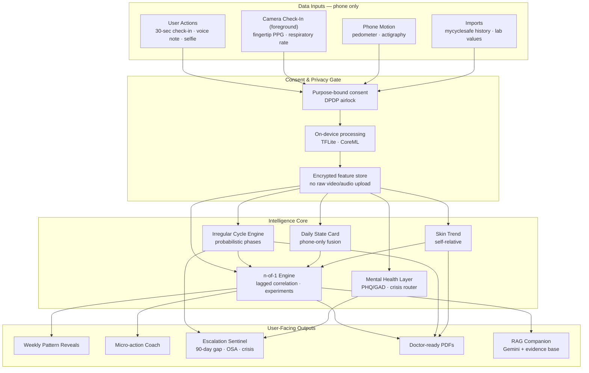
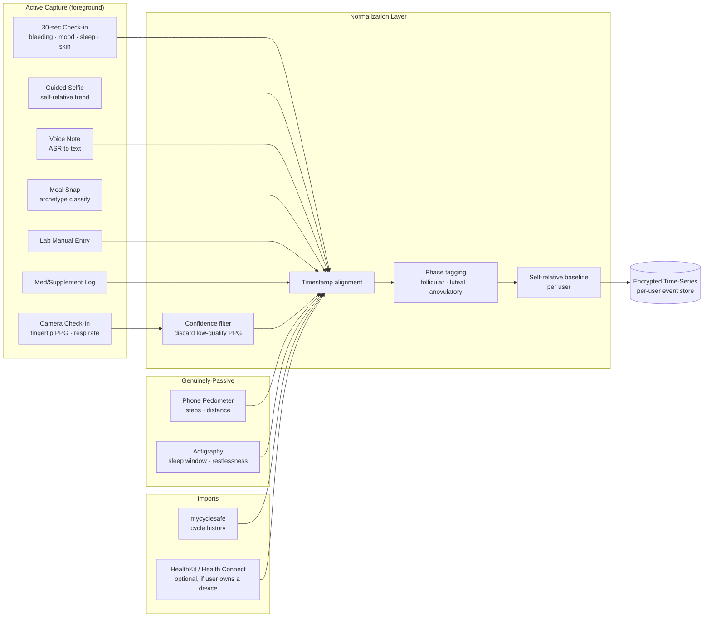
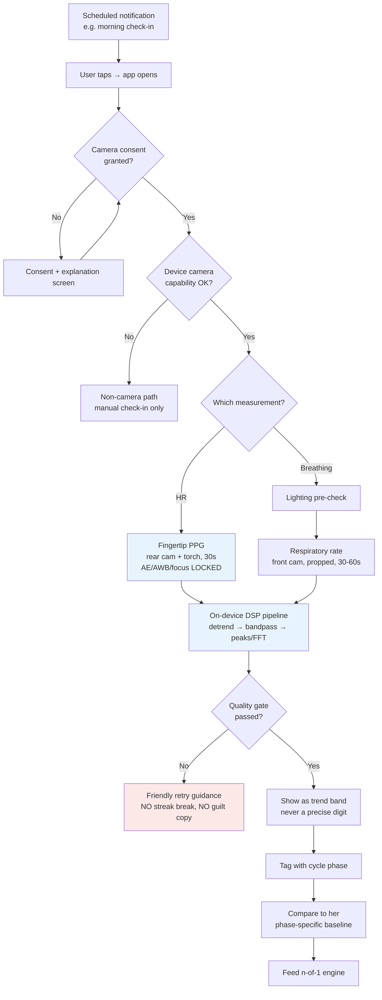
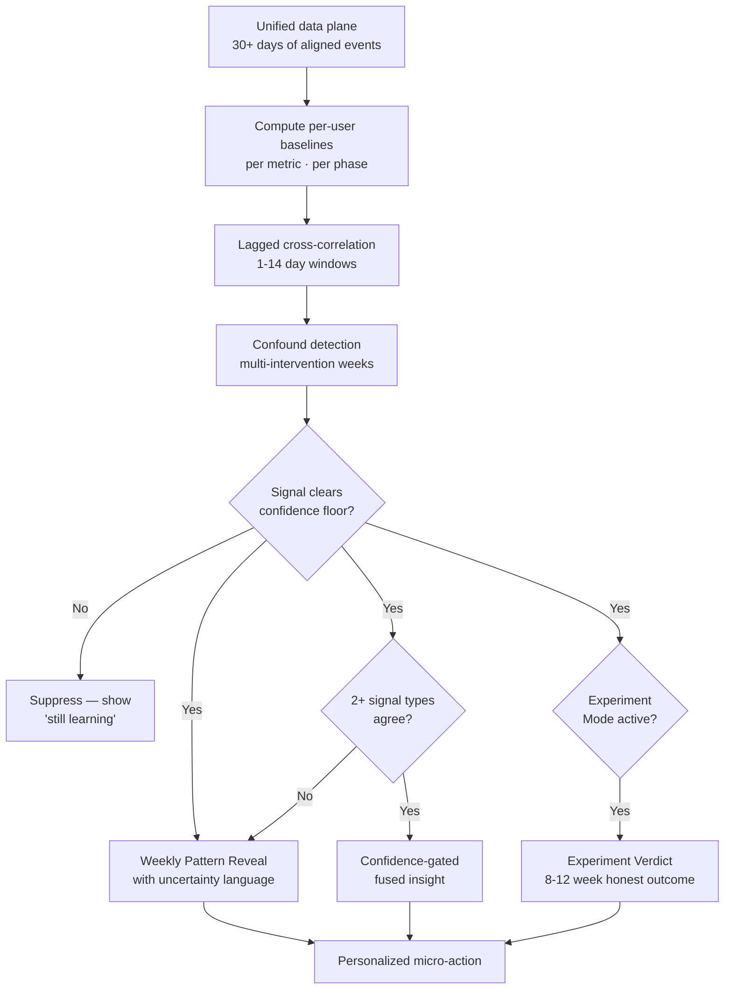
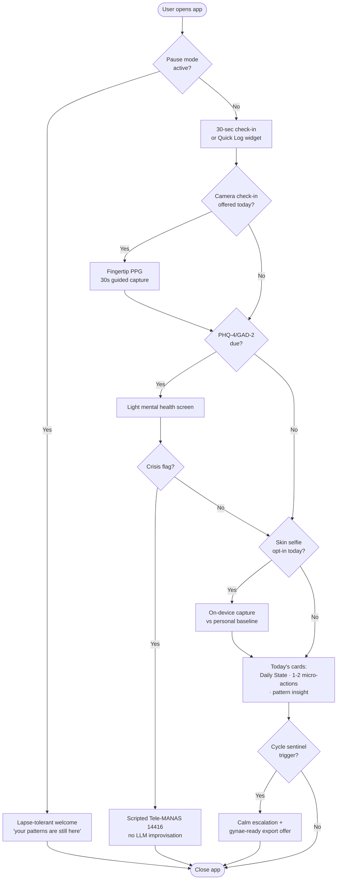
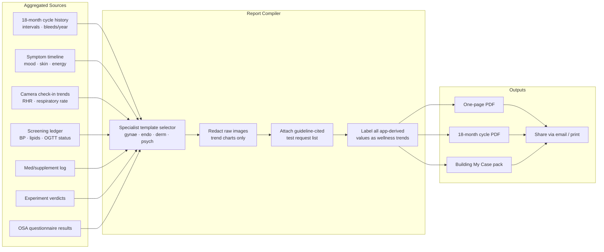
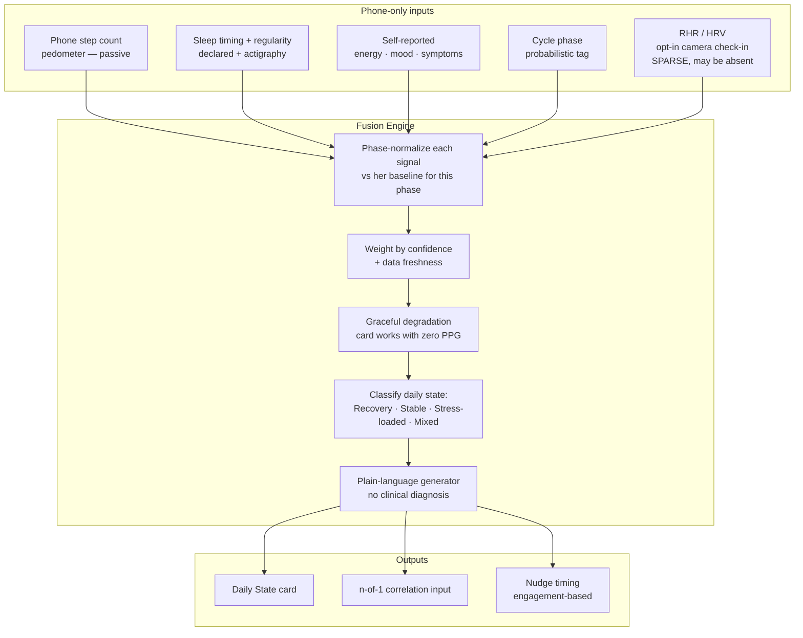
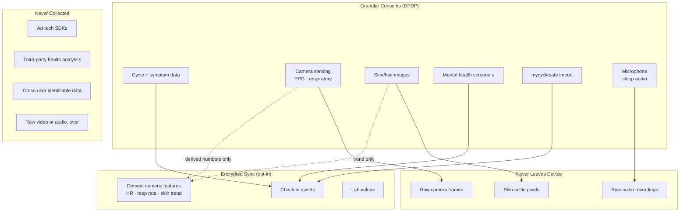

# PMOS Companion — Complete Features Specification
### v2 — feasibility-corrected

*Research-backed feature blueprint for a lifelong PMOS/PCOS monitoring and well-being product. Synthesizes patient pain-point research, clinical guidelines (2023 International Guideline, draft NICE PMOS 2026), competitive landscape analysis, and smartphone sensing research.*

**Related docs:** [01-product-definition.md](./01-product-definition.md) · [02-build-spec.md](./02-build-spec.md)
**Audit trail:** [../research/05-feasibility-audit/](../research/05-feasibility-audit/)

> ### ⚠️ This version has been feasibility-audited. Read §0 first.
> The previous draft contained features that a third-party app **cannot legally or technically ship**. They have been removed or rewritten. Two hard constraints now govern the whole document:
> **(1) NO EXTERNAL DEVICES** — nothing that requires the user to buy hardware.
> **(2) NO PASSIVE CAMERA CAPTURE** — every camera measurement is a foreground, user-initiated session. This is not a design preference; it is enforced by both mobile platforms.

---

## 0. Feasibility Rulings — what changed and why

An adversarial audit (platform policy, sensing science, device dependencies, citation verification) tested every sensing claim against official platform documentation and primary literature. Findings that changed the product:

### 0.1 The five findings that most change the plan

**1. "Passive capture on unlock" is an OS-vendor privilege, not an app capability.**
Google's PHRM works because Google owns the face-unlock path on Pixel. For a third-party app:
- **iOS** exposes *no* unlock event to apps at all, and `AVCaptureSession` is interrupted with `videoDeviceNotAvailableInBackground` the moment the app backgrounds. There is no trigger and no camera. ([Apple docs](https://developer.apple.com/documentation/avfoundation/avcapturesession/interruptionreason))
- **Android 9+** blocked background camera access. On Android 14+, starting a camera foreground service *from* the background throws `SecurityException` — `CAMERA` is a while-in-use permission. ([Android FGS docs](https://developer.android.com/develop/background-work/services/fgs/service-types))
- **Web/PWA** is the most restricted of the three, not an escape hatch.
- *Every* commercial rPPG SDK (Binah.ai, NuraLogix Anura, VitalLens) requires a foreground, user-held, still, well-lit session — the strongest possible evidence that no passive path exists for third parties.
→ **Every camera feature is now a 30–60s guided check-in.** The word "passive" is reserved only for pedometer/accelerometer data, which genuinely does run in the background.

**2. Apple bans camera-derived SpO₂ and blood pressure outright.**
App Store Review Guideline 1.4.1: *"Apps that claim to take x-rays, measure blood pressure, body temperature, blood glucose levels, or blood oxygen levels **using only the sensors on the device** are not permitted."* ([Apple](https://developer.apple.com/app-store/review/guidelines/))
This is independent of the science (which also fails — phone RGB sensors have IR-cut filters and cannot access the 660nm/940nm wavelengths pulse oximetry requires).
→ **SpO₂ and PTT blood pressure are cut entirely** — not deferred, cut. Renaming them ("BP trend", "cardiovascular load") does not avoid device classification.

**3. Two camera signals ARE validated and shippable — and they're enough.**
- **Fingertip contact PPG heart rate** (rear camera + torch): **MAPE 1.6% ± 4.3%**, no significant difference across skin-tone groups. This is classical DSP, not deep learning — a small team can build it.
- **Front-camera respiratory rate**: **MAE 0.78 ± 0.61 breaths/min**. Robust to skin tone and lighting because it tracks gross chest motion (0.1–0.7 Hz), not subtle colour change.
Both validated in Google's prospective studies ([Communications Medicine 2022](https://pmc.ncbi.nlm.nih.gov/articles/PMC9053269/)) and both shipped as **user-initiated** measurements.
→ **These two become the flagship sensing features.**

**4. The India skin-tone reality is a first-class design constraint, not a footnote.**
Google's own free-living PHRM data, by Monk Skin Tone, shows **valid-measurement rate**: 58% (MST 1–4), 45% (MST 5–7), **25% (MST 8–10)**. India sits predominantly in MST 5–8.
→ For face rPPG, **expect 25–45% of attempts to fail quality gating.** The UX must treat failure as the normal case: no broken streaks, no guilt copy, graceful degradation to zero HR data. *(This is a major reason fingertip PPG — which showed no significant skin-tone difference — is the primary HR path and face rPPG is secondary/beta.)*

**5. The "no external devices" rule costs less than feared — but the loss is hidden in v1, not v2.**
Of §3.14's 23 innovative features, only **2 are hard hardware dependencies** (~9%): CGM sync and glucose-response meal tagging. The quiet casualty is **v1's "wearable import"**, which silently assumed a smartwatch and was load-bearing for sleep stages, HRV, resting HR and SpO₂ — all consumed by the Metabolic Weather card, phase-normalized baselines, and the OSA screen.
→ Wearable data is now **optional enrichment only. Zero features depend on it.**

### 0.2 Cut entirely

| Feature | Reason |
|---|---|
| Passive HR on unlock (PHRM-style) | Platform-blocked on iOS, Android and web |
| Opportunistic re-sampling | Same — depends on background capture |
| Finger PPG SpO₂ | App Store 1.4.1 ban + phone sensors lack required wavelengths |
| Pulse transit time BP | App Store 1.4.1 ban; uncalibrated cuffless BP is not valid |
| Bedside ballistocardiography | Published BCG evidence is for dedicated under-mattress hardware, not a phone on a mattress |
| Camera stress from facial action units | Construct-validity failure — [Barrett et al. 2019](https://journals.sagepub.com/doi/10.1177/1529100619832930) rejects reading internal states from facial movement |
| Voice biomarker mood scoring | Cross-lingual transfer collapses to ~49% (chance) on binary tasks; no Hindi/Tamil validation |
| Automated hirsutism (mFG) scoring | No validated automated system; the reference standard itself has ~14-point interobserver variability |
| CGM sync (Dexcom Stelo / Abbott Libre) | Stelo not sold in India; Libre has no legal third-party API; ~₹8,400/month ≈ 50% of average per-capita monthly income; and the 2023 Guideline names OGTT (₹100–300), not CGM |
| Glucose-response meal tagging | Depends on CGM |
| External keystroke dynamics | No iOS API; Android requires accessibility services → store-review rejection |
| Google Fit integration | API sign-ups closed May 2024; support ends end-2026. Replaced by Health Connect |

### 0.3 Rewritten, not cut

| Was | Now |
|---|---|
| Passive front-camera HR on unlock | **Guided 30–60s camera check-in** (notification → tap → foreground capture) |
| "PHRM-style passive HR" as the hero | **Fingertip contact PPG** as the hero (better accuracy, skin-tone-fair) |
| Face rPPG as a primary metric | Face rPPG as **secondary/beta**, never the number symptoms correlate against |
| Wearable import (v1, load-bearing) | **Optional enrichment (Later/P3)** — no feature may depend on it |
| Brain fog via external typing speed | **In-app** typing dynamics in our own text fields — zero permissions |
| Overnight BCG heart rate | **Actigraphy sleep-window detection** (accelerometer bed/wake + restlessness) |
| Facial-AU stress | 1-tap self-reported stress + validated instrument |
| Voice mood biomarker | **Voice-note journaling** (ASR → text → symptom log) — voice as input, not biomarker |
| Automated hirsutism score | **Self-scored illustrated mFG questionnaire** (established practice) |
| Google Fit / Apple Health / Samsung | **Apple HealthKit (iOS) / Health Connect (Android)** |

### 0.4 Platform ruling — this cannot be a PWA

A PWA cannot deliver the sensing core: there is no web API for HealthKit or Health Connect (both native-only); `getUserMedia` requires a visible, foregrounded page; background sync is unreliable on iOS.

→ **Native (or React Native / Flutter) is required for anything touching camera, microphone, motion, or health stores.** A PWA may carry the *non-sensing* surface only — cycle logging, symptom journal, education, doctor exports. If the team wants PWA-first India reach, the sensing features must be explicitly scoped out of it.

### 0.5 Citation corrections

| Citation | Status | Fix |
|---|---|---|
| Google PHRM, Nature June 2026 | ✅ **Genuine** — Liao, Di Achille, Wu et al., *"Passive heart-rate monitoring during smartphone use in everyday life"*, Nature, 2 June 2026, DOI [10.1038/s41586-026-10507-6](https://doi.org/10.1038/s41586-026-10507-6) | Keep, but change the verb: it is a *demonstration of the science*, **not a capability we can integrate**. There is no PHRM SDK, API, ML Kit feature, or Health Connect type. |
| PHRM-mini model + Google HR dataset | ⚠️ **Licence-blocked** | Released for *non-commercial, non-clinical academic research only*, IRB-gated. **We cannot use them.** Remove from architecture. |
| Quoted accuracy (<10% MAPE, <5 bpm RHR MAE) | ⚠️ **Real but incomplete** | Computed only over clips that **passed quality gating** — 43.1% of free-living clips — and aggregated over ~231 clips/user/day. At 1–2 captures/day, plan for **5–8 bpm single-measurement error**. Never display a single reading to the digit. |
| "Fitbit passive heart rate" precedent | ❌ **Different thing** | That is wrist PPG on a purchased wearable, first-party only. Never cite it as precedent for camera rPPG. |
| Google camera HR precedent | ⚠️ **Misstated** | Google Fit shipped HR as **fingertip contact**, and respiratory rate as front-camera — both **user-initiated**. Do not cite Google as precedent for *passive* or *contactless HR*. |
| mHealth PCOS review — `doi.org/10.31435/ijitss...` | ⚠️ **Unverified indexing** | IJITSS is not confirmed in Scopus/Web of Science. Replace with an indexed source or corroborate before using in any pitch. |
| 2023 International Guideline, Lancet PMOS rename, MARS analysis | ✅ Verified | Keep |

---

## 1. Executive Summary

PMOS (Polyendocrine Metabolic Ovarian Syndrome, formerly PCOS) affects ~8–13% of reproductive-age women globally and ~1-in-10 in India. The 2026 global consensus rename, published in The Lancet, reframes it as a **lifelong metabolic-endocrine condition**, not a cysts-and-fertility problem — yet nearly every digital product still treats it that way.

**The product opportunity:** Build the first **complete monitoring companion** that:
- Treats irregular cycles as **signal, not error**
- Connects cycle + symptom + visual + physiological data into **personal cause→effect insights**
- Coaches evidence-graded daily levers the medical system withholds
- Arms users with **doctor-ready evidence** against long diagnostic delays
- Uses **phone-only camera sensing** (guided check-ins) to add objective signal without hardware
- Is **weight-neutral, mental-health-aware, and privacy-first by architecture**

**The hardware posture — now a headline claim:**
> **Works on a ₹10,000 phone. No watch, no sensor, no strips, no cuff. Nothing to buy.**
> Every competitor's metabolic layer needs hardware our user does not own.

---

## 2. Pain Points Research

*(Unchanged from v1 — this research was verified and is the strongest part of the document.)*

### 2.1 Healthcare System Failures

| Pain Point | Evidence | Severity |
|---|---|---|
| **Diagnostic delay (months to years)** | University of Colorado focus groups: 2 months–13 years to diagnosis; India avg ~7 months | Critical |
| **Medical gaslighting & dismissal** | Symptoms minimized as "normal puberty," "just stress," or personal failing | Critical |
| **Fertility-only framing** | Doctors emphasize weight loss + future fertility; teens need help with acne, anxiety, irregular cycles *now* | Critical |
| **No education at diagnosis** | Post-diagnosis: confused, overwhelmed, fearful; little treatment guidance | High |
| **Fragmented specialist care** | Gynae, endo, derm, psych rarely coordinated; user navigates alone | High |
| **Rare behavioral-health referral** | Nutrition/behavioral health referrals rare or non-existent at diagnosis | High |
| **Self-advocacy burden** | Users research symptoms, request tests, bring info to appointments — creates stress + misinformation risk | High |

### 2.2 Daily Living & Symptom Burden

| Pain Point | Evidence | Severity |
|---|---|---|
| **Multisystem symptoms** | Menstrual irregularity, hirsutism, cystic acne, pelvic pain, brain fog, binge urges, unrefreshing sleep, mood swings | Critical |
| **Symptom variability** | Same woman varies month-to-month; doctor sees a snapshot, user lives the film | High |
| **Anovulatory/phantom cycles** | Long gaps (60–200+ days), spotting vs period confusion, medication-induced bleeds | Critical |
| **Insulin resistance invisible day-to-day** | Energy crashes, cravings, skin flares tied to metabolic state — no daily feedback loop | High |
| **Body image distress** | 84.5% pathological appearance scores; shame is a churn mechanism | Critical |
| **Mental health burden** | Anxiety ~6×, depression ~4× general population; 75%/58% elevated scores | Critical |
| **Sleep apnea underdetected** | OSA prevalence ~37% in PMOS vs ~6% general; no app screens for it | High |

### 2.3 Digital Product Failures

| Pain Point | Evidence | Severity |
|---|---|---|
| **The fertility trap** | Flo, Clue, Ovia assume 28-day cycles + TTC intent; alienating for not-TTC users | Critical |
| **"Late period" anxiety** | "200 days… Flo never fails to remind me I'm late" — triggers pregnancy-scare loops | Critical |
| **Log without insight** | Dashboards that notice but never conclude | High |
| **Tracker burnout** | 80-field symptom logs; users quit by week 3 | High |
| **Split product landscape** | Cycle apps lack metabolic layer; lifestyle programs lack cycle intelligence | High |
| **Supplement overwhelm + misinformation** | "Overwhelmed by how many!"; commerce-funded content undermines trust | High |
| **Low information quality** | MARS analysis: commercial PCOS apps score high on aesthetics, low on clinical credibility | High |
| **No doctor-ready output** | Users hand-roll spreadsheets; 7-minute OPD visits can't reconstruct 18 months of data | Critical |
| **Privacy distrust** | Flo FTC settlement; health data + face photos require architectural trust | High |
| **English-only in India** | Major tracker rivals English-only; guideline mandates regionally validated screeners | Medium |
| **Hardware paywalls** | Metabolic insight gated behind a ₹4,000+ wearable or ₹8,400/month CGM | High |

### 2.4 Treatment & Self-Management Gaps

| Pain Point | Evidence | Severity |
|---|---|---|
| **n-of-1 disease, generic advice** | "What works differs significantly person to person" — no product personalizes | Critical |
| **Handed meds without explanation** | Metformin/GLP-1 strips with no adherence support or safety education | High |
| **No structured experiments** | Users try inositol/spearmint/yoga for months with no before/after verdict | High |
| **Screening non-adherence** | BP, lipids, OGTT, vitamin D — guideline-mandated but nobody tracks/reminds | High |
| **Endometrial protection gap** | >90-day gaps / <4 bleeds/year — users unaware of clinical significance | Critical |
| **ED risk from food tracking** | Calorie/macro apps worsen eating disorders in this population | High |

---

## 3. Feature Architecture

Each feature is tagged with **pain points**, **phase** (MVP · v1 · v2 · Later) and **priority** (P0–P3).
**Feasibility verdicts** are shown where the audit changed something: ✅ shippable · ⚠️ degraded/constrained.

---

### 3.1 Cycle & Reproductive Monitoring

*No feasibility issues — this section is pure application logic and is the product's spine.*

| Feature | Description | Phase | Priority |
|---|---|---|---|
| **Irregular-native cycle engine** ✅ | Probabilistic windows with confidence bands; day-count framing ("Day 47 of your usual 30–60 range"); zero "late"/"overdue" copy | MVP | P0 |
| **Named cycle states** ✅ | Irregular, oligomenorrhea, amenorrhea, medically regulated, post-pill recovery, perimenopause — not errors | MVP | P0 |
| **Bleeding taxonomy** ✅ | Period vs spotting vs withdrawal bleed vs breakthrough; flow intensity; clots; pain correlation | MVP | P0 |
| **Cycle-interval sentinel** ✅ | Rolling interval distribution; bleeds/year counter; calm escalation at >90-day gaps or <4 bleeds/year with endometrial-protection education | MVP | P0 |
| **Phase estimation (probabilistic)** ✅ | Soft follicular/luteal/anovulatory estimates with uncertainty — never hard ovulation prediction | MVP | P1 |
| **Medication bleed tracking** ✅ | OCP/progestin-induced bleeds separated from natural cycles for accurate interval math | v1 | P1 |
| **Ovulation awareness (opt-in TTC module)** ✅ | LH test logging, BBT, cervical signs — TTC users only; "monitoring ≠ predicting" in PMOS | Later | P2 |
| **Life-stage mode transitions** ✅ | Perimenopause hints; post-pill recovery timeline; teen-safe defaults | Later | P2 |

---

### 3.2 Unified Daily Check-In & Symptom Tracking

| Feature | Description | Phase | Priority |
|---|---|---|---|
| **30-second unified check-in** ✅ | One log: bleeding, sleep timing, movement, mood, energy, skin, cravings, pain, meds/supplements | MVP | P0 |
| **PMOS-specific symptom set** ✅ | Curated ~15 dimensions (not 80): hormonal, metabolic, mental, pain, sleep, digestion | MVP | P0 |
| **Severity sliders + quick tags** ✅ | 1-tap severity + optional notes; "same as yesterday" shortcut | MVP | P1 |
| **Pause mode** ✅ | First-class pause for travel, illness, mental-health breaks; no guilt copy on return | MVP | P0 |
| **Self-scored mFG questionnaire** ✅ | Illustrated nine-area 0–4 hirsutism scale the user completes herself — established clinical practice, replaces the cut automated scorer | v1 | P1 |
| **Lapse-tolerant re-engagement** ✅ | "Welcome back — your patterns are still here"; capped streaks; obsessive-tracking detection | v1 | P1 |
| **Quick Log widget** ✅ | Home-screen 5-second log for bleeding or mood | v1 | P1 |
| **Voice-note journaling** ⚠️ | Speak 30s → on-device ASR → text into symptom log. **Voice as an input modality, NOT a mood biomarker** (cross-lingual mood inference is ~chance) | v2 | P2 |
| **In-app typing dynamics (brain fog proxy)** ⚠️ | Inter-key interval, backspace rate, time-to-first-keystroke **inside our own text fields only** — zero special permissions. Never system-wide | Later | P3 |

---

### 3.3 Physiological Monitoring — phone-only, user-initiated

> **⚠️ Foundational rule:** every camera measurement is a **foreground, user-initiated session**. There is no passive, background, or on-unlock capture on any platform. Notification → tap → capture screen with live preview → 30–60s → result.

| Feature | Description | Phase | Priority |
|---|---|---|---|
| **Fingertip PPG heart rate** ✅ **FLAGSHIP** | Finger over rear camera + torch, 30s. Validated MAPE **1.6%**, no significant skin-tone difference. Classical DSP — buildable in-house | MVP | P0 |
| **Fingertip PPG HRV (rMSSD)** ⚠️ | Same capture. **Personal-baseline z-score only — never an absolute number.** 30fps gives 33ms IBI quantisation; needs ≥50Hz or peak interpolation. Do NOT attempt HRV from face rPPG | v1 | P1 |
| **Contactless respiratory rate** ✅ **SHOWPIECE #2** | Front camera, phone propped, 30–60s. Tracks chest motion 0.1–0.7Hz. Validated MAE **0.78 br/min**. Robust across skin tones and lighting | v1 | P1 |
| **Face rPPG heart rate** ⚠️ **BETA** | Front camera, 45–60s, locked AE/AWB. RMSE ~2 bpm in lab, degrades badly in low light and at elevated HR. **Label experimental; never the number symptoms correlate against.** Expect 25–45% failure in India lighting/skin tones | v2 | P2 |
| **Phase-normalized baselines** ✅ | Compare today's HR/HRV to *her* phase-specific baseline, not population average — luteal dips aren't flagged as problems | v1 | P1 |
| **Phone step count** ✅ | `CMPedometer` / Health Connect `StepsRecord` — genuinely passive, phone-only, no wearable | MVP | P1 |
| **Actigraphy sleep window** ⚠️ | Accelerometer bed/wake detection + restlessness index. Replaces the cut BCG feature. Gross sleep timing, **not sleep staging** | v2 | P2 |
| **Sleep regularity tracking** ✅ | Bed/wake consistency (timing, not duration); correlates with skin/mood in n-of-1 engine | v1 | P1 |
| **Snoring / sleep-audio analysis** ⚠️ | On-device mic during a **user-started "Start night"** session; phone on charge; persistent recording indicator all night; audio analysed on-device and discarded, **never uploaded**. Requires App Review 2.5.4/2.5.14 justification + Android mic FGS declaration. India OEM battery-killers will truncate nights — handle gracefully | v2 | P2 |
| **Optional wearable enrichment** ⚠️ | HealthKit / Health Connect read **if the user already owns a device**. **Zero features may depend on it.** Never assumed, never in the value prop | Later | P3 |

**❌ Cut from this section:** SpO₂ (App Store 1.4.1 + physics), PTT blood pressure (1.4.1 + not valid uncalibrated), overnight BCG (dedicated-hardware evidence only), passive on-unlock capture (platform-blocked), Google Fit (API retired).

**Regulatory note:** all physiological features are **wellness signals, not clinical findings**. Copy: *"trend for self-awareness — not a diagnosis."* Never display as ECG-equivalent. No arrhythmia detection, no clinical alerts.

---

### 3.4 n-of-1 Personalization Engine

*The audit found no feasibility problems here. **This — not the sensing — is the product's real moat.***

| Feature | Description | Phase | Priority |
|---|---|---|---|
| **Weekly pattern reveal (v0)** ✅ | Lagged associations with honest uncertainty ("skin better 3 days after 7+ hr nights; 12 observations, weak signal"); suppression below confidence floor | MVP | P0 |
| **Per-user baselines** ✅ | Every metric scored vs *her* history, not population norms | MVP | P0 |
| **Lag window discovery** ✅ | Detect 1–14 day delays (sleep→skin, supplement→mood, food→cycle) | MVP | P1 |
| **Experiment Mode** ✅ | Structured n-of-1 trials: pre-declared outcome, 8–12 week window, washout, honest verdict ("no detectable change" is valid) | v1 | P0 |
| **Experiment templates** ✅ | Myo-inositol, sleep window, spearmint tea, yoga, low-GL eating, metformin adherence | v1 | P1 |
| **Confound warnings** ✅ | "You changed 3 things this week — results may be unclear" | v1 | P1 |
| **Digital experiment control arm** ✅ | Auto-uses pre-intervention weeks as baseline — no manual "before" setup | v1 | P1 |
| **Confidence-gated insight fusion** ⚠️ | Surface a pattern only when ≥2 signal types agree. **Re-tune thresholds for the reduced phone-only signal set** — do not inherit numbers computed against a 7-signal fusion | v1 | P1 |
| **Privacy-preserving cohort priors** ✅ | Aggregate-only, opt-in, k-anonymized ("women with patterns like yours…") | Later | P2 |
| **Full phenotype driver profiler** ✅ | Symptoms + labs → driver profile, refined by n-of-1 results | Later | P2 |

---

### 3.5 Visual Biomarker Monitoring (Skin)

| Feature | Description | Phase | Priority |
|---|---|---|---|
| **Guided selfie capture** ✅ | Fixed on-screen face outline, lighting-quality check that **refuses** bad shots, front camera, flash off, stored locally | v1 | P1 |
| **Self-relative time-lapse** ✅ **the real retention feature** | Side-by-side / time-lapse the user reads herself. **Needs no model at all** — and is more trustworthy than a score | v1 | P1 |
| **Coarse acne category** ⚠️ | 4-level (clear/mild/moderate/severe) only if fine-tuned on a purpose dataset. Research reaches ~84–87% severity accuracy but **lesion-count detection is unreliable (mAP 0.54)** — never show counts. Skin-tone generalisation is a documented gap | v2 | P2 |
| **On-device vision processing** ✅ | TFLite/CoreML so face images never leave the phone (production target) | v2 | P1 |
| **Hard anti-beauty guardrails** ✅ | No symmetry/attractiveness scores, no before/after collages, no goal bodies, no cross-user comparison | MVP | P0 |
| **Separate granular consent** ✅ | Skin images: unbundled consent, one-tap delete, no training use without explicit opt-in | v1 | P0 |

**❌ Cut:** automated hirsutism/mFG density scoring → replaced by the **self-scored illustrated mFG questionnaire** in §3.2.

---

### 3.6 Metabolic & Lab Monitoring

> **📋 Ruling — labs are NOT a "device" violation.** The no-external-devices rule exists to stop the product being unusable unless the user buys hardware. Labs fail every prong: a one-off *service* not an owned device; **mandated by the 2023 Guideline whether or not this app exists**; low one-off cost in India (fasting insulin ~₹800, OGTT ₹100–300).
> **Two hard constraints follow:** (a) **no** n-of-1 pattern, experiment verdict, coaching lever, insight, or doctor export may be gated behind a lab value — the Lab vault is optional enrichment and everything must degrade gracefully to zero labs; (b) vitamin-D education must never be blocked on a test result.

| Feature | Description | Phase | Priority |
|---|---|---|---|
| **Test-request helper** ✅ | "Tests you can ask for by name" — fasting insulin, free testosterone, DHEAS, 75g OGTT, AMH | MVP | P0 |
| **Guideline screening ledger** ✅ | BP annually, lipids at diagnosis, glycaemic status every 1–3 yrs, OGTT pre-pregnancy; due/done/trended. **BP is measured at a clinic or pharmacy — we do not measure BP** | v1 | P0 |
| **Lab vault** ✅ | Store fasting glucose, insulin, HOMA-IR, LH:FSH, androgens, lipids, thyroid, vitamin D, HbA1c with dates | v1 | P1 |
| **Reference range context** ✅ | Values against standard ranges; trend arrows; "discuss with your doctor" framing | v1 | P1 |
| **OGTT reminder + prep guide** ✅ | Pre-test fasting instructions; result logging template. **The guideline-recommended path — and the honest replacement for CGM** | v1 | P1 |
| **Vitamin D test-then-correct** ✅ | Push the test, not the pill; remind retest; clinician sets dose | v1 | P1 |

**❌ Cut:** CGM sync, glucose-response meal tagging, home glucometer logging. There is no phone-only substitute for a glucose value — we say so plainly rather than substituting a fake one.

---

### 3.7 Mental Health & Emotional Well-Being

| Feature | Description | Phase | Priority |
|---|---|---|---|
| **Crisis-safe mental-health floor** ✅ | PHQ-4/GAD-2 light check-ins; pre-scripted Tele-MANAS 14416 flow; **zero LLM improvisation**; never paywalled | MVP | P0 |
| **Full validated screeners** ✅ | Regionally validated PHQ-9/GAD-7 (proper Hindi/Tamil validation, not machine translation) | v1 | P0 |
| **Mood trajectory view** ✅ | 30/90-day mood trend aligned to cycle phase and interventions | MVP | P1 |
| **Mood-aware coaching pacing** ✅ | Suppress action-heavy nudges on bad mental-health days | v1 | P1 |
| **CBT/ACT micro-skills** ✅ | 2–5 min evidence-based skills; framed "practice, not therapy" | v1 | P1 |
| **1-tap self-reported stress** ✅ | Single-item stress rating + validated instrument. **Replaces the cut facial-AU stress inference** | v1 | P1 |
| **HRV biofeedback (paced breathing)** ⚠️ | 4-week fingertip-PPG breathing program. Uses HRV as **relative within-session feedback**, which is defensible even where absolute rMSSD is not | v2 | P2 |
| **ED screen before food depth** ✅ | Eating-disorder screen gates any calorie/macro tracking | MVP | P0 |
| **Isolation-aware community (optional)** ✅ | Moderated, anonymity-first peer space — not the core loop | Later | P3 |

---

### 3.8 Coaching & Lifestyle Levers

*No feasibility issues.*

| Feature | Description | Phase | Priority |
|---|---|---|---|
| **Daily micro-action coach (thin MVP)** ✅ | 1–2 evidence-graded, phase-aware micro-actions/day from curated deck | MVP | P0 |
| **Personalized coach (v1)** ✅ | Actions derived from *her* n-of-1 patterns ("your data suggests…") | v1 | P0 |
| **Indian-cuisine-native guidance** ✅ | Additive language ("add dal and a vegetable"); regional examples; no calorie counting by default | MVP | P1 |
| **Movement dose tracker** ✅ | 150–300 min/wk moderate + 2× strength; 10-min entries count; capability framing | MVP | P1 |
| **Low-GL eating patterns** ✅ | Mechanism coached inside her cuisine; ED-gated; no macro targets | v1 | P1 |
| **Meal-archetype tagging** ⚠️ | AI meal snap classifies high-GL vs low-GL Indian archetypes (paratha vs dal-chawal) → correlate with **symptoms**, not glucose. Replaces the cut CGM-dependent version | v2 | P2 |
| **Yoga/breathwork library** ✅ | Guided sessions as a logged lever; HOMA-IR evidence cited honestly | v1 | P1 |
| **Sleep regularity coaching** ✅ | Consistent bed/wake targets based on *her* best-skin / best-mood weeks | v1 | P1 |
| **OSA screen-and-refer** ⚠️ | Symptom questions → doctor-ready summary; drowsy-driving urgent flag. Questionnaire-driven, not sensor-driven. **⚠️ ESS requires a paid commercial licence and STOP-BANG is CC BY-NC-ND (non-commercial)** — ship unbranded symptom questions or license properly. See §9.2 | v1 | P0 |
| **Evidence grades on every claim** ✅ | Visible certainty grade + date on all educational content | MVP | P0 |
| **Smart nudge timing** ⚠️ | Time nudges to engagement patterns and declared routine — **not** to passive physiological state (which we cannot continuously observe) | v2 | P2 |

---

### 3.9 Treatment & Medication Companion

*No feasibility issues.*

| Feature | Description | Phase | Priority |
|---|---|---|---|
| **Med/supplement stack tracker** ✅ | Log what, when, dose; correlate with outcomes in n-of-1 engine | MVP | P1 |
| **Evidence-graded supplement library** ✅ | Inositol, spearmint, omega-3, vit D — studied dose, certainty grade, India availability/price; **zero commerce** | v1 | P0 |
| **Prescribed-treatment companion** ✅ | Metformin/GLP-1/spironolactone/OCP: education, adherence logging, side-effect tracking, prescriber question lists | v1 | P1 |
| **GLP-1 safety education** ✅ | Restored ovulation ⇒ contraception required; neutral, non-promotional | v1 | P0 |
| **Experiment ↔ supplement integration** ✅ | Start inositol → auto-enrolled 12-week experiment with pre-declared outcomes | v1 | P1 |
| **Stacking-confound warnings** ✅ | "You started 3 supplements this week" | v1 | P1 |

---

### 3.10 Doctor & Clinical Advocacy Tools

*No feasibility issues. **This is the second pillar that carries the product.***

| Feature | Description | Phase | Priority |
|---|---|---|---|
| **Doctor-visit one-pager v0** ✅ | Symptom timeline + cycle history + med log; guideline-cited test requests | MVP | P0 |
| **Gynae-ready PDF export** ✅ | 18-month cycle history, interval stats, bleeding log — one tap | MVP | P0 |
| **Specialist-specific prep reports** ✅ | Tailored summaries for gynae, endocrinologist, dermatologist, psych | v1 | P1 |
| **"Building My Case" mode** ✅ | For undiagnosed users: symptom evidence pack + diagnostic criteria explainer + question scripts | v1 | P1 |
| **Question scripts** ✅ | Guideline-backed assertiveness training ("Can we check fasting insulin and free testosterone?") | v1 | P0 |
| **Localized referral pathways** ✅ | "See a doctor" becomes actionable — city, budget, telemedicine options | v1 | P1 |
| **Red-flag escalation copy** ✅ | Chest pain, fainting, severe bleeding, suicidality → "see a doctor now" with local resources | MVP | P0 |
| **Clinician portal** ✅ | Structured annual review reports co-designed with Indian gynaecologists/endocrinologists | Later | P2 |

---

### 3.11 Education & Awareness

| Feature | Description | Phase | Priority |
|---|---|---|---|
| **Dual-named content ("PMOS formerly PCOS")** ✅ | Product, store metadata, in-app copy — own both search surfaces for the 3-year transition | MVP | P0 |
| **Evidence-graded education library** ✅ | Mechanism explainers, myth-busting (PCOD vs PMOS, "4 types" pseudoscience), long-term risks | MVP | P1 |
| **Life-long condition framing** ✅ | Not a cure narrative; progress = variance shrinking, screenings done, energy improving | MVP | P0 |
| **Gemini RAG health companion** ✅ | Evidence-grounded Q&A over a curated guideline corpus; cites sources; never diagnoses or doses | MVP | P1 |
| **Vernacular content (India-native)** ✅ | Hindi/Tamil UI + content; regional cuisine coaching; validated screeners | v1 | P0 |
| **18+ age gate** ⚠️ | **Changed from "teen-safe mode."** DPDP prohibits profiling of under-18s and our n-of-1 engine *is* profiling; the Rule 11 healthcare exemption does not reach a non-clinical app. Adolescent support becomes a post-compliance roadmap item — see §9.1 | MVP | P0 |

---

### 3.12 Privacy, Trust & Data Architecture

| Feature | Description | Phase | Priority |
|---|---|---|---|
| **Purpose-bound DPDP consent airlock** ✅ | Separate consents: cycle import, camera sensing, mental health, skin images — granular delete/export | MVP | P0 |
| **mycyclesafe.ai funnel + history import** ✅ | Bridge for irregular-cycle users; cold-start kill with 12–18 months imported data | MVP | P0 |
| **No ad-tech SDKs** ✅ | Zero third-party analytics on health events; no data sale | MVP | P0 |
| **On-device-first** ✅ | Camera frames and audio processed on-device; only derived numeric features sync (encrypted, opt-in) | v1 | P0 |
| **One-tap full data export + delete** ✅ | DPDP/GDPR compliance; trust signal | MVP | P0 |
| **Local-first mode (optional)** ✅ | Full offline operation; no account required | v2 | P2 |

---

### 3.13 Notifications & Engagement

| Feature | Description | Phase | Priority |
|---|---|---|---|
| **Insight-driven notifications only** ✅ | Every notification = personal insight or due action; never "you're late" | MVP | P0 |
| **Quiet hours + frequency cap** ✅ | Max 1–2/day; user-controlled | MVP | P0 |
| **No guilt streaks** ✅ | Celebrate consistency optionally; never punish misses. **Doubly important given expected camera-capture failure rates** | MVP | P0 |
| **Weekly digest** ✅ | One weekly pattern summary push | v1 | P1 |

---

### 3.14 The Camera Check-In — build specification

*This replaces the former "passive sensing" pillar. Everything here is foreground, user-initiated, phone-only.*

#### 3.14.1 Hardware posture (state this publicly)
> **21 of 23 originally-specified innovative features require nothing but the phone.** The 2 that required hardware (CGM sync, glucose-response meal tagging) have been removed. **No feature in this product requires a purchase.**

#### 3.14.2 Fingertip PPG — the flagship

**Why this one:** the only camera vital sign with large prospective validation (MAPE **1.6% ± 4.3%**), and — critically for India — **no significant difference across skin-tone groups** (1.8% very light–intermediate, 1.3% tan/brown, 1.8% dark).

```
Capture:   rear camera, torch ON continuously, 30s @ ≥30fps (60fps if available)
Critical:  LOCK auto-exposure, auto-white-balance and focus before capture
           (AE hunting is the #1 signal killer)
ROI:       full-frame mean of the RED channel
           (red for fingertip transmission; green is for face rPPG)
Chain:     per-frame spatial mean
           → detrend (smoothness-priors, λ≈10)
           → 4th-order Butterworth bandpass 0.7–3.5 Hz (42–210 bpm)
           → peak detection + FFT cross-check
           → quality gate (reject on saturation, motion, weak AC/DC ratio)
Output:    BPM as a range/band, never a single precise digit
```
**Coach the user:** rest the finger lightly (pressing hard occludes the capillary bed), warm hands, stay still.

#### 3.14.3 Respiratory rate — showpiece #2

**Why:** MAE **0.78 ± 0.61 br/min**, and it tracks *gross chest motion*, so it is far more robust to skin tone and lighting than rPPG.

```
Capture:   front camera, flash off, 30fps, 30–60s, phone PROPPED (add an
           explicit "prop your phone against something" onboarding step —
           handheld capture is the main failure mode)
ROI:       chest/shoulder region from pose or face-mesh landmarks, expanded down
Chain:     dense optical flow or ROI intensity/centroid signal
           → detrend → bandpass 0.1–0.7 Hz (6–42 breaths/min)
           → FFT peak + zero-crossing cross-check
```

#### 3.14.4 Face rPPG — clearly labelled beta

```
Capture:   front camera, flash OFF, 30fps, exposure + WB LOCKED, 45–60s
ROI:       forehead + both cheeks via MediaPipe Face Mesh (skip eyes, lips, nostrils)
Chain:     per-ROI spatial mean R/G/B → POS or CHROM chrominance projection
           (~20 lines of NumPy, public literature) → detrend → bandpass → FFT
Reality:   RMSE ~2 bpm in controlled lab conditions; degrades badly under low
           illumination and at elevated heart rates. Warm/flickering Indian
           indoor LED lighting beats in-band with the pulse signal.
```
**Expect 25–45% of attempts to fail quality gating for MST 5–8 users.** Ship a lighting pre-check before capture; treat failure as normal; never break a streak on it.

#### 3.14.5 Build-vs-buy

| Option | Reality |
|---|---|
| **In-house (recommended for fingertip PPG)** | Classical DSP. Open-source references: `vitallens-python`, `rPPG-Toolbox` (POS/CHROM/G). No licence cost, full control, on-device by construction |
| **Binah.ai SDK** | Fully on-device (matters for DPDP + offline), iOS 14+/iPhone XS+, Android 10+. Per-seat pricing — negotiate flat/MAU-capped |
| **NuraLogix Anura** | Requires Camera2 **FULL/LEVEL_3** — a material share of India's entry-level Android base will not qualify |
| **VitalLens (cloud)** | ❌ **Economically impossible**: priced per *frame*. 10K DAU × 1 capture/day ≈ 72M frames/month ≈ 18× the top published tier. No Android SDK |

**Device-capability gate is mandatory** — check camera capability at install and provide a non-camera path for phones that don't qualify.

#### 3.14.6 Store compliance checklist (pre-launch, non-negotiable)
1. Google Play **Health apps declaration form** (mandatory since Aug 2025; Jan 2026 added Medical Device labelling + stricter Health Connect justification)
2. **Store-listing device-compatibility disclosure** naming minimum OS and camera requirements
3. In-app **"not a medical device"** disclaimer + clinician-consultation reminder
4. Privacy policy in-app and in listing
5. **Hard rule: no marketing or in-app copy may quote Google's PHRM accuracy figures as ours.** We cite only accuracy measured on our own pipeline
6. App Review 2.5.4 / 2.5.14 justification prepared if shipping overnight audio
7. Health Connect per-data-type justification — budget **2–4 weeks review latency and possible rejection**

#### 3.14.7 Design principles for all sensing
1. **Foreground + user-initiated** — no passive capture exists on any platform
2. **Opt-in with separate consent** per sensor class (camera, mic, motion)
3. **On-device first** — raw video/audio never uploaded; only derived numbers sync
4. **Confidence gating** — discard noisy readings; show "still learning", never false precision
5. **Self-relative only** — trends vs *her* baseline, never population comparison
6. **Wellness framing** — "signal for self-awareness", never "you have condition X"
7. **Graceful degradation** — every downstream feature must work with **zero** sensor data
8. **Failure is the normal case** — especially for MST 5–8 users in warm indoor light

---

## 4. Corrected Phase Roadmap

### Phase 0 — MVP
*Core magic loop: 30-sec log → pattern reveal → one micro-action → escalation when it matters.*

- Irregular-native cycle engine + interval sentinel
- 30-second unified check-in + pause mode
- Weekly pattern reveal (n-of-1 v0) + per-user baselines + lag discovery
- **Fingertip PPG heart rate** ← the flagship sensing feature, in from day one
- Thin daily micro-action coach
- Gynae-ready PDF + doctor one-pager v0 + test-request helper
- Crisis-safe mental-health floor (PHQ-4/GAD-2 + Tele-MANAS)
- Dignity defaults (weight opt-in, **18+ age gate**, no shame copy, anti-beauty guardrails)
- Evidence-graded education starter + Gemini RAG companion
- mycyclesafe handoff + consent airlock + privacy architecture
- Phone step count

**Success metrics:** D7 retention >40%; ≥1 pattern reveal/user/week; zero "late period" copy incidents; **fingertip PPG capture success >85%**.

### Phase 1 — v1
*Retention + trust deepeners; indispensable at doctor visits.*

- Experiment Mode + templates + digital control arm + supplement library
- Full mental-health layer (validated PHQ-9/GAD-7) + 1-tap stress + CBT/ACT skills
- Guided skin selfie + self-relative time-lapse
- Self-scored mFG questionnaire
- Full doctor advocacy kit + specialist reports + "Building My Case"
- Guideline screening ledger + lab vault + OGTT flow
- Sleep regularity + **questionnaire-based OSA screen-and-refer**
- Prescribed-treatment companion + GLP-1 safety education
- **Contactless respiratory rate**
- Fingertip HRV (personal z-score only) + phase-normalized baselines
- Vernacular v1 (Hindi/Tamil) + lapse-tolerant re-engagement

**Success metrics:** 90-day retention >25%; ≥1 doctor export/user/quarter; experiment completion >30%.

### Phase 2 — v2
*Deeper sensing + on-device intelligence.*

- Face rPPG (beta, clearly labelled)
- Actigraphy sleep-window detection
- Snoring / sleep-audio analysis (user-started sessions)
- On-device skin vision scoring + coarse acne category
- HRV biofeedback (paced breathing)
- Meal-archetype tagging (symptom-correlated, not glucose)
- Voice-note journaling (ASR input)
- Local-first / offline mode
- Smart nudge timing (engagement-based)
- **Daily State card** (rebuilt — see §6.7)

**Success metrics:** camera check-in adoption >20% of DAU; on-device processing >80% of skin scores.

### Phase 3 — Later
- Privacy-preserving cohort priors
- Clinician portal + structured annual review
- Full phenotype driver profiler
- Life-stage modes (perimenopause, TTC opt-in)
- Regional depth (more languages, cuisines)
- Optional moderated community
- In-app typing dynamics (brain fog proxy)
- Optional wearable enrichment *(explicitly last — nothing depends on it)*

---

## 5. Precedent & Evidence Base

### 5.1 What the research actually establishes

**Google Research, Nature 2026** (Liao, Di Achille, Wu et al., *"Passive heart-rate monitoring during smartphone use in everyday life"*, DOI [10.1038/s41586-026-10507-6](https://doi.org/10.1038/s41586-026-10507-6)) demonstrated that smartphone-camera rPPG can reach wearable-grade daily resting-HR accuracy.

**What we can take from it:** the underlying signal science is sound.
**What we cannot take from it:**
- The **trigger** — capture fires on the OS face-unlock event, a platform-owner hook. No SDK, API, ML Kit feature or Health Connect type exists.
- The **model** — PHRM-mini and the Google HR dataset are licensed for *non-commercial, non-clinical academic research only*, IRB-gated. We cannot use them.
- The **aggregation** — accuracy figures assume ~231 clips/user/day, of which only 43.1% pass quality gating. At 1–2 user-initiated captures/day we should plan for **5–8 bpm single-measurement error**.

**Google's *shipped* camera features** (validated in [Communications Medicine, 2022](https://pmc.ncbi.nlm.nih.gov/articles/PMC9053269/)) are the honest precedent, and both are user-initiated:
| Feature | Method | Accuracy |
|---|---|---|
| Heart rate | **Fingertip contact**, rear camera + torch | MAPE 1.6% ± 4.3% |
| Respiratory rate | Front camera, contactless | MAE 0.78 ± 0.61 br/min |

**Glossary note:** "PHRM" in this document means camera rPPG only. It is unrelated to Fitbit's wrist-PPG passive HR / AFib work, which requires a purchased wearable and is first-party only. Never cite the Fitbit figures as precedent here.

### 5.2 Why camera HR matters for PMOS

| Use case | Value |
|---|---|
| Resting HR trend | Insulin resistance, stress, sleep debt and inflammation all affect RHR; the personal trend is what matters, not a single reading |
| Phase-normalized comparison | RHR/HRV vary naturally across cycle phases — compare to *her* luteal baseline rather than alarming on a normal dip |
| Objective experiment outcome | An 8-week inositol or lifestyle experiment gets a signal that isn't self-report |
| OSA referral strength | Elevated RHR + unrefreshing sleep + positive questionnaire screen → a stronger referral case |
| Reduced self-report bias | One objective anchor in an otherwise entirely subjective dataset |

### 5.3 Available phone-only signals

| Signal | Source | Phase | Status |
|---|---|---|---|
| Heart rate | Fingertip PPG (rear + torch) | MVP | ✅ Validated, skin-tone-fair |
| Respiratory rate | Front camera, contactless | v1 | ✅ Validated |
| HRV (relative) | Fingertip PPG | v1 | ⚠️ Personal z-score only |
| Steps / movement | Phone pedometer | MVP | ✅ Genuinely passive |
| Sleep timing | Declared + actigraphy | v1/v2 | ⚠️ Timing, not staging |
| Circadian regularity | Declared bed/wake + app engagement | v1 | ⚠️ No unlock-event access |
| Snoring events | On-device mic, user-started | v2 | ⚠️ Session-based |
| Skin trend | Guided selfie | v1 | ⚠️ Self-relative |
| Face rPPG HR | Front camera | v2 | ⚠️ Beta only |
| ~~SpO₂~~ | — | — | ❌ Banned + physically infeasible |
| ~~Blood pressure~~ | — | — | ❌ Banned + not valid |
| ~~Glucose~~ | — | — | ❌ No phone-only path exists |
| ~~Sleep stages~~ | — | — | ❌ Requires a wearable |

---

## 6. System Data Flow Diagrams

### 6.1 High-Level Architecture



### 6.2 Data Ingestion Pipeline



### 6.3 Camera Check-In Flow *(replaces the former passive-on-unlock flow)*



### 6.4 n-of-1 Personalization Engine Flow



### 6.5 Daily User Journey



### 6.6 Doctor Export Data Flow



### 6.7 Daily State Card — rebuilt for phone-only inputs

> **Corrected:** the former "Metabolic Weather" card declared 7 inputs, 2 of which required hardware (glucose CV → CGM; sleep stages → wearable) and 2 more of which assumed continuous wearable sampling. Rebuilt around what a phone alone produces.



**Not inputs:** glucose (no phone-only path), wearable sleep stages (requires hardware). The card is defined without them.

### 6.8 Privacy & Consent Boundaries



---

## 7. Competitive Feature Matrix

> ### 🚨 CORRECTED — the previous matrix was materially wrong
> Direct verification of the two closest competitors found that **both are real and both already ship several features the earlier draft claimed as our differentiators.** Some of the earlier draft's feature descriptions match their public marketing copy almost verbatim (e.g. the "Day 47 sits inside your usual range" framing, and the phrase "Building My Case"). Anyone can check these sites in thirty seconds — putting the old matrix in front of judges or investors would have been a credibility disaster.

### 7.1 Verified competitor positions

**PMOS Vera** ([pmosvera.com](https://pmosvera.com/)) — **shipped**, iPhone-only, $5.99/mo or $39.99/yr.
Already has: irregular-native framing (*"Day 47 sits inside your own usual range"* — near-identical to our copy), symptom/mood logging, **lab tracking (HOMA-IR, LH:FSH, vitamin D)**, Apple Health read-only, **photo journal for skin/hair**, **doctor PDF export** (cycles/symptoms/labs), explicit **weight-neutral** stance ("no calorie counting, no weighing, no scoring"), and a **stronger privacy architecture than ours** — no servers, no accounts, no cloud at all, AES-256 on-device.

**Josie** ([josie.care](https://josie.care/)) — **not shipped**; waitlist, "beta coming soon."
Claims: 50+ PCOS symptoms across 8 categories, pattern recognition across cycle/medication/lifestyle, **"specialist-specific prep reports"**, **"Building My Case mode for women still seeking a diagnosis"**, and four cycle states — **irregular, oligomenorrhea, amenorrhea, medically regulated** — matching our §3.1 "Named cycle states" exactly.

### 7.2 Corrected matrix

| Capability | Flo/Clue | **PMOS Vera** (shipped) | **Josie** (unshipped) | Veera/Gynoveda | Our Product |
|---|---|---|---|---|---|
| Irregular-native (no "late") | ❌ | ✅ | ✅ | ❌ | ✅ *(parity, not advantage)* |
| Named cycle states | ❌ | Partial | ✅ | ❌ | ✅ *(parity)* |
| Doctor-ready export | ❌ | ✅ | ✅ | ✅ (paid) | ✅ *(parity)* |
| Specialist-specific prep reports | ❌ | ❌ | ✅ | ❌ | ✅ *(parity)* |
| "Building My Case" for undiagnosed | ❌ | ❌ | ✅ | ❌ | ✅ *(parity)* |
| Weight-neutral by default | ❌ | ✅ | Partial | ❌ | ✅ *(parity)* |
| Self-relative skin/photo journal | ❌ | ✅ | ❌ | ❌ | ✅ *(parity)* |
| Lab tracking | ❌ | ✅ | ❌ | Partial | ✅ *(parity)* |
| Pattern / cause→effect surfacing | ❌ | Partial | ✅ (claimed) | ❌ | ✅ *(narrow lead — see below)* |
| Privacy-first / on-device | ❌ | ✅✅ **stronger than ours** | Partial | ❌ | ⚠️ *(we are behind)* |
| **Structured experiments with verdicts** | ❌ | ❌ | ❌ | ❌ | **✅ genuinely unique** |
| **Camera vitals, no hardware** | ❌ | ❌ | ❌ | ❌ | **✅ genuinely unique** |
| **Mental-health screening + crisis path** | Partial | ❌ | ❌ | Partial | **✅ genuinely unique** |
| **OSA screen-and-refer** | ❌ | ❌ | ❌ | ❌ | **✅ genuinely unique** |
| **Guideline screening ledger** | ❌ | ❌ | ❌ | Partial | **✅ genuinely unique** |
| **India vernacular (Hindi/Tamil)** | ❌ | ❌ | ❌ | Partial | **✅ genuinely unique** |
| **Evidence grades + zero commerce** | ❌ | ❌ | ❌ | ❌ | **✅ genuinely unique** |
| **mycyclesafe funnel (its existing user base)** | ❌ | ❌ | ❌ | ❌ | **✅ structurally unique** |

### 7.3 What this actually means

**The category is now contested.** "Irregular-native PCOS tracker with a doctor export" is no longer a wedge — it is table stakes, and PMOS Vera is already shipping it at $5.99/mo with a privacy story stronger than ours.

**Six defensible edges survive**, and the strategy should now lead with them:
1. **Experiment Mode** — pre-declared outcomes, washout, honest verdicts including "no detectable change." Nobody notices→concludes. This is the sharpest remaining differentiator and should be pulled *forward*, not left at v1.
2. **Camera vitals with zero hardware** — fingertip PPG heart rate. No PCOS competitor has any objective physiological signal.
3. **Clinical safety depth** — mental-health screening + scripted crisis path, OSA screen-and-refer, guideline screening ledger. All absent everywhere.
4. **India-native** — vernacular, Indian cuisine coaching, Tele-MANAS, local referral pathways, ₹-appropriate pricing. Both competitors are Western and English-only; PMOS Vera is *iPhone-only*, which excludes most of the Indian market outright.
5. **Zero commerce + evidence grades** — a structural position competitors funded by supplements cannot copy.
6. **The mycyclesafe funnel** — its existing user base, and the irregular-cycle segment is by definition this audience. Neither competitor has distribution; Josie is still collecting a waitlist.

**Two warnings:**
- **Close the privacy gap or stop claiming it.** PMOS Vera has *no servers at all*. Our cloud-sync + LLM architecture cannot honestly claim to be more private — reframe our claim as "on-device processing for camera and images, encrypted sync for what needs it," and never position privacy as a lead differentiator against Vera.
- **Rewrite the near-verbatim copy.** The "Day 47…" framing and "Building My Case" naming must be changed before any public material ships. Independent convergence or not, the resemblance is close enough to be embarrassing if noticed.

**Still unverified:** Vitalix (vitalix.health) and pmos-pcos.com — check before citing.

---

## 8. Anti-Features (Explicitly NOT Building)

1. **No supplement sales or affiliate links** — pill revenue makes honest evidence grading impossible
2. **No "late" badges, single due-dates, or pregnancy-scare prompts**
3. **No beauty/attractiveness scores, cross-user comparison, or before/after collages**
4. **No calorie counter, macro targets, or weight-loss goals by default**
5. **No fertility-first funnel or ambient TTC content**
5b. **🆕 No under-18 users at launch** — DPDP's child-data regime prohibits the profiling our engine performs (§9.1)
6. **No diagnosis, PMOS-likelihood scores, or dose recommendations** (non-SaMD line)
7. **No "cure PCOS," "reverse insulin resistance," or "restore fertility" claims**
8. **No 80-field exhaustive tracker**
9. **No guilt streaks, punitive gamification, or notification spam**
10. **No ad-tech SDKs, third-party health analytics, or data sale**
11. **No human-coach-dependent core tiers or 90-day program framing**
12. **No LLM improvisation on crisis paths**
13. **No passive/background camera or microphone capture** — every session is foreground and user-initiated *(platform-enforced, and we state it as a value)*
14. **🆕 No feature that requires buying hardware** — no wearable, no CGM, no glucometer, no cuff, no strips
15. **🆕 No blood pressure, blood oxygen, or blood glucose measurement from phone sensors** — banned by App Store 1.4.1 and not physically valid
16. **🆕 No inference of internal emotional state from facial expression** — the science does not support it
17. **🆕 No quoting another company's accuracy figures as our own** — we publish only what we measure on our own pipeline

---

## 9. Regulatory & Safety Guardrails

*Verified July 2026. Two findings below change product decisions, not just compliance paperwork.*

### 9.1 🚨 DPDP Act — under-18 users must be excluded at launch

This is the most consequential regulatory finding, and it contradicts the spec's "teen-safe mode."

**The law:** the DPDP Act classifies **anyone under 18 as a child.** Processing a child's personal data requires **verifiable parental consent** — the platform must verify both the age of the user *and* the identity of the claimed parent. The Act **expressly prohibits tracking, behavioural monitoring, targeted advertising, and profiling of children.** ([DPDP Rules 2025 – Rule 10](https://www.dpdpa.com/dpdparules/rule10.html), [MediaNama](https://www.medianama.com/2025/01/223-data-protection-rules-2025-children-data-india/))

**The healthcare exemption does NOT rescue us.** Rule 11 exempts *"a clinical establishment or mental health establishment or healthcare professional"* — and allied healthcare professionals supporting treatment or referral plans — from verifiable parental consent and from the tracking/monitoring restrictions, **but only where processing is restricted to the provision of health services to the child**, and subject to Fourth Schedule conditions. It is explicitly **not a blanket exemption**. ([Chambers & Partners](https://chambers.com/articles/child-s-personal-data-and-privacy-analysing-the-draft-dpdp-rules-2025), [ELP Law](https://elplaw.in/leadership/processing-of-childrens-personal-data-under-the-dpdp-act-what-does-it-means-for-businesses-3/))

**A consumer well-being app is not a clinical establishment or a healthcare professional.** We have deliberately positioned as non-clinical to stay outside SaMD — which means we cannot simultaneously claim the clinical exemption. The two positions are mutually exclusive.

**The deeper problem:** *the n-of-1 engine is profiling.* Lagged correlation discovery over longitudinal behavioural and physiological data is precisely the "profiling / behavioural monitoring" the Act prohibits for children. This is not a consent checkbox — for under-18s it is a prohibited processing activity, and it is the core of our product.

**→ Decision: 18+ only at launch.** Replace "teen-safe mode" (MVP P0) with an **18+ age gate** (MVP P0). Serving adolescents becomes a post-compliance roadmap item requiring verifiable-parental-consent infrastructure and a legal review of whether the engine can run at all for minors.

**This is a real product loss, and it should be stated honestly:** PMOS commonly presents in adolescence — OSA prevalence in PMOS is **29% in adolescents** — and the spec's own pain research says teens need help with acne, anxiety and irregular cycles *now*. We are excluding a genuinely underserved segment for legal reasons. Compliance deadline: 18 months from the November 2025 notification.

### 9.2 ⚠️ OSA screening instruments are not free for commercial use

| Instrument | Licensing reality |
|---|---|
| **Epworth Sleepiness Scale (ESS)** | License required. Free for non-commercial only; **commercial and funded-academic users pay a fee**, administered by [Mapi Research Trust](https://eprovide.mapi-trust.org/instruments/epworth-sleepiness-scale) |
| **STOP-BANG** | Released under **CC BY-NC-ND 3.0** — *"does not permit commercial exploitation or the creation of derivative works without specific permission."* **Non-commercial only.** A commercial app needs written permission from the authors |
| **Berlin Questionnaire** | Licensing status unclear — verify before use |

**→ Action:** the "OSA screen-and-refer" feature (v1, P0) cannot ship on an unlicensed instrument. Choose one: (a) license the ESS from Mapi, (b) obtain written permission for STOP-BANG, (c) clarify Berlin, or (d) ship **non-instrument symptom questions** (snoring, unrefreshing sleep, daytime sleepiness, witnessed apnoea) that prompt a doctor visit *without* reproducing a copyrighted scale or computing its score. Option (d) is free and adequate for screen-and-refer, but must not be presented as a validated instrument score.

### 9.3 ✅ Mental-health screeners are clear

**PHQ-9, GAD-7 and PHQ-4 are free of copyright restriction.** Pfizer released them in 2010 with no permission required to reproduce, translate, display or distribute — including commercially. Translations are provided free by Pfizer. ([Pfizer press release](https://www.pfizer.com/news/press-release/press-release-detail/pfizer_to_offer_free_public_access_to_mental_health_assessment_tools_to_improve_diagnosis_and_patient_care), [phqscreeners.com/terms](https://www.phqscreeners.com/terms))
*Still to confirm: which Hindi/Tamil translations are formally validated, versus merely available.*

### 9.4 CDSCO — the non-clinical position holds

CDSCO has issued **final guidance on Medical Device Software (MDSW)**, revised after the October 2025 draft, distinguishing SaMD from SiMD with risk-based Class A–D. Diagnostic / treatment-choice / critical-monitoring software is held to a higher standard than **wellness or informational software**. Class A Non-Sterile Non-Measuring devices are exempt from full mandatory licensing under **G.S.R. 777(E) (14 Oct 2022)** — but this is *not* "unregulated": a registration number is still required, and post-market surveillance obligations apply. ISO 13485 is a practical prerequisite for market access. ([CDSCO final MDSW guidance summary](https://operonstrategist.com/cdsco-releases-final-guidance-medical-device-software/))

**→** Our screen-and-refer, no-score, no-diagnosis, wellness-framed position is the correct one and is consistent with the lower tier — but budget for registration and post-market surveillance rather than assuming zero regulatory overhead.

### 9.5 Guardrail summary

| Domain | Rule |
|---|---|
| **Age** | **18+ only at launch** (DPDP child-data regime + profiling prohibition) |
| **SaMD boundary** | Screen-and-refer permitted; score-and-diagnose prohibited. Class A NSNM path; registration + post-market surveillance still apply |
| **App Store 1.4.1** | No BP, SpO₂, glucose or temperature from device sensors — **hard ban, no workaround** |
| **Accuracy claims** | Must disclose data and methodology; unvalidated claims → rejection. Never cite Google's figures as ours |
| **Play Health declaration** | Mandatory; device-compatibility disclosure in store listing; budget 2–4 weeks review latency |
| **Physiological sensing** | Wellness trends only; never "your heart rate indicates X" |
| **Mental health** | PHQ/GAD free to use → scripted referral; Tele-MANAS 14416; no generative crisis advice |
| **OSA screening** | **Do not ship ESS or STOP-BANG without a licence/permission** — use unbranded symptom questions or license properly |
| **Skin vision** | Self-relative trend only; separate consent; on-device target |
| **Data (DPDP 2023)** | Purpose-bound consent, granular delete, no consent inherited from mycyclesafe |
| **Claims (DMR/FSSAI/ASCI)** | Evidence grades on all content; no cure/reverse language |
| **Red flags** | Chest pain, fainting, drowsy driving, critical labs, suicidality → immediate escalation |

---

## 10. Success Metrics by Phase

| Metric | MVP Target | v1 Target | v2 Target |
|---|---|---|---|
| D7 retention | >40% | >50% | >55% |
| D90 retention | — | >25% | >35% |
| Weekly active loggers | >60% of MAU | >70% | >75% |
| Pattern reveals viewed | >1/user/week | >1.5/user/week | — |
| Doctor exports | — | >1/user/quarter | >2/user/quarter |
| Experiment completion | — | >30% started | >40% started |
| **Fingertip PPG capture success** | **>85%** | >88% | >90% |
| **Face rPPG capture success (MST 5–8)** | — | — | **>55%** (realistic, not aspirational) |
| Camera check-in adoption | — | >15% DAU | >20% DAU |
| Crisis path integrity | 100% scripted | 100% scripted | 100% scripted |
| NPS (beta) | >50 | >60 | >65 |

---

## 11. What Actually Carries This Product

The audit removed a lot of the sensing spectacle. It is worth being clear about what remains — because the answer is that **the differentiation was never in the sensors.**

**⚠️ Revised after competitor verification (§7).** Two of the three pillars originally listed here turned out to be parity features, not differentiators — PMOS Vera ships irregular-native framing, weight-neutral design, photo journal, lab tracking and doctor exports today, and Josie claims specialist prep reports and "Building My Case." What genuinely remains:

1. **Experiment Mode** — structured n-of-1 trials that end in a verdict. Competitors surface patterns; none *conclude*. This is now the lead differentiator and should move earlier in the roadmap.
2. **Camera vitals with zero hardware** — no PCOS competitor has any objective physiological signal at all.
3. **Clinical safety depth** — mental-health screening + crisis path, OSA screen-and-refer, guideline screening ledger. Absent everywhere.
4. **India-native distribution** — vernacular, Indian cuisine, Tele-MANAS, ₹ pricing, and the mycyclesafe funnel. PMOS Vera is iPhone-only and Western-priced; Josie hasn't shipped.

**And the constraint became a weapon:**
> *"Works on a ₹10,000 phone. No watch, no sensor, no strips, no cuff. Nothing to buy."*

Every competitor's metabolic layer needs hardware the target user does not own — India's wearable market **contracted 4.0% in 2025**, with smartwatches down 17.6%, and the budget devices that did grow have unreliable data and often no Health Connect integration at all. Meanwhile CGM costs ~₹8,400/month, roughly half of average per-capita monthly income.

**And the sensing that survived is genuinely impressive and honest:** a validated, skin-tone-fair fingertip heart-rate measurement (MAPE 1.6%) and a contactless respiratory rate (MAE 0.78 br/min) — both real, both demoable, both requiring nothing but the phone in her hand.

That is a better story than a passive-sensing pillar we could not have shipped.

---

## 12. Sources

### Clinical & Guidelines
- 2023 International Evidence-based Guideline for PMOS/PCOS — [Fertility & Sterility](https://doi.org/10.1016/j.fertnstert.2023.07.025)
- **NICE PMOS Guideline — ✅ VERIFIED.** GID-NG10436, *"Polyendocrine Metabolic Ovarian Syndrome (PMOS)"*. Draft consultation **1 Jul – 11 Aug 2026**; expected publication **9 Dec 2026**. An adaptation of the 2023 international guideline for the UK context — and it has **already adopted "PMOS" in its title and recommendations** — [NICE project page](https://www.nice.org.uk/guidance/indevelopment/gid-ng10436)
- PMOS rename (Lancet, May 2026) — [STAT News](https://www.statnews.com/2026/05/12/pcos-now-called-pmos-polyendocrine-metabolic-ovarian-syndrome/)
- StatPearls: PMOS — [NCBI](https://www.ncbi.nlm.nih.gov/books/NBK459251/)

### Patient Experience Research
- PCOS care gaps qualitative study — [PMC](https://pmc.ncbi.nlm.nih.gov/articles/PMC12496442/)
- Diagnostic delay & dismissal — [News-Medical](https://www.news-medical.net/news/20250707/PCOS-patients-often-feel-dismissed-misunderstood-and-underserved-by-the-healthcare-system.aspx)
- India PCOS crisis — [Think Global Health](https://www.thinkglobalhealth.org/article/india-unprepared-pcos-crisis)
- Mental health burden — [PMC](https://www.ncbi.nlm.nih.gov/pmc/articles/PMC12176914/)
- Body image distress — [LAMSALEB](https://lamsaleb.org/the-impact-of-polycystic-ovary-syndrome-pcos-on-mental-health-anxiety-depression-and-body-image-distress/)

### Digital Health & App Quality
- PCOS app MARS analysis — [JMIR](https://doi.org/10.2196/71118)
- ~~mHealth PCOS systematic review (IJITSS)~~ — **indexing unverified; replace or corroborate**

### Smartphone Sensing — validated
- **Google camera HR (fingertip) + respiratory rate, prospective validation** — [Communications Medicine 2022 / PMC](https://pmc.ncbi.nlm.nih.gov/articles/PMC9053269/)
- Google PHRM — Liao, Di Achille, Wu et al., *Nature*, 2 June 2026 — [DOI 10.1038/s41586-026-10507-6](https://doi.org/10.1038/s41586-026-10507-6) · [preprint arXiv:2503.03783](https://arxiv.org/html/2503.03783v3) *(science only — not an available capability)*
- rPPG algorithm evaluation across datasets — [npj Digital Medicine](https://www.nature.com/articles/s41746-025-02192-y)
- PPG sampling-rate requirements for HRV — [Biomedical Signal Processing & Control](https://www.sciencedirect.com/science/article/pii/S1746809421001865)
- Acne severity grading from smartphone images — [PMC](https://www.ncbi.nlm.nih.gov/pmc/articles/PMC9406819/)
- Facial expression → emotion inference, critical review — [Barrett et al., Psychological Science in the Public Interest 2019](https://journals.sagepub.com/doi/10.1177/1529100619832930)

### Platform & Policy
- App Store Review Guidelines (1.4.1 medical, 2.5.4/2.5.14 background modes) — [Apple](https://developer.apple.com/app-store/review/guidelines/)
- AVCaptureSession background interruption — [Apple](https://developer.apple.com/documentation/avfoundation/avcapturesession/interruptionreason)
- Android foreground service types (camera, microphone) — [Android](https://developer.android.com/develop/background-work/services/fgs/service-types)
- Android implicit broadcast exceptions — [Android](https://developer.android.com/develop/background-work/background-tasks/broadcasts/broadcast-exceptions)
- Health Connect data-access declaration — [Android](https://developer.android.com/health-and-fitness/guides/health-connect/publish/declare-access)
- Google Play health content & services policy — [Play Console Help](https://support.google.com/googleplay/android-developer/answer/16679511)

### Regulatory & Clinical Instruments
- PHQ-9 / GAD-7 free public access (no copyright restriction, commercial use permitted) — [Pfizer](https://www.pfizer.com/news/press-release/press-release-detail/pfizer_to_offer_free_public_access_to_mental_health_assessment_tools_to_improve_diagnosis_and_patient_care) · [terms](https://www.phqscreeners.com/terms)
- Epworth Sleepiness Scale licensing (commercial fee, via Mapi Research Trust) — [ePROVIDE](https://eprovide.mapi-trust.org/instruments/epworth-sleepiness-scale)
- DPDP Rules 2025, child data & verifiable parental consent — [Rule 10](https://www.dpdpa.com/dpdparules/rule10.html) · [analysis](https://chambers.com/articles/child-s-personal-data-and-privacy-analysing-the-draft-dpdp-rules-2025) · [Rule 11 healthcare exemption scope](https://elplaw.in/leadership/processing-of-childrens-personal-data-under-the-dpdp-act-what-does-it-means-for-businesses-3/)
- CDSCO final guidance on Medical Device Software (MDSW) — [summary](https://operonstrategist.com/cdsco-releases-final-guidance-medical-device-software/)
- OSA prevalence in PCOS/PMOS (37% vs 6%; OR 9.52) — [Frontiers in Endocrinology 2025](https://www.frontiersin.org/journals/endocrinology/articles/10.3389/fendo.2025.1532519/full) · [PMC meta-analysis](https://pmc.ncbi.nlm.nih.gov/articles/PMC11377251/)

### Market
- India wearables market decline 2025 — [BizTech Reports](https://www.biztechreports.com/news-archive/2026/4/1/indias-wearables-market-declines-40-to-114-million-units-)

---

*Last updated: July 2026 · feasibility-corrected v2 · For Tech for Good Hackathon 2026 and beyond*
