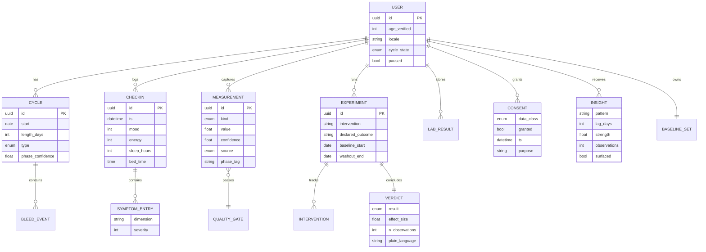

# PMOS Companion: Data Model

Companion document to the [PRD](./00-PRD.md). Entity relationships and the rules that govern them.

## Design rules

Four rules govern the schema. Every measurement carries confidence and source. Every insight carries an observation count, which the confidence gate reads. Consent is recorded per data class, never globally. Baselines are per user and per cycle phase.

## Field notes

| Entity | Note |
|---|---|
| USER | `age_verified` gates the 18+ requirement in REG-001. `paused` drives pause mode, FR-204 |
| CYCLE | `type` carries the named states from FR-103. `phase_confidence` keeps phase estimation probabilistic per FR-107 |
| MEASUREMENT | `confidence` and `source` are mandatory. The n-of-1 engine weights by confidence and never mixes sources silently |
| INSIGHT | `observations` feeds the confidence gate in FR-403. `surfaced` records whether it cleared the floor |
| VERDICT | `result` includes "no detectable change" as a first-class value, per FR-406 |
| CONSENT | One row per data class, never a global flag. Required by REG-005 |
| BASELINE_SET | Held per user and per cycle phase, so luteal variation is never read as an anomaly |
